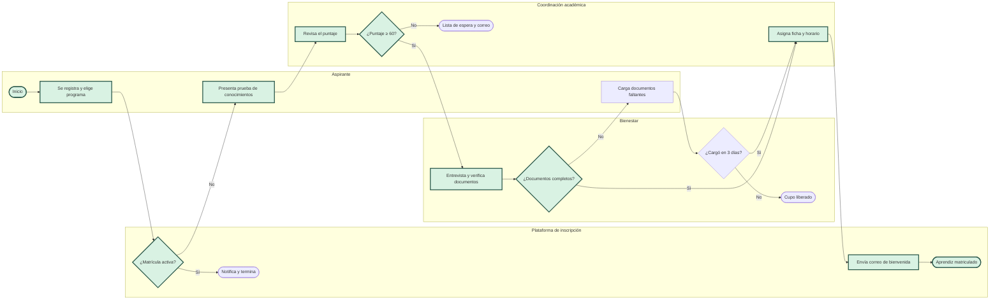

# Guía Metodológica: Gemini Canvas y Todas sus Posibilidades Prácticas

**Formación en Inteligencia Artificial Aplicada · Modo Participante y Facilitador**
**Autoría Curricular: DevBrain v8.10 · Regional Colombia (es-CO)**

---

## 1. ¿Qué es Gemini Canvas y por qué revoluciona el aprendizaje con IA?

Tradicionalmente, la interacción con un modelo de lenguaje ocurre mediante un **chat lineal**: envías una pregunta, la IA produce una respuesta extensa y esta se desplaza verticalmente hacia arriba. Si necesitas cambiar un solo párrafo o pedir una corrección menor, el chat suele reescribir todo el texto desde cero o fragmentar la conversación.

**Gemini Canvas** (Lienzo de Gemini) transforma esta experiencia en un **espacio de trabajo bidireccional y colaborativo en pantalla dividida (Split Screen)**:
* **Panel Izquierdo (Chat de Instrucciones):** Tu canal de diálogo para formular requerimientos, pedir ajustes o aclarar dudas.
* **Panel Derecho (Lienzo de Trabajo Activo):** Un editor dinámico donde vive tu artefacto (un informe técnico, un prototipo de código, una tabla de decisión o un diagrama). El artefacto no desaparece ni se oculta; permanece visible mientras tú y la IA trabajan sobre él.

```text
┌────────────────────────────────────────────────────────────────────────┐
│                        GOOGLE GEMINI WORKSPACE                         │
├──────────────────────────────┬─────────────────────────────────────────┤
│    CHAT CONVERSACIONAL       │          LIENZO (CANVAS ACTIVO)         │
│   (Instrucción y Diálogo)    │   [Longitud] [Tono] [Previsualizar]     │
│                              │                                         │
│ 👤 Aprendiz:                  │ # INFORME TÉCNICO DE GESTIÓN            │
│ "Genera una propuesta..."    │                                         │
│                              │ 1. Resumen Ejecutivo                    │
│ 🤖 Gemini:                   │ Texto estructurado editable en vivo... │
│ "He abierto el borrador      │                                         │
│ en el Canvas de la derecha.  │ [Párrafo seleccionado con cursor]       │
│ Puedes editarlo o pedirme    │ ↳ ✏️ "Cambiar tono a formal"           │
│ ajustes por sección."        │                                         │
└──────────────────────────────┴─────────────────────────────────────────┘
```

---

## 2. Cómo Activar y Abrir Gemini Canvas

1. **Activación Automática por Intención:** Cuando solicitas un documento extenso (superior a 300 palabras), una tabla compleja o una aplicación de código en HTML/JS/Python, Gemini abre automáticamente el panel lateral de Canvas.
2. **Activación desde el prompt:** Si no activaste el botón, indica en el prompt que el trabajo debe quedar en Canvas. Escríbelo como una orden para Gemini, no como un paso tuyo:
   > *"En Canvas, redacta..."* o *"Crea este proyecto en Canvas..."*
3. **Botón en Interfaz:** En la respuesta de Gemini, haz clic en el icono **"Abrir en Canvas"** (icono de lienzo o ventana dividida).
4. **Flujo Multimodal:** Al adjuntar una fotografía de una pizarra o un boceto dibujado a mano y solicitar *"Genera el código web de este diseño en Canvas"*, el lienzo se inicializa con la aplicación renderizada en directo.

### Qué necesitas para trabajar con Gemini Canvas en la web

- **Cuenta y acceso:** una cuenta de Google con Gemini habilitado. Abre [gemini.google.com/app](https://gemini.google.com/app) en Chrome, Edge o Firefox actualizados. Con la cuenta `@soy.sena.edu.co`, el administrador puede desactivar Gems, Deep Research, «Compartir» o «Agregar funciones de Gemini»; cada ejercicio indica una ruta alternativa.
- **Activar Canvas:** en la barra del chat, abre «Herramientas» y elige «Canvas» antes de enviar el prompt.
- **Ventanas emergentes:** permite las ventanas emergentes de gemini.google.com; «Exportar a Documentos de Google» y «Exportar a Colab» abren una pestaña nueva.
- **Archivos de práctica:** los ejercicios 10A, 11A y 11B adjuntan un archivo con el botón «+» del chat; descárgalo antes desde la tarjeta del ejercicio.
- **Límites de la vista previa:** la vista previa se ejecuta en un contenedor aislado. Puede cargar librerías desde CDN (Chart.js, Mermaid, Pyodide), pero no garantiza descargas de archivos ni conserva `localStorage` entre sesiones, y no ejecuta un archivo `.py` por sí sola. Por eso los ejercicios comprueban los resultados en pantalla y dejan las exportaciones como pasos opcionales.
- **Diagramas Mermaid:** no necesitas Mermaid Live. Pide una página HTML que cargue Mermaid desde CDN; si quieres comparar, pega el código de referencia de la guía en el chat de la izquierda y pide que lo dibuje en la vista previa.

---

## 3. Las Diez Grandes Posibilidades de Gemini Canvas

Cada posibilidad trae un prompt autosuficiente: los datos van dentro del prompt, entre comillas triples, para que Gemini no tenga que inventar cifras. Después del prompt está la lista con la que el aprendiz comprueba su propio resultado en Canvas. Las imágenes del simulador son reconstrucciones del resultado esperado, dibujadas con esos mismos datos; el diseño de cada Canvas puede variar, pero las cifras y el contenido no.

---

### Posibilidad 1: Redacción Editorial y Documentos Extensos

* **Propósito:** Estructurar propuestas técnicas, actas complejas y términos de referencia sin perder coherencia entre secciones.
* **Controles del simulador:** 📏 Ajustar longitud · 📄 Exportar a Google Docs
* **Prompt maestro (CRTT+L, con datos):**

```text
Contexto: El centro de formación publicará una invitación abierta para comprar estaciones de trabajo. El comité de compras necesita un documento técnico que cualquier proveedor pueda cumplir sin favorecer una marca.

Rol: Actúa como profesional de infraestructura tecnológica que redacta términos de referencia para compras públicas.

Datos:
"""
Necesidad: Laboratorio de Inteligencia Artificial y Multimedia (ambiente 305). Lo usan 40 aprendices por jornada para entrenar modelos pequeños, practicar visión artificial y editar video. Los equipos actuales no tienen GPU dedicada.
Cantidad: 20 estaciones de trabajo.
Valor unitario de referencia (estudio de mercado, IVA incluido): COP 9.800.000.

Requisitos mínimos (componente | requisito mínimo | tolerancia aceptada):
Procesador | 14 núcleos y 20 hilos; frecuencia base de 2,5 GHz o superior | Equivalente o superior, de cualquier fabricante
Memoria RAM | 32 GB DDR5 a 5600 MHz en doble canal | Ampliable a 64 GB
GPU dedicada | 12 GB de VRAM GDDR6, compatible con PyTorch y TensorFlow | Equivalente o superior
Almacenamiento | SSD NVMe PCIe 4.0 de 1 TB; lectura de 5.000 MB/s o más | Una ranura M.2 adicional libre
Pantalla | 27 pulgadas, 2560 × 1440, panel IPS | Hasta 32 pulgadas

Cronograma (plazo | actividad):
Semanas 1 y 2 | Entrega de los equipos en el ambiente 305
Semana 3 | Instalación y configuración
Semana 4 | Pruebas de rendimiento y recibo a satisfacción

Garantía mínima: 36 meses en sitio, con atención de fallas críticas en máximo 24 horas hábiles.
"""

Tarea: En Canvas, redacta los términos de referencia con estas cuatro secciones numeradas:
1. Resumen ejecutivo y justificación de la necesidad formativa, en máximo 120 palabras.
2. Especificaciones técnicas mínimas: una tabla con las columnas Componente, Requisito mínimo y Tolerancia aceptada, con las 5 filas de los datos.
3. Presupuesto y cronograma: calcula el presupuesto total (cantidad × valor unitario) y presenta el cronograma en una tabla de 3 filas.
4. Criterios de aceptación y garantía: una lista de verificación que el comité pueda marcar al recibir los equipos.
Entrega: Documento formal en español de Colombia, con títulos numerados del 1 al 4 y dos tablas.

Tono: Formal e imparcial, propio de un proceso de compra pública.

Límites:
- Copia los requisitos y valores tal como aparecen en los datos; no agregues componentes ni cambies cifras.
- No menciones marcas ni modelos comerciales.
- Escribe los valores en pesos colombianos con punto de miles, por ejemplo COP 1.000.000.
```

* **Cómo verificar el resultado:**
  * [ ] El documento tiene exactamente 4 secciones numeradas: resumen ejecutivo, especificaciones técnicas, presupuesto y cronograma, y aceptación y garantía. *Cómo comprobarlo:* Revisa los títulos del Canvas de arriba abajo.
  * [ ] La tabla de especificaciones tiene 5 filas (Procesador, Memoria RAM, GPU dedicada, Almacenamiento y Pantalla) con los mismos valores de los datos. *Cómo comprobarlo:* Compara fila por fila con el bloque de datos del prompt.
  * [ ] El presupuesto total es COP 196.000.000 (20 × COP 9.800.000). *Cómo comprobarlo:* Busca «196.000.000» con Ctrl+F en el Canvas.
  * [ ] El cronograma tiene 3 filas: semanas 1 y 2, semana 3 y semana 4. *Cómo comprobarlo:* Cuenta las filas de la segunda tabla.
  * [ ] La garantía dice 36 meses en sitio y atención de fallas críticas en máximo 24 horas hábiles. *Cómo comprobarlo:* Lee la sección 4.
  * [ ] No aparece ninguna marca ni modelo comercial de procesadores, tarjetas gráficas o pantallas. *Cómo comprobarlo:* Busca nombres de fabricantes con Ctrl+F; no debe haber resultados.
  * [ ] El resumen ejecutivo tiene 120 palabras o menos. *Cómo comprobarlo:* Si se pasa, selecciónalo y usa «Ajustar longitud» → «Más corto».

---

### Posibilidad 2: Desarrollo y Prototipado Web en Vivo

* **Propósito:** Construir aplicaciones interactivas en HTML/CSS/JS ejecutables directamente dentro de Gemini Canvas con previsualización en vivo.
* **Controles del simulador:** ▶ Vista previa · 🧮 Regla de estado
* **Prompt maestro (CRTT+L, con datos):**

```text
Contexto: La coordinación quiere probar un tablero sencillo antes de pedir un desarrollo formal. Lo usarán instructores sin conocimientos técnicos.

Rol: Actúa como desarrollador frontend que construye prototipos accesibles para equipos docentes.

Datos:
"""
Ficha 2871 · Seguimiento semanal (porcentajes de 0 a 100)
Aprendiz | Asistencia | Evidencias entregadas
Ana María García | 95 | 100
Carlos Andrés Pérez | 88 | 90
Julián David Torres | 70 | 65
Laura Sofía Mendoza | 92 | 80
Diego Alejandro Ruiz | 64 | 72
Valentina Ríos Cárdenas | 86 | 95

Regla de estado:
- Requiere apoyo: asistencia o evidencias por debajo de 70.
- Al día: asistencia y evidencias de 85 o más.
- En progreso: cualquier otro caso.
"""

Tarea: En Canvas, crea una sola página HTML, con CSS y JavaScript, que incluya:
1. Dos tarjetas KPI calculadas con JavaScript a partir de los datos: asistencia promedio y evidencias promedio, con un decimal.
2. Una tabla con los 6 aprendices y una columna Estado calculada con la regla de los datos.
3. Un buscador por nombre que no distinga mayúsculas y un filtro por estado que funcionen al mismo tiempo.
4. Una gráfica de barras en SVG con las evidencias de cada aprendiz.
Entrega: Un único archivo HTML con comentarios breves en español.

Tono: Sencillo y amable: lo usarán instructores sin formación técnica.

Límites:
- No uses librerías externas, CDN ni npm: todo debe funcionar en la vista previa de Canvas.
- Guarda los datos en un arreglo de JavaScript; no escribas los resultados a mano.
- Usa el color #2D5A4C para los elementos principales y conserva un contraste AA.
```

* **Cómo verificar el resultado:**
  * [ ] La tarjeta de asistencia muestra 82,5 % y la de evidencias 83,7 % (también vale con punto decimal). *Cómo comprobarlo:* Abre la vista previa del Canvas.
  * [ ] La tabla tiene 6 filas y la columna Estado suma 3 Al día, 1 En progreso y 2 Requiere apoyo. *Cómo comprobarlo:* Cuenta los estados en la vista previa.
  * [ ] Al filtrar «Requiere apoyo» quedan 2 filas: Julián David Torres y Diego Alejandro Ruiz. *Cómo comprobarlo:* Usa el filtro por estado.
  * [ ] Al escribir «ana» en el buscador queda 1 fila (Ana María García); al borrar el texto vuelven las 6. *Cómo comprobarlo:* Escribe en el buscador de la vista previa.
  * [ ] La gráfica tiene 6 barras; la más alta es Ana María García (100) y la más baja Julián David Torres (65). *Cómo comprobarlo:* Observa la gráfica en la vista previa.
  * [ ] El código no contiene etiquetas script con src, sentencias import ni enlaces a CDN. *Cómo comprobarlo:* Pasa a la vista de código y busca «src=» e «import».

---

### Posibilidad 3: Análisis Estructurado, Matrices y Tablas

* **Propósito:** Evaluar propuestas de oferentes o comparar alternativas complejas con fórmulas visibles que cualquier integrante del comité puede recalcular.
* **Controles del simulador:** 🧮 Ver fórmula · 📄 Exportar a Documentos de Google
* **Prompt maestro (CRTT+L, con datos):**

```text
Contexto: El comité de compras debe elegir un proveedor de internet dedicado para el campus y necesita una matriz cuantitativa que cualquier integrante pueda recalcular.

Rol: Actúa como analista de compras públicas que prepara matrices de decisión para comités evaluadores.

Datos:
"""
Proceso: servicio de internet dedicado para el campus durante 36 meses.
Escala de calificación: de 1 (no cumple) a 10 (cumple de forma sobresaliente).

Criterio | Peso | Proveedor A (fibra) | Proveedor B (híbrido) | Proveedor C (satelital)
C1 Ancho de banda garantizado | 25 % | 9,5 | 8 | 6
C2 Disponibilidad SLA del 99,8 % | 20 % | 9 | 8,5 | 7
C3 Soporte técnico 24/7 en sitio | 15 % | 8,5 | 7 | 6
C4 Costo mensual por Mbps | 25 % | 8 | 9 | 5
C5 Experiencia certificada | 15 % | 9 | 8 | 6

Fórmula: puntaje sobre 100 = suma de (calificación × peso) ÷ 10.
Estados: Recomendado si el puntaje es 85 o más; Admisible con observaciones entre 70 y 84,9; No cumple por debajo de 70.
"""

Tarea: En Canvas, construye la matriz ponderada con:
1. Una tabla con los 5 criterios, su peso y la calificación de cada proveedor, tal como aparecen en los datos.
2. Una columna de aporte por proveedor (calificación × peso ÷ 10) en cada criterio.
3. Una fila final con el puntaje sobre 100 de cada proveedor, con un decimal, y su estado según los umbrales.
4. Una conclusión de dos frases que nombre al proveedor recomendado y la diferencia de puntos con el segundo.
Entrega: Tabla con encabezados claros, estados en verde, ámbar y rojo, y cifras con coma decimal.

Tono: Objetivo y neutral, sin favorecer a ningún proveedor.

Límites:
- Usa solo las calificaciones y los pesos de los datos, y muestra la fórmula que aplicaste.
- Debajo de la tabla, escribe la operación que produce cada total para que se pueda recalcular.
```

* **Cómo verificar el resultado:**
  * [ ] Los pesos suman 100 % (25 + 20 + 15 + 25 + 15). *Cómo comprobarlo:* Suma la columna Peso.
  * [ ] El aporte del Proveedor A en C1 es 23,75 (9,5 × 25 ÷ 10). *Cómo comprobarlo:* Busca la celda en la columna de aportes de A.
  * [ ] Puntaje final: Proveedor A = 88,0; Proveedor B = 82,0; Proveedor C = 59,5. *Cómo comprobarlo:* Recalcula al menos uno con tu calculadora.
  * [ ] Estados: A Recomendado (verde), B Admisible con observaciones (ámbar) y C No cumple (rojo). *Cómo comprobarlo:* Compara cada puntaje con los umbrales de los datos.
  * [ ] La conclusión recomienda al Proveedor A y menciona la diferencia de 6,0 puntos con el Proveedor B. *Cómo comprobarlo:* Lee el texto debajo de la tabla.
  * [ ] Debajo de la tabla aparece la operación completa de cada total. *Cómo comprobarlo:* Rehaz una operación con tu calculadora y compárala con el total del Canvas.

---

### Posibilidad 4: Diagramación de Procesos y Flujogramas

* **Propósito:** Mapear flujos de trabajo institucionales, protocolos de soporte técnico y ciclos de vida de software con sintaxis visual Mermaid.
* **Controles del simulador:** 📝 Ver código Mermaid · 📥 Descargar SVG
* **Prompt maestro (CRTT+L, con datos):**

```text
Contexto: La mesa de ayuda del centro necesita un diagrama que el personal nuevo entienda en un minuto y que se pueda guardar en el repositorio de documentación.

Rol: Actúa como analista de procesos de soporte de TI.

Datos:
"""
Responsables y pasos (identificador | responsable | paso):
P1 | Usuario solicitante | Reporta la falla (inicio o fin)
P2 | Mesa de ayuda Nivel 1 | Registra el ticket y diagnostica
D1 | Mesa de ayuda Nivel 1 | ¿Resuelto en 15 minutos o menos? (decisión)
P3 | Mesa de ayuda Nivel 1 | Documenta la solución
P4 | Mesa de ayuda Nivel 1 | Clasifica la severidad y escala
P5 | Soporte especializado Nivel 2 | Interviene en sitio o reemplaza el hardware
P6 | Soporte especializado Nivel 2 | Actualiza la base de conocimiento
P7 | Usuario solicitante | Verifica la solución y responde la encuesta
P8 | Mesa de ayuda Nivel 1 | Cierra el ticket (inicio o fin)

Conexiones:
P1 → P2
P2 → D1
D1 → P3 (respuesta «Sí»)
D1 → P4 (respuesta «No»)
P4 → P5
P5 → P6
P3 → P7
P6 → P7
P7 → P8
"""

Tarea: En Canvas, crea una página web que dibuje con Mermaid, cargado desde CDN, el diagrama con:
1. Sintaxis flowchart TD.
2. Un subgrafo por responsable, con el nombre exacto de los datos.
3. Los 9 pasos con sus identificadores: D1 como rombo, y P1 y P8 como cápsulas de inicio y fin.
4. Las 9 conexiones de los datos; las dos salidas de D1 rotuladas «Sí» y «No».
Entrega: Un solo archivo HTML ejecutable con el código Mermaid y una línea que explique cómo leer el diagrama.

Tono: Claro y neutral, con etiquetas cortas en los nodos.

Límites:
- No agregues pasos, responsables ni conexiones que no estén en los datos.
- El diagrama debe dibujarse sin errores en la vista previa de Canvas.
```

* **Cómo verificar el resultado:**
  * [ ] El código se dibuja sin mensajes de error de sintaxis. *Cómo comprobarlo:* Abre la «Vista previa»; si aparece un error, pide a Gemini que lo corrija desde la consola.
  * [ ] Hay 3 carriles (subgrafos): Usuario solicitante, Mesa de ayuda Nivel 1 y Soporte especializado Nivel 2. *Cómo comprobarlo:* Cuenta los recuadros con título en el diagrama.
  * [ ] Aparecen los 9 pasos (P1 a P8 y D1), cada uno en el carril de su responsable. *Cómo comprobarlo:* Compara cada nodo con la tabla de datos.
  * [ ] D1 es un rombo con dos salidas: «Sí» hacia P3 y «No» hacia P4. *Cómo comprobarlo:* Sigue las flechas que salen del rombo.
  * [ ] Hay 9 flechas en total y los dos caminos llegan a P7 y luego a P8. *Cómo comprobarlo:* Cuenta las líneas «-->» en el código.
  * [ ] El código empieza con «flowchart TD». *Cómo comprobarlo:* Pasa a la vista de código.

---

### Posibilidad 5: Diseño Visual y Mockups de Interfaz (UI)

* **Propósito:** Definir sistemas de diseño accesibles y generar maquetas conceptuales de interfaces antes de la fase de codificación.
* **Controles del simulador:** 👁️ Validar contraste · 🖼️ Prompt de imagen · 🎨 Copiar tokens CSS
* **Prompt maestro (CRTT+L, con datos):**

```text
Contexto: El equipo quiere validar la paleta y la pantalla de inicio antes de diseñar el resto de la aplicación móvil.

Rol: Actúa como diseñador de interfaces con experiencia en accesibilidad WCAG 2.2.

Datos:
"""
Producto: aplicación móvil «Mi Portafolio SENA» para aprendices.
Pantalla: inicio del aprendiz, 360 px de ancho.
Contenido de la pantalla:
- Encabezado: «Mi Portafolio SENA» y «Tecnología en ADSO · Ficha 2871».
- Tarjeta 1: Evidencias entregadas, 18 de 20.
- Tarjeta 2: Asistencia, 96 %.
- Tarjeta 3: Próxima entrega, «Diagrama de procesos», vence el 14 de noviembre.
- Botón principal: «Subir evidencia».

Paleta (token | HEX | uso):
--color-primario | #2D5A4C | encabezado y botón
--color-texto | #1E293B | texto
--color-fondo | #F8FAF9 | fondo
--color-alerta | #D97706 | íconos y avisos grandes
--color-alerta-texto | #B45309 | texto de avisos

Pares de contraste que se deben comprobar (texto sobre fondo):
1. #2D5A4C sobre #F8FAF9
2. #1E293B sobre #F8FAF9
3. #FFFFFF sobre #2D5A4C
4. #D97706 sobre #FFFFFF
5. #B45309 sobre #FFFFFF
"""

Tarea: En Canvas, crea una página HTML con:
1. Una sección de tokens con una muestra de color por cada fila de la paleta.
2. Una tabla que calcule con JavaScript la razón de contraste de los 5 pares con la fórmula de WCAG 2.2, con dos decimales, y el nivel que cumple: AAA, AA, AA texto grande o No cumple.
3. Una maqueta de la pantalla de inicio de 360 px de ancho con el contenido de los datos; el botón debe mostrar un contorno real con :focus-visible al llegar con la tecla Tab, no un contorno fijo.
4. Al final de la página, un bloque de texto en inglés que describa la maqueta con los HEX de la paleta; lo copiaré después como descripción de diseño.
Entrega: Un único archivo HTML; la tabla de contraste con las columnas Par, Razón y Nivel.

Tono: Cercano y claro en los textos de la interfaz.

Límites:
- Calcula los contrastes en el código; no los escribas a mano.
- Usa solo los colores de la paleta y no uses librerías externas.
```

* **Cómo verificar el resultado:**
  * [ ] La tabla de contraste muestra #2D5A4C sobre #F8FAF9 = 7,48:1 (AAA); #1E293B sobre #F8FAF9 = 13,96:1 (AAA); #FFFFFF sobre #2D5A4C = 7,84:1 (AAA). *Cómo comprobarlo:* Compáralo con «Validar contraste» de este simulador (también vale con punto decimal).
  * [ ] #D97706 sobre #FFFFFF = 3,19:1 (AA texto grande): solo sirve para íconos o texto grande. *Cómo comprobarlo:* Revisa la fila 4 de la tabla.
  * [ ] #B45309 sobre #FFFFFF = 5,02:1 (AA): sirve para el texto de los avisos. *Cómo comprobarlo:* Revisa la fila 5 de la tabla.
  * [ ] La maqueta muestra Evidencias 18 de 20, Asistencia 96 % y la próxima entrega «Diagrama de procesos». *Cómo comprobarlo:* Abre la vista previa del Canvas.
  * [ ] El botón «Subir evidencia» muestra un contorno solo al llegar a él con la tecla Tab, y el CSS usa :focus-visible. *Cómo comprobarlo:* Haz clic en la vista previa, presiona Tab y busca «focus-visible» en el código.
  * [ ] El bloque en inglés del final describe la maqueta e incluye #2D5A4C, #1E293B y #F8FAF9. *Cómo comprobarlo:* Busca los tres HEX en ese bloque; luego puedes pegarlo en un chat nuevo de Gemini para generar la imagen.

---

### Posibilidad 6: Edición Quirúrgica por Selección (Inline)

* **Propósito:** Aislar párrafos, cláusulas o funciones de código para pedir mejoras puntuales manteniendo intacto el resto del documento.
* **Controles del simulador:** 🔄 Comparar antes y después · 🕒 Historial de versiones
* **Prompt maestro (CRTT+L, con datos):**

```text
Contexto: Necesitas el acta en un Canvas para corregir después solo el punto 3, que el comité consideró confuso y punitivo.

Rol: Actúa como secretario técnico que transcribe las actas del comité académico.

Datos:
"""
ACTA DE CONCERTACIÓN · Ficha 2879123 (Técnico en Programación de Software)
1. Objeto: acordar las condiciones de la evaluación final del módulo de bases de datos.
2. Fecha de la prueba final: 14 de noviembre de 2026, 8:00 a. m., ambiente 204.
3. Inasistencia: Los aprendices que no asistan perderán la oportunidad de presentar la prueba final a menos que tengan una excusa válida de un médico u otra autoridad y deben presentarla antes de dos días hábiles.
4. Compromisos: el instructor publica la rúbrica el 7 de noviembre; los aprendices confirman su asistencia en la plataforma del curso.
"""

Tarea: En Canvas, haz lo siguiente:
1. Transcribe el acta exactamente como aparece en los datos, con su título y los 4 puntos numerados.
2. No corrijas ni resumas nada todavía; la edición del punto 3 se hará en el paso 2.
3. Al final, confirma en el chat cuántos puntos tiene el acta.
Entrega: Documento con el título en negrita y los puntos numerados del 1 al 4.

Tono: Formal y respetuoso, propio de un acta institucional.

Límites:
- Conserva sin cambios las fechas, la hora y los números de ficha y de ambiente.
```

* **Paso 2 · Selecciona solo el punto 3 en el Canvas y escribe en el cuadro de edición:**

```text
Reescribe este punto en tono respetuoso y claro, en dos viñetas: 1) cómo y en qué plazo se entrega el soporte de la inasistencia; 2) qué ocurre si el soporte es válido. Conserva el plazo de dos días hábiles y no agregues requisitos, correos ni fechas nuevas.
```

* **Cómo verificar el resultado:**
  * [ ] Después del paso 1, el Canvas tiene el acta completa con 4 puntos idénticos a los datos. *Cómo comprobarlo:* Compara el Canvas con el bloque de datos antes de editar.
  * [ ] Después del paso 2, solo cambió el punto 3: ahora tiene exactamente 2 viñetas. *Cómo comprobarlo:* Compara con la versión anterior (deshacer o historial de versiones del Canvas).
  * [ ] Los puntos 1, 2 y 4 siguen iguales: 14 de noviembre de 2026, 8:00 a. m., ambiente 204 y rúbrica el 7 de noviembre. *Cómo comprobarlo:* Lee los tres puntos sin editar.
  * [ ] El punto 3 conserva «dos días hábiles» y el soporte de un médico u otra autoridad. *Cómo comprobarlo:* Busca «dos días hábiles» con Ctrl+F.
  * [ ] La segunda viñeta dice que, con un soporte válido, el aprendiz conserva la oportunidad de presentar la prueba final. *Cómo comprobarlo:* Lee la segunda viñeta.
  * [ ] No aparecen requisitos nuevos (correos, formatos, fechas o sanciones) y ya no dice «perderán». *Cómo comprobarlo:* Busca «correo», «formato» y «perderán»; no debe haber resultados.

---

### Posibilidad 7: Auditoría, Explicación y Refactorización de Algoritmos

* **Propósito:** Depurar cuellos de botella de rendimiento, optimizar la complejidad asintótica de funciones críticas y generar documentación técnica verificable.
* **Controles del simulador:** ⚡ Solución de referencia · 🧪 Pruebas de referencia
* **Prompt maestro (CRTT+L, con datos):**

```text
Contexto: La función agrupa las entregas de cada corte (10.000 registros) y se volvió lenta. Se necesita una versión eficiente que devuelva exactamente el mismo resultado.

Rol: Actúa como ingeniero de software que revisa el rendimiento de código Python.

Datos:
"""
Función actual (Python 3.11):

def agrupar_por_estado(entregas):
    resumen = {"al_dia": [], "en_progreso": [], "apoyo": []}
    vistos = []
    for e in entregas:
        if e["documento"] in vistos:  # se ignora el documento repetido
            continue
        vistos.append(e["documento"])
        if e["puntaje"] >= 70:
            resumen["al_dia"].append(e["nombre"])
        elif e["puntaje"] >= 50:
            resumen["en_progreso"].append(e["nombre"])
        else:
            resumen["apoyo"].append(e["nombre"])
    return resumen

Entrada de ejemplo:
entregas = [
    {"documento": "101", "nombre": "Ana", "puntaje": 70.0},
    {"documento": "102", "nombre": "Luis", "puntaje": 69.9},
    {"documento": "103", "nombre": "Marta", "puntaje": 50.0},
    {"documento": "104", "nombre": "Jorge", "puntaje": 49.9},
    {"documento": "101", "nombre": "Ana", "puntaje": 95.0},
    {"documento": "105", "nombre": "Sara", "puntaje": 0.0},
    {"documento": "106", "nombre": "Iván", "puntaje": 100.0},
]
"""

Tarea: En Canvas, entrega:
1. Una explicación de dos frases de por qué la función actual es O(n²), señalando la línea responsable.
2. La función refactorizada en O(n), con el mismo nombre, type hints y docstring en español.
3. Un archivo de pruebas con pytest que cubra la lista vacía, un documento repetido y los límites 0, 49.9, 50, 69.9 y 70.
4. Un bloque final que imprima el resultado con la entrada de ejemplo.
Entrega: La explicación primero y después dos bloques de código: la función y las pruebas.

Tono: Didáctico y preciso, con ejemplos numéricos.

Límites:
- Conserva el comportamiento: si un documento se repite, cuenta su primer registro.
- Usa solo la biblioteca estándar de Python.
```

* **Cómo verificar el resultado:**
  * [ ] La explicación señala la línea «if e["documento"] in vistos»: buscar en una lista recorre sus elementos, y eso ocurre dentro del ciclo. *Cómo comprobarlo:* Lee la explicación antes del código.
  * [ ] La versión nueva usa un set (conjunto) para vistos y conserva el nombre agrupar_por_estado. *Cómo comprobarlo:* Busca «set(» en el código.
  * [ ] Con la entrada de ejemplo imprime {'al_dia': ['Ana', 'Iván'], 'en_progreso': ['Luis', 'Marta'], 'apoyo': ['Jorge', 'Sara']}. *Cómo comprobarlo:* Copia el código a tu equipo o a Google Colab y ejecútalo.
  * [ ] Las pruebas cubren la lista vacía, el documento repetido y los 5 límites, y «python -m pytest» termina sin fallos. *Cómo comprobarlo:* Guarda la función como clasificador.py y las pruebas como test_clasificador.py, y ejecuta pytest. Si Gemini entrega todo en un solo archivo, ejecuta pytest sobre ese archivo.
  * [ ] La función tiene type hints y un docstring en español que menciona la complejidad O(n). *Cómo comprobarlo:* Lee la firma y el docstring.

---

### Posibilidad 8: Guías Didácticas y Rúbricas Analíticas de Evaluación

* **Propósito:** Co-diseñar guías de aprendizaje completas, criterios observables y rúbricas analíticas estructuradas para formación técnica por competencias.
* **Controles del simulador:** 💬 Preguntas de referencia · 📄 Exportar a Google Docs
* **Prompt maestro (CRTT+L, con datos):**

```text
Contexto: El equipo instructor necesita una rúbrica que dos evaluadores apliquen al mismo repositorio y obtengan la misma nota.

Rol: Actúa como diseñador curricular que construye instrumentos de evaluación por competencias.

Datos:
"""
Programa: Tecnólogo en Análisis y Desarrollo de Software (datos de práctica).
Competencia: Construir el sistema que cumpla con los requisitos de la solución informática.
Resultado de aprendizaje: Codificar los módulos del backend según la arquitectura definida y verificarlos con pruebas automatizadas.
Evidencia de producto: repositorio del backend con su informe de pruebas.

Criterios y pesos:
C1 Separación de capas (dominio, aplicación e infraestructura) | 30 %
C2 Pruebas automatizadas con aserciones | 35 %
C3 Manejo de errores HTTP con el formato de RFC 9457 | 35 %

Niveles de desempeño (nota de 0,0 a 5,0):
Excelente: de 4,5 a 5,0
Bueno: de 3,8 a 4,4
En desarrollo: de 3,0 a 3,7
Requiere refuerzo: menos de 3,0

Nota final = suma de (nota del criterio × peso).
Caso para calibrar: un aprendiz obtiene 4,8 en C1; 3,5 en C2; 4,0 en C3.
"""

Tarea: En Canvas, redacta la guía de evaluación con:
1. La identificación curricular copiada de los datos.
2. Una rúbrica en una tabla: 3 filas (C1, C2 y C3, con su peso) y 4 columnas de nivel con el rango de nota en el encabezado.
3. La calificación del caso para calibrar, con la operación paso a paso y el nivel que resulta.
4. Tres preguntas de retroalimentación, una por criterio, que el instructor le haga al aprendiz.
Entrega: Documento con títulos numerados y la rúbrica en una sola tabla.

Tono: Formativo y respetuoso con el aprendiz evaluado.

Límites:
- Cada descriptor debe nombrar algo observable en el repositorio o en el informe (archivos, pruebas, códigos HTTP), no adjetivos como «bueno» o «adecuado».
- Los pesos deben sumar 100 %.
```

* **Cómo verificar el resultado:**
  * [ ] La rúbrica tiene 3 criterios × 4 niveles = 12 descriptores. *Cómo comprobarlo:* Cuenta las celdas de la tabla.
  * [ ] Los pesos 30 %, 35 % y 35 % suman 100 %. *Cómo comprobarlo:* Suma la columna de pesos.
  * [ ] Cada descriptor nombra algo que se puede comprobar: archivos, importaciones, pruebas, fallos o códigos HTTP. *Cómo comprobarlo:* Lee cada celda y pregúntate cómo lo verificarías en el repositorio.
  * [ ] La nota del caso es 4,8 × 0,30 + 3,5 × 0,35 + 4,0 × 0,35 = 1,44 + 1,225 + 1,40 = 4,065 ≈ 4,1 (Bueno). *Cómo comprobarlo:* Repite la operación con tu calculadora.
  * [ ] Hay 3 preguntas abiertas, una por criterio, que no se responden con «sí» o «no». *Cómo comprobarlo:* Lee la última sección.
  * [ ] La competencia y el resultado de aprendizaje coinciden palabra por palabra con los datos. *Cómo comprobarlo:* Compara con el bloque de datos.

---

### Posibilidad 9: Consultas SQL Complejas, ETL y Modelado Relacional

* **Propósito:** Construir consultas analíticas de alto rendimiento, diseñar pipelines de transformación de datos relacionales y optimizar planes de ejecución.
* **Controles del simulador:** 🗄️ Consulta de referencia · 📋 Resultado esperado
* **Prompt maestro (CRTT+L, con datos):**

```text
Contexto: El reporte mensual por ficha tarda demasiado con 5.000 aprendices. Antes de llevar la nueva consulta a producción, se valida con la muestra de los datos.

Rol: Actúa como analista de bases de datos PostgreSQL.

Datos:
"""
CREATE TABLE aprendices (id INT PRIMARY KEY, nombre TEXT NOT NULL, ficha_id INT NOT NULL);
CREATE TABLE entregas (aprendiz_id INT REFERENCES aprendices(id), calificacion NUMERIC(2,1));
CREATE TABLE registro_asistencia (aprendiz_id INT REFERENCES aprendices(id), fecha DATE, asistio BOOLEAN);

INSERT INTO aprendices VALUES (1,'Ana',2871),(2,'Luis',2871),(3,'Marta',2871),(4,'Jorge',2872),(5,'Sara',2872);
INSERT INTO entregas VALUES (1,4.5),(1,4.1),(2,3.8),(2,4.2),(3,4.6),(4,3.0),(4,3.4),(5,4.9);
INSERT INTO registro_asistencia VALUES
(1,'2026-10-05',true),(1,'2026-10-12',true),(1,'2026-10-19',true),(1,'2026-10-26',true),
(2,'2026-10-05',true),(2,'2026-10-12',false),(2,'2026-10-19',true),(2,'2026-10-26',true),
(3,'2026-10-05',true),(3,'2026-10-12',true),(3,'2026-10-19',true),(3,'2026-10-26',true),
(4,'2026-10-05',true),(4,'2026-10-12',false),(4,'2026-10-19',false),(4,'2026-10-26',true);
-- Sara (id 5) no tiene registros de asistencia en octubre.
"""

Tarea: En Canvas, escribe en SQL:
1. Una consulta con dos CTE: una para el promedio de notas y otra para la asistencia del 2026-10-01 al 2026-10-31.
2. El puesto de cada aprendiz dentro de su ficha con ROW_NUMBER(), ordenado por promedio de mayor a menor.
3. El porcentaje de asistencia con un decimal; si un aprendiz no tiene registros, debe aparecer con NULL y sin error de división por cero.
4. La sentencia que crea un índice compuesto en registro_asistencia (aprendiz_id, fecha) que incluya asistio.
5. La tabla de resultado que esperas con los datos de muestra.
Entrega: Un bloque SQL comentado y, debajo, la tabla de resultado esperada.

Tono: Didáctico, con comentarios breves en cada consulta.

Límites:
- No uses subconsultas correlacionadas.
- Usa ROUND(…, 1) para el promedio y el porcentaje, y ordena por ficha y puesto.
```

* **Cómo verificar el resultado:**
  * [ ] La consulta usa WITH con dos CTE y ROW_NUMBER() OVER (PARTITION BY ficha_id ORDER BY promedio DESC). *Cómo comprobarlo:* Lee el bloque SQL.
  * [ ] Usa LEFT JOIN y NULLIF (o CASE) para que Sara aparezca con NULL en asistencia. *Cómo comprobarlo:* Busca «LEFT JOIN» y «NULLIF» en el código.
  * [ ] Resultado con la muestra: 2871 → 1 Marta 4,6 · 100,0; 2 Ana 4,3 · 100,0; 3 Luis 4,0 · 75,0. 2872 → 1 Sara 4,9 · NULL; 2 Jorge 3,2 · 50,0. *Cómo comprobarlo:* Ejecuta el esquema y la consulta en PostgreSQL (local o en un editor en línea) y compara fila por fila.
  * [ ] El índice es CREATE INDEX … ON registro_asistencia (aprendiz_id, fecha) INCLUDE (asistio). *Cómo comprobarlo:* Lee la sentencia del índice.
  * [ ] No hay subconsultas dentro de SELECT ni de WHERE. *Cómo comprobarlo:* Busca «(SELECT» en el código; solo debe aparecer dentro de las CTE.

---

### Posibilidad 10: Informes Ejecutivos Multifuente y Dictamen Técnico

* **Propósito:** Cruzar múltiples auditorías e informes densos para extraer conclusiones directivas, matrices de riesgo y planes de acción con valor legal y técnico.
* **Controles del simulador:** ⚖️ Ver regla del semáforo · 📄 Exportar a Google Docs
* **Prompt maestro (CRTT+L, con datos):**

```text
Contexto: El comité directivo decide el lunes si libera el pago final del contrato. Necesita un dictamen de una página basado solo en los extractos de los informes.

Rol: Actúa como auditor de sistemas que redacta dictámenes para comités directivos.

Datos:
"""
Contrato: CT-2026-014, plataforma de gestión académica (datos de práctica).
Fecha de corte: 30 de octubre de 2026.
Avance certificado por la interventoría: 94 %.
Pagos: 80 % desembolsado; 20 % final pendiente.

Extractos de los informes:
[INF-1, p. 12] Interventoría técnica: Los tokens JWT de acceso no expiran y no existe un mecanismo de revocación. Impacto: Alto. Probabilidad: Media.
[INF-2, p. 31] Rendimiento: La tabla bitacora_auditoria tiene 2,1 millones de filas sin índices; la consulta de auditoría tarda 6,8 s. Impacto: Medio. Probabilidad: Media.
[INF-3, p. 7] Protección de datos: La autorización de tratamiento de datos está implementada; falta publicar el aviso de privacidad en el formulario de inscripción. Impacto: Medio. Probabilidad: Baja.

Regla del semáforo: Bajo o Baja = 1; Medio o Media = 2; Alto o Alta = 3. Puntaje = impacto × probabilidad. De 1 a 2: VERDE; de 3 a 4: ÁMBAR; de 6 a 9: ROJO.
Regla de decisión: si hay al menos un riesgo ROJO, el pago final queda retenido hasta que se subsane; si no, se aprueba con observaciones.
Plazo de subsanación: 10 días hábiles desde la notificación.
"""

Tarea: En Canvas, redacta el dictamen técnico con:
1. Encabezado con el contrato, el objeto, la fecha de corte, el avance certificado y el estado de los pagos.
2. Síntesis en tres párrafos cortos: cumplimiento general, hallazgos y decisión.
3. Matriz de riesgos con las columnas Hallazgo, Fuente, Impacto, Probabilidad, Puntaje y Semáforo, calculada con la regla de los datos.
4. Decisión y plazo de subsanación según la regla de decisión, con una acción recomendada por hallazgo.
Entrega: Documento formal en español de Colombia, con la matriz en una tabla.

Tono: Ejecutivo y objetivo, con cifras antes que opiniones.

Límites:
- Usa solo los hechos de los extractos, cita la fuente de cada uno (por ejemplo [INF-1, p. 12]) y presenta las acciones como recomendaciones.
- Calcula la matriz antes de redactar la síntesis: los colores que mencione la síntesis deben coincidir con la matriz.
- Escribe los porcentajes como texto normal (94 %), sin notación matemática, y no pases de una página (unas 450 palabras).
```

* **Cómo verificar el resultado:**
  * [ ] El encabezado dice CT-2026-014, 30 de octubre de 2026, avance del 94 % y pagos: 80 % desembolsado y 20 % pendiente, con el signo % visible. *Cómo comprobarlo:* Lee el encabezado; si ves «94» sin «%», Gemini usó notación matemática y debes pedirle que la quite.
  * [ ] La síntesis menciona los mismos colores que la matriz: 1 ROJO, 1 ÁMBAR y 1 VERDE. *Cómo comprobarlo:* Compara el segundo y el tercer párrafo de la síntesis con la columna Semáforo.
  * [ ] La matriz tiene 3 filas: Tokens JWT sin expiración ni revocación = 3 × 2 = 6 · ROJO; Bitácora de auditoría sin índices = 2 × 2 = 4 · ÁMBAR; Aviso de privacidad (Ley 1581 de 2012) = 2 × 1 = 2 · VERDE. *Cómo comprobarlo:* Recalcula cada puntaje con la regla del semáforo.
  * [ ] Cada hallazgo cita su fuente: [INF-1, p. 12], [INF-2, p. 31], [INF-3, p. 7]. *Cómo comprobarlo:* Busca «INF-» con Ctrl+F; deben aparecer las tres fuentes.
  * [ ] La decisión aplica la regla: El pago final del 20 % queda retenido hasta que se subsane el riesgo ROJO. Plazo de subsanación: 10 días hábiles desde la notificación. *Cómo comprobarlo:* Lee el último párrafo y la sección de decisión.
  * [ ] No aparecen hechos que no estén en los extractos (otras tecnologías, cifras, normas o fechas). *Cómo comprobarlo:* Subraya cada cifra del dictamen y búscala en los datos.
  * [ ] Cabe en una página: unas 450 palabras o menos. *Cómo comprobarlo:* Exporta a Google Docs y revisa el número de páginas.

---

## 4. Asistentes Personalizados a Medida: Gemini Gems

Los **Gems** son versiones personalizadas de Google Gemini que combinan instrucciones de sistema persistentes (*System Prompts*), fuentes de conocimiento exclusivas (documentos PDF, guías o reglamentos) y tono calibrado para tareas especializadas.

### Diferencia Operativa: Gemini Canvas vs. Gemini Gems

| Característica | Gemini Canvas | Gemini Gems |
| :--- | :--- | :--- |
| **Enfoque Principal** | Lienzo dinámico para co-crear un artefacto (documento, código, tabla). | Asistente persistente con rol y restricciones predefinidas. |
| **Memoria de Rol** | Dura lo que dura la sesión de trabajo sobre ese artefacto. | Permanente en tu cuenta de Gemini; disponible en cualquier chat. |
| **Modo de Interacción** | Split Screen (Chat a la izquierda + Lienzo interactivo a la derecha). | Chat conversacional asistido con directrices fijas. |
| **Exportación** | Documentos de Google, Presentaciones de Google, PDF, Colab (Python) o enlace para compartir. | Respuestas guiadas, evaluaciones y asesoría continua. |
| **Combinación Ideal** | Puedes usar un **Gem de Arquitectura** para abrir un **Canvas de código**. | El Gem define la política; el Canvas ejecuta el artefacto. |

### Presets Canónicos para el Aula Técnica:

1. 🎓 **Gem Tutor Socrático:**
   * *System Prompt:* "Actúa como docente socrático de programación. Cuando el estudiante pida código o la solución a un ejercicio, jamás entregues el código resuelto. Formula dos preguntas orientadoras que le permitan analizar el flujo de datos y encontrar su propio error."
2. ⚖️ **Gem Auditor de Rúbricas:**
   * *System Prompt:* "Actúa como evaluador técnico. Coteja el código o evidencia entregada contra los criterios de la rúbrica oficial. Genera una tabla con 3 columnas: Criterio, Nivel de Cumplimiento (1 a 5) y Observación Constructiva."
3. 📋 **Gem Redactor de Actas y Pliegos:**
   * *System Prompt:* "Actúa como secretario técnico institucional. Transforma notas desordenadas en actas formales con numeración decimal, compromisos con fecha límite y tono neutro en español de Colombia."

---

## 5. Flujos Multimodales: De Boceto / Pizarra a Prototipo Web en Canvas

Gemini cuenta con capacidades de visión artificial de última generación. Puedes fotografiar un dibujo hecho en una libreta o en la pizarra del aula y pedirle que lo traduzca a una aplicación web funcional en Canvas:

1. **Captura:** Dibuja la pantalla a mano alzada en una hoja de papel, rotulando los campos (ejemplo: "Nombre", "Correo", "Botón Enviar").
2. **Carga:** Adjunta la imagen al chat de Gemini con el botón de archivo (📷 o 📎).
3. **Prompt Multimodal:**
   > *"Analiza este boceto a mano alzada. En Canvas, genera una aplicación web en HTML, CSS y JavaScript que implemente exactamente la distribución dibujada, aplicando una paleta verde salvia y validaciones en tiempo real."*
4. **Lienzo Activo:** Gemini interpreta la jerarquía visual de tu dibujo y abre el Canvas con el código fuente y el interruptor de previsualización en vivo listo para probar.

---

## 6. Guía de Atajos y Buenas Prácticas en el Aula

1. **Uso de la tecla Tab:** En el editor de código de Canvas, la tecla Tab indentará correctamente tu código sin enviar el mensaje.
2. **Historial de Versiones:** En la esquina superior derecha de Canvas, haz clic en el icono de reloj para retroceder a cualquier versión previa si una modificación no te satisface.
3. **Control de Longitud Reactivo:** Usa el slider superior de Canvas para mover el documento entre versión de síntesis (1 párrafo) y versión extendida (4 páginas).
4. **Seguridad y Cero Secretos:** Recuerda la regla canónica: nunca pegues contraseñas reales, tokens de autenticación institucional ni datos de aprendices protegidos por la Ley 1581 de 2012 en el chat de Gemini. Emplea siempre datos representativos de prueba.

---

## 7. Ejercicios prácticos por modo

Cada modo de Canvas tiene dos ejercicios completos. Las personas, cifras y documentos se prepararon para aprender y no contienen registros reales. Cada prompt sigue la fórmula CRTT+L y trae los datos entre comillas triples, así que basta con copiarlo una vez, activar Canvas en Gemini y pegarlo. Después se itera dentro de Canvas con los pasos indicados.

### 1. Redacción Editorial y Documentos Extensos

#### Ejercicio A (1A): Informe de deserción con tablero interactivo en Canvas

- **Nivel:** Básico · **Duración:** 25 min · **Función de Canvas:** Documento + Selección con cursor + Transformación a tablero web en Canvas
- **Qué vas a lograr:** Convertir una tabla de deserción en un informe ejecutivo claro y, desde el mismo Canvas, transformar el documento en un tablero web interactivo con tarjetas KPI y gráfico de barras para presentar al comité.
- **Situación:** La coordinación académica debe presentar el lunes cómo bajó la deserción durante 2025 y qué acciones funcionaron. Solo tienes la tabla trimestral y la encuesta de salida.
- **¿Por qué en Canvas?:** El informe queda en un documento editable junto al chat: corriges una sección sin regenerar todo y, con «Crear → Página web», lo conviertes en un tablero sin copiar datos.
- **¿Qué ocurre fuera de Canvas?:** El texto base podría redactarse en el chat normal, pero la edición por párrafo sin regenerar la tabla y la conversión directa con «Crear → Página web» ocurren en Canvas; el paso final abre Documentos de Google fuera de Gemini.
- **Capacidades que practicas:** Documento en Canvas · Edición por selección · Ajustar longitud y tono · Crear → Página web · Exportar a Documentos de Google

**1. Prompt (CRTT+L) para pegar en Gemini:**

```text
Contexto: El comité académico se reúne el lunes para decidir qué acciones contra la deserción mantener en 2026. Leerá el informe en cinco minutos.

Rol: Actúa como analista de calidad educativa que prepara informes para comités directivos.

Datos:
"""
DATOS DE DESERCIÓN 2025 — Centro de Gestión Empresarial (datos de práctica)

Trimestre,Matriculados,Desertores,Tasa
2025-T1,420,38,9.0%
2025-T2,395,31,7.8%
2025-T3,402,22,5.5%
2025-T4,388,14,3.6%

Causas reportadas en la encuesta de salida (105 desertores):
- Dificultad económica: 41
- Cruce con horario laboral: 27
- Problemas de conectividad: 19
- Salud o situación familiar: 10
- Otras causas: 8

Acciones aplicadas desde el T2:
- Apoyo de sostenimiento para 60 aprendices (desde abril).
- Franja nocturna nueva en dos programas (desde julio).
- Préstamo de 35 portátiles con módem (desde septiembre).
"""

Tarea: En Canvas, redacta un informe ejecutivo con:
1. Un resumen de máximo cinco líneas con la conclusión principal.
2. Una tabla con la tasa de cada trimestre y su variación en puntos frente al trimestre anterior.
3. Las causas de deserción ordenadas de mayor a menor, con su porcentaje.
4. Tres recomendaciones para 2026, cada una con un responsable sugerido y un indicador.
Entrega: Títulos numerados, una tabla y frases cortas en español de Colombia.

Tono: Formal y directo, pensado para un comité directivo.

Límites:
- Usa solo estos datos; si una acción no se puede relacionar con certeza con un resultado, dilo.
- No inventes cifras ni nombres de personas.
```

**2. Itera paso a paso (con frontera de ejecución):**

1. [🟢 En Canvas] Activa Canvas en la barra del chat de Gemini, pega el prompt y envíalo.
2. [🟢 En Canvas] Selecciona la sección de recomendaciones y escribe en el cuadro de edición: «Agrega una meta numérica para 2026 a cada recomendación».
3. [🟢 En Canvas] Usa «Ajustar longitud → Más corto» y comprueba que la tabla se conserve.
4. [🟢 En Canvas] Abre «Crear → Página web» sobre el informe y, en la «Vista previa», comprueba las tarjetas KPI y el gráfico de la caída de deserción.
5. [🟠 Fuera de Gemini] (Opcional) Exporta el informe con «Compartir y exportar → Exportar a Documentos de Google» si necesitas una copia editable fuera de Gemini.
6. [🔵 En esta guía] Revisa tu entregable con la lista «Verifica tu resultado» de esta guía y marca cada criterio cumplido.

**3. Verifica tu resultado:**

- [ ] El resumen menciona la caída de 9,0 % a 3,6 % (5,4 puntos).
- [ ] La tabla muestra las cuatro tasas y la variación entre trimestres.
- [ ] La dificultad económica aparece como primera causa (39 % de 105).
- [ ] Cada recomendación tiene responsable, indicador y la meta numérica para 2026 que pediste por selección.
- [ ] La página web muestra tarjetas KPI y un gráfico con la caída de 9,0 % a 3,6 %.
- [ ] Después de «Ajustar longitud → Más corto», el informe en Canvas conserva la tabla completa.

**Reto extra:** Selecciona la tabla del informe y pide: «Agrega una columna que diga si el trimestre cumplió la meta de bajar al menos un punto». Así practicas editar una tabla sin regenerar el resto.

#### Ejercicio B (1B): Propuesta de proyecto productivo con cuestionario de repaso

- **Nivel:** Intermedio · **Duración:** 30 min · **Función de Canvas:** Edición directa + Historial de versiones + Cuestionario + Exportar a Docs
- **Qué vas a lograr:** Redactar una propuesta formal de proyecto productivo con presupuesto y cronograma, y generar un cuestionario para que el equipo de aprendices domine la propuesta.
- **Situación:** Un equipo quiere financiar una huerta hidropónica con recursos del centro. La propuesta debe convencer al comité y el equipo debe sustentarla sin leer.
- **¿Por qué en Canvas?:** Canvas mantiene la propuesta como documento vivo: editas directamente palabras, comparas versiones, ajustas el tono y, con «Crear → Cuestionario», generas el repaso desde el mismo texto.
- **¿Qué ocurre fuera de Canvas?:** La redacción inicial podría pedirse en el chat, pero la edición directa con barra de formato, el historial de versiones y «Crear → Cuestionario» son exclusivos de Canvas; la exportación abre Documentos de Google.
- **Capacidades que practicas:** Documento en Canvas · Edición por selección · Ajustar longitud y tono · Edición directa y formato en el lienzo · Historial de versiones y cambios · Crear → Cuestionario · Exportar a Documentos de Google

**1. Prompt (CRTT+L) para pegar en Gemini:**

```text
Contexto: Un equipo de aprendices presentará esta propuesta al comité de proyectos del centro para obtener financiación. El comité decide por viabilidad, costos y valor formativo.

Rol: Actúa como formulador de proyectos productivos para convocatorias institucionales.

Datos:
"""
PROYECTO PRODUCTIVO: HUERTA HIDROPÓNICA ESCOLAR (datos de práctica)

Equipo: 12 aprendices del programa Producción Agropecuaria Ecológica y 1 instructor líder.
Espacio: terraza de 60 m² con punto de agua y energía.
Duración: 16 semanas.
Meta de producción: 180 kg de lechuga y 40 kg de cilantro por ciclo de 8 semanas.

Presupuesto (COP):
Estructura y canales NFT,3.200.000
Bomba y temporizador,850.000
Semillas y plántulas,420.000
Solución nutritiva 12 meses,960.000
Sensores de pH y conductividad,1.150.000
Capacitación y certificación BPA,1.420.000
TOTAL,8.000.000

Cronograma:
Semanas 1-3: diseño e instalación de la estructura.
Semanas 4-5: siembra y calibración de sensores.
Semanas 6-13: dos ciclos de cultivo con registro diario.
Semanas 14-16: venta en la feria del centro y evaluación.

Indicadores: kg cosechados, costo por kg, % de plántulas perdidas, ingresos por venta.
"""

Tarea: En Canvas, redacta la propuesta con:
1. El problema, la justificación pedagógica y el objetivo general.
2. Tres objetivos específicos medibles, cada uno ligado a un indicador de los datos.
3. El presupuesto con el porcentaje de cada rubro y el cronograma por fases.
4. El costo por kilogramo si toda la inversión se carga al primer ciclo y los kilos que hay que vender a 9.000 COP para recuperarla.
5. Tres riesgos con su medida de mitigación.
Entrega: Documento formal con títulos numerados y dos tablas.

Tono: Formal y persuasivo, propio de una convocatoria institucional.

Límites:
- Muestra los cálculos paso a paso.
- Montos en pesos colombianos con punto de miles.
- Si la inversión no se recupera en las 16 semanas, dilo con claridad y propón una medida.
```

**2. Itera paso a paso (con frontera de ejecución):**

1. [🟢 En Canvas] Activa Canvas en la barra del chat de Gemini, pega el prompt y envíalo.
2. [🟢 En Canvas] Haz clic directamente en el documento de Canvas para escribir el nombre de tu ficha y aplica formato de encabezado desde la barra de formato inferior.
3. [🟢 En Canvas] Selecciona el párrafo de justificación y escribe: «Relaciónalo con las competencias del programa de formación».
4. [🟢 En Canvas] Usa «Cambiar tono → Más formal» y luego abre «Mostrar cambios recientes» o «Versión anterior» en la barra superior de Canvas para comparar el ajuste.
5. [🟢 En Canvas] Abre «Crear → Cuestionario» sobre la propuesta, respóndelo y revisa la retroalimentación de cada pregunta.
6. [🟠 Fuera de Gemini] (Opcional) Exporta la propuesta a Documentos de Google desde «Compartir y exportar» si el comité la pide en Drive.
7. [🔵 En esta guía] Revisa tu entregable con la lista «Verifica tu resultado» de esta guía.

**3. Verifica tu resultado:**

- [ ] La tabla de presupuesto suma 8.000.000 COP y la estructura NFT pesa 40 %.
- [ ] Los tres objetivos específicos tienen un indicador medible.
- [ ] El costo del primer ciclo es 8.000.000 ÷ 220 kg ≈ 36.364 COP por kg y el punto de equilibrio a 9.000 COP es ≈ 889 kg.
- [ ] El informe concluye que la inversión no se recupera en las 16 semanas (dos ciclos dan 440 kg y 3.960.000 COP) y propone una medida.
- [ ] El cronograma cubre las 16 semanas sin huecos.
- [ ] El cuestionario de «Crear → Cuestionario» pregunta por presupuesto, cronograma e indicadores y explica cada respuesta.
- [ ] «Mostrar cambios recientes» o «Versión anterior» deja ver la diferencia del cambio de tono.

**Reto extra:** Pide: «Agrega un escenario optimista con dos ciclos más y compáralo en una tabla con el escenario base».

#### Ejercicio B (1C): Recorrido por la interfaz de Canvas con una guía de bienvenida

- **Nivel:** Básico · **Duración:** 20 min · **Función de Canvas:** Documento + Ajustar longitud y tono + Versiones + Exportar a PDF
- **Qué vas a lograr:** Reconocer las dos zonas de Canvas y usar sus controles básicos sobre un documento corto. Si es tu primera vez en Canvas, haz este ejercicio antes que 1A.
- **Situación:** Vas a dar la bienvenida a un grupo nuevo. Necesitas una guía de una página, con las reglas de convivencia, que puedas acortar, formalizar y guardar como PDF.
- **¿Por qué en Canvas?:** Aquí conoces los controles de Canvas en un documento corto: el chat queda a la izquierda, el documento a la derecha, y puedes cambiar longitud y tono, volver a una versión anterior y ver el PDF antes de guardarlo.
- **¿Qué ocurre fuera de Canvas?:** Todo el recorrido ocurre en Gemini: el documento, los botones de longitud, tono y versiones y la vista previa del PDF. El archivo PDF solo se guarda en tu equipo si decides conservarlo.
- **Capacidades que practicas:** Documento en Canvas · Ajustar longitud y tono · Historial de versiones y cambios · Exportar a PDF con vista previa

**1. Prompt (CRTT+L) para pegar en Gemini:**

```text
Contexto: Un grupo nuevo de 25 aprendices empieza clases virtuales y necesita conocer las reglas de convivencia el primer día.

Rol: Actúa como redactor de guías de bienvenida para aprendices.

Datos:
"""
GUÍA DE BIENVENIDA AL AULA VIRTUAL — FICHA DE PRÁCTICA (datos de práctica)

Grupo: 25 aprendices de primer trimestre. Sesiones: martes y jueves, de 6:00 p. m. a 9:00 p. m.

Reglas de convivencia en las sesiones virtuales:
1. Ingresar 10 minutos antes y dejar el micrófono apagado.
2. Usar el chat para las preguntas; el instructor las responde al final de cada bloque.
3. Entregar las evidencias en la plataforma antes de las 11:59 p. m. del día acordado.
4. Avisar con 24 horas de anticipación si no puede asistir.
5. Cuidar el lenguaje en el chat y en los foros.
"""

Tarea: En Canvas, redacta la guía de bienvenida con:
1. Un título y un saludo de dos líneas.
2. Las cinco reglas numeradas, cada una con una frase que explique para qué sirve.
3. Un cierre con el horario de las sesiones.
Entrega: Documento con título y lista numerada.

Tono: Cercano y claro, dirigido a jóvenes aprendices.

Límites:
- Conserva las horas y los plazos de los datos.
- No agregues reglas nuevas.
```

**2. Itera paso a paso (con frontera de ejecución):**

1. [🟢 En Canvas] Activa Canvas en la barra del chat de Gemini, pega el prompt y envíalo.
2. [🟢 En Canvas] Ubica las dos zonas: a la izquierda el chat de Gemini y a la derecha el documento de Canvas. Escribe en el chat: «Agrega una sexta regla sobre puntualidad» y observa que el documento cambia.
3. [🟢 En Canvas] Usa «Ajustar longitud → Más corto» y después «Cambiar tono → Más formal»; el documento cambia sin que escribas nada.
4. [🟢 En Canvas] Abre «Versión anterior» para ver el texto antes del cambio de tono y «Versión siguiente» para volver al más reciente.
5. [🟢 En Canvas] Abre «Compartir y exportar → Exportar a PDF» y revisa la vista previa del PDF antes de guardarlo.
6. [🔵 En esta guía] Comprueba tu resultado con la lista «Verifica tu resultado» de esta guía.

**3. Verifica tu resultado:**

- [ ] El documento tiene seis reglas numeradas y una de ellas habla de puntualidad.
- [ ] Después de «Ajustar longitud → Más corto», el documento es más breve que el original y conserva las seis reglas.
- [ ] «Versión anterior» muestra el texto previo al cambio de tono y «Versión siguiente» devuelve el más reciente.
- [ ] Las horas y los plazos siguen igual: 6:00 p. m. a 9:00 p. m., 10 minutos antes, 11:59 p. m. y 24 horas de anticipación.
- [ ] La vista previa del PDF muestra el título y las seis reglas.

**Reto extra:** Pide en el chat: «Agrega al final una tabla con las cinco reglas y quién las vigila: aprendiz, instructor o coordinación».

### 2. Desarrollo y Prototipado Web en Vivo

#### Ejercicio A (2A): Simulador de presupuesto con sliders y gráfico de dona en vivo

- **Nivel:** Intermedio · **Duración:** 30 min · **Función de Canvas:** Canvas de código + Vista previa ejecutable
- **Qué vas a lograr:** Construir una aplicación web que recalcula en tiempo real un presupuesto, con controles deslizantes, alertas de negocio y un gráfico animado.
- **Situación:** El comité de la feria necesita jugar con la distribución del presupuesto en la reunión, ver el impacto en pesos y detectar de inmediato una distribución riesgosa.
- **¿Por qué en Canvas?:** En el chat solo verías código; Canvas lo ejecuta en la vista previa, así pruebas los controles y corriges errores desde la consola sin salir de Gemini.
- **¿Qué ocurre fuera de Canvas?:** Todos los pasos en Gemini se ejecutan dentro de Canvas (código, vista previa en vivo y consola de errores); no necesitas salir a un editor externo.
- **Capacidades que practicas:** Código con vista previa · Consola y corrección de errores

**1. Prompt (CRTT+L) para pegar en Gemini:**

```text
Contexto: El comité de la feria repartirá su presupuesto en una reunión en vivo y quiere ver al instante el efecto de cada cambio.

Rol: Actúa como desarrollador frontend que crea herramientas de decisión para equipos no técnicos.

Datos:
"""
PRESUPUESTO DE LA FERIA DE PROYECTOS (datos de práctica)

Presupuesto total: 12.000.000 COP

Categoría,Porcentaje inicial,Mínimo permitido
Logística y montaje,35,25
Alimentación,25,15
Publicidad,15,5
Premios,15,10
Imprevistos,10,5

Reglas de negocio:
1. La suma de porcentajes siempre debe ser 100.
2. Si una categoría queda por debajo de su mínimo, se muestra una alerta roja con el nombre de la categoría.
3. Si imprevistos baja de 8 %, se muestra una advertencia amarilla: "Riesgo financiero alto".
4. Cada categoría muestra su valor en pesos (porcentaje x 12.000.000).
"""

Tarea: En Canvas, crea una aplicación web de una sola página que permita:
1. Ajustar el porcentaje de cada categoría con un control deslizante y ver su valor en pesos.
2. Mantener la suma en 100 % repartiendo la diferencia entre las demás categorías.
3. Ver la distribución en un gráfico de dona que se actualice en vivo, dibujado con SVG.
4. Recibir las alertas de las reglas de negocio.
5. Restablecer los valores iniciales.
Entrega: Un solo archivo HTML con CSS y JavaScript.

Tono: Sencillo y amable: lo usará gente sin formación técnica.

Límites:
- Formato de moneda colombiano.
- Diseño responsivo y accesible: contraste AA y controles con etiqueta.
- Sin librerías externas ni descargas de archivos.
```

**2. Itera paso a paso (con frontera de ejecución):**

1. [🟢 En Canvas] Activa Canvas en la barra del chat de Gemini, pega el prompt y envíalo.
2. [🟢 En Canvas] Cuando termine, abre la «Vista previa» del Canvas para usar la aplicación.
3. [🟢 En Canvas] Sube «Logística» a 50 % y observa cómo se redistribuyen las demás categorías.
4. [🟢 En Canvas] Baja «Imprevistos» a 6 % y comprueba que aparezca la advertencia.
5. [🟢 En Canvas] Si la vista previa muestra un error, abre la consola o usa «Corregir error» en Canvas para repararlo.
6. [🟢 En Canvas] Pide en el chat de la izquierda: «Agrega un botón que muestre la distribución en formato CSV dentro de un cuadro de texto para copiarla y un interruptor de modo oscuro».
7. [🔵 En esta guía] Comprueba todos los puntos en la lista «Verifica tu resultado» de esta guía.

**3. Verifica tu resultado:**

- [ ] La app abre en la vista previa sin errores.
- [ ] Los valores iniciales en pesos son 4.200.000 / 3.000.000 / 1.800.000 / 1.800.000 / 1.200.000.
- [ ] La suma de porcentajes se mantiene en 100 al mover cualquier control.
- [ ] La dona cambia en vivo con animación.
- [ ] Las alertas roja y amarilla aparecen según las reglas.
- [ ] El cuadro de texto con el CSV lista las cinco categorías y el modo oscuro funciona.

**Reto extra:** Pide: «Agrega un segundo escenario guardado y un gráfico de barras que compare ambos escenarios lado a lado».

#### Ejercicio B (2B): Tablero Kanban arrastrable con gráfico de avance del sprint

- **Nivel:** Avanzado · **Duración:** 35 min · **Función de Canvas:** Vista previa + Seleccionar y preguntar + Historial de versiones
- **Qué vas a lograr:** Crear un tablero Kanban funcional con arrastrar y soltar, contadores por columna y un gráfico burndown que compara el avance ideal y el real.
- **Situación:** El equipo del sprint 3 quiere ver en una sola pantalla qué tareas faltan y si va atrasado frente a la línea ideal.
- **¿Por qué en Canvas?:** La app corre en la vista previa y puedes señalar un elemento con «Seleccionar y preguntar», editar solo una función en el código o volver a una versión anterior.
- **¿Qué ocurre fuera de Canvas?:** Todo el flujo técnico transcurre 100 % dentro de Canvas (pestañas «Vista previa», «Código», «Seleccionar y preguntar» e historial de versiones). Nota: como la vista previa se ejecuta en un contenedor aislado (sandbox), algunas sesiones no conservan localStorage al recargar; por eso incluimos exportación/importación JSON como respaldo.
- **Capacidades que practicas:** Código con vista previa · Edición por selección · Seleccionar y preguntar en la vista previa · Historial de versiones y cambios

**1. Prompt (CRTT+L) para pegar en Gemini:**

```text
Contexto: El equipo del sprint 3 necesita ver en una sola pantalla qué falta y si va atrasado frente al plan.

Rol: Actúa como desarrollador frontend con experiencia en herramientas ágiles.

Datos:
"""
TAREAS DEL SPRINT 3 — APP DE CITAS DEL CENTRO (datos de práctica)

id,titulo,responsable,puntos,estado
T1,Diseñar pantalla de login,Ana,3,Hecho
T2,Conectar API de usuarios,Luis,5,Hecho
T3,Validar formulario de cita,Marta,3,En curso
T4,Calendario de disponibilidad,Jorge,8,En curso
T5,Notificación por correo,Sara,5,Por hacer
T6,Pruebas unitarias del backend,Iván,5,Por hacer
T7,Panel del instructor,Ana,8,Por hacer
T8,Accesibilidad y contraste,Marta,3,Hecho

Sprint de 10 días con 40 puntos.
Puntos pendientes reales por día (corte del día 10): 40,40,37,37,34,34,32,29,29,29
"""

Tarea: En Canvas, crea un tablero Kanban web que:
1. Muestre las tareas en las columnas Por hacer, En curso y Hecho.
2. Permita mover las tarjetas arrastrándolas y también con el teclado.
3. Sume los puntos de cada columna y muestre el avance del sprint.
4. Incluya un gráfico burndown con la línea ideal y la real, dibujado con SVG.
5. Filtre las tarjetas por responsable.
Entrega: Un solo archivo HTML ejecutable.

Tono: Técnico y conciso en los comentarios del código.

Límites:
- Sin frameworks: solo HTML, CSS y JavaScript.
- Cada tarjeta debe poder enfocarse y tener una etiqueta para lectores de pantalla.
```

**2. Itera paso a paso (con frontera de ejecución):**

1. [🟢 En Canvas] Activa Canvas en la barra del chat de Gemini, pega el prompt y envíalo.
2. [🟢 En Canvas] Cuando termine, abre la «Vista previa» del Canvas, arrastra la tarea T3 a «Hecho» y filtra por «Ana».
3. [🟢 En Canvas] En la «Vista previa», activa «Seleccionar y preguntar», haz clic sobre el encabezado de una columna y pide: «Muestra el porcentaje de puntos de esta columna frente al total».
4. [🟢 En Canvas] Pasa a «Código», selecciona la función del gráfico y escribe: «Marca los días en que la línea real supera a la ideal».
5. [🟢 En Canvas] Usa «Versión anterior» y «Mostrar cambios» en la barra superior de Canvas para comparar la diferencia del código y regresa a la versión más reciente.
6. [🟢 En Canvas] Pide en el chat de la izquierda: «Guarda el estado del tablero en localStorage y agrega dos botones: Exportar muestra el JSON en un cuadro de texto e Importar lo lee desde ese cuadro, por si el contenedor aislado de la vista previa reinicia la sesión».
7. [🔵 En esta guía] Revisa todos los criterios en la lista «Verifica tu resultado» de esta guía.

**3. Verifica tu resultado:**

- [ ] Al inicio, Hecho suma 11 puntos (T1, T2, T8) y el progreso es 27,5 %.
- [ ] Las tarjetas se mueven con ratón y con teclado.
- [ ] El burndown muestra la línea ideal y la real; la real queda por encima desde el día 2 y cierra con 29 puntos pendientes.
- [ ] El filtro por responsable funciona sin recargar.
- [ ] Los contadores se actualizan al soltar una tarjeta.
- [ ] El estado se conserva con localStorage o mediante los botones de exportar e importar JSON.

**Reto extra:** Pide: «Agrega una columna Bloqueado con límite WIP de 2 tarjetas y una alerta visual cuando se supere».

#### Ejercicio B (2C): Juego de decisiones «Meta de ahorro» para compartir y copiar

- **Nivel:** Intermedio · **Duración:** 30 min · **Función de Canvas:** Juego en la vista previa + Compartir + Copiar Canvas
- **Qué vas a lograr:** Construir un juego por turnos con reglas exactas, comprobar sus resultados jugando y compartirlo para que otra persona lo copie y cambie una regla.
- **Situación:** El grupo practica finanzas personales. Quieren un juego corto donde cada decisión de ahorro tenga un efecto que se pueda comprobar con cuentas simples.
- **¿Por qué en Canvas?:** El juego se juega en la vista previa, se comparte con un enlace y un compañero hace su propia copia con «Copiar Canvas» para cambiar una regla sin tocar tu original.
- **¿Qué ocurre fuera de Canvas?:** Todo ocurre en Gemini. Los enlaces compartidos abren solo en gemini.google.com, no en la aplicación móvil. Si tu cuenta institucional no permite enlaces, usa «Copiar contenido» y pega el código en un chat nuevo con Canvas.
- **Capacidades que practicas:** Código con vista previa · Consola y corrección de errores · Compartir el Canvas · Copiar un Canvas compartido

**1. Prompt (CRTT+L) para pegar en Gemini:**

```text
Contexto: Los aprendices decidirán cuánto ahorrar cada semana y verán al final si cumplieron la meta. El juego se compartirá con otros grupos.

Rol: Actúa como diseñador de juegos educativos de finanzas personales.

Datos:
"""
JUEGO «META DE AHORRO» (reglas de práctica)

Duración: 6 semanas. Sueldo semanal: 200.000 COP.
Cada semana el jugador elige ahorrar 0, 25, 50 o 75 % del sueldo.
Meta: terminar con al menos 500.000 COP ahorrados.
Evento fijo de la semana 3: imprevisto de 80.000 COP.
El imprevisto se paga primero con el dinero no ahorrado de esa semana; si no alcanza, lo que falta se toma de lo ahorrado en esa semana.
Pantalla: semana actual, barra de ahorro acumulado, botones 0 %, 25 %, 50 % y 75 %, y botón Reiniciar.
"""

Tarea: En Canvas, crea un juego web de una sola página con:
1. La pantalla y los botones de las reglas, con una barra de ahorro acumulado que se anima.
2. El cálculo semanal con el imprevisto de la semana 3 y el resultado final frente a la meta.
3. Un mensaje de resultado accesible (aria-live) y un botón para reiniciar.
Entrega: Un solo archivo HTML ejecutable.

Tono: Motivador y claro, para jóvenes aprendices.

Límites:
- Sin librerías externas ni descargas de archivos.
- Montos en pesos colombianos con punto de miles.
```

**2. Itera paso a paso (con frontera de ejecución):**

1. [🟢 En Canvas] Activa Canvas en la barra del chat de Gemini, pega el prompt y envíalo.
2. [🟢 En Canvas] Abre la «Vista previa» y juega una partida eligiendo 50 % las seis semanas; comprueba el ahorro final y el mensaje de resultado.
3. [🟢 En Canvas] Si la vista previa muestra un error, abre la consola o usa «Corregir error» para que Gemini lo repare.
4. [🟢 En Canvas] Reinicia y juega otra partida con 75 % las seis semanas; comprueba que la semana 3 ahorra menos por el imprevisto.
5. [🟢 En Canvas] Usa «Compartir» en «Compartir y exportar» para generar el enlace (si tu cuenta institucional no lo permite, usa «Copiar contenido» y pégalo en un chat nuevo con Canvas).
6. [🟢 En Canvas] Pide a un compañero que abra tu enlace y pulse «Copiar Canvas»; en su copia debe cambiar el imprevisto de la semana 3 a 120.000 COP y jugar con 75 %. Tu juego original no cambia.
7. [🔵 En esta guía] Comprueba tu resultado con la lista «Verifica tu resultado» de esta guía.

**3. Verifica tu resultado:**

- [ ] Con 50 % las seis semanas el ahorro final es 600.000 COP y el juego dice que cumpliste la meta de 500.000 COP.
- [ ] Con 25 % las seis semanas el ahorro final es 300.000 COP y el juego dice que no cumpliste la meta.
- [ ] Con 75 % las seis semanas el ahorro final es 870.000 COP; la semana 3 ahorra 120.000 COP por el imprevisto.
- [ ] El botón Reiniciar deja la semana en 1 y el ahorro en 0.
- [ ] Con el imprevisto en 120.000 COP, 75 % deja 830.000 COP en la copia de tu compañero.
- [ ] Tu juego original conserva el imprevisto de 80.000 COP después de que tu compañero edita su copia.

**Reto extra:** Pide: «Agrega una semana 5 con un aumento de sueldo de 10 % y una tabla con el ahorro semanal de la partida».

### 3. Análisis Estructurado, Matrices y Tablas

#### Ejercicio A (3A): Tablero de ventas anuales con gráfico y recomendaciones en vivo

- **Nivel:** Intermedio · **Duración:** 30 min · **Función de Canvas:** Canvas de código + Vista previa + edición por selección + Compartir
- **Qué vas a lograr:** Convertir 12 meses de ventas en un tablero web que calcule totales, participación y crecimiento, y que puedas filtrar y compartir.
- **Situación:** La tienda del centro debe decidir qué producto promocionar en 2026 y en qué meses reforzar inventario.
- **¿Por qué en Canvas?:** Una tabla sola la daría el chat; en Canvas los datos se vuelven un tablero que se ejecuta, se ajusta por selección y se comparte con un enlace.
- **¿Qué ocurre fuera de Canvas?:** La tabla y el gráfico interactivo corren dentro de Canvas; si tu cuenta institucional restringe enlaces públicos en «Compartir», usa «Copiar contenido» para guardar el HTML.
- **Capacidades que practicas:** Código con vista previa · Edición por selección · Compartir el Canvas

**1. Prompt (CRTT+L) para pegar en Gemini:**

```text
Contexto: La tienda del centro debe decidir qué producto promocionar en 2026 y en qué meses reforzar el inventario.

Rol: Actúa como analista comercial de pequeñas unidades productivas.

Datos:
"""
VENTAS 2025 — TIENDA AGROINDUSTRIAL DEL CENTRO (miles de COP, datos de práctica)

Mes,Cafe,Panela,Queso
Ene,4200,2100,1800
Feb,3900,2000,1750
Mar,4500,2300,1900
Abr,4800,2250,2000
May,5100,2400,2100
Jun,4700,2600,2050
Jul,5300,2500,2200
Ago,5600,2700,2300
Sep,5200,2650,2250
Oct,5800,2900,2400
Nov,6200,3100,2600
Dic,7400,3600,3100
"""

Tarea: En Canvas, crea un tablero web de una sola página con:
1. Una tabla con el total de cada mes y su variación porcentual frente al mes anterior.
2. Los totales anuales y la participación de cada producto.
3. El mes pico, el mes más bajo y el producto que más creció de enero a diciembre.
4. Un gráfico de barras apiladas por mes, dibujado con SVG, y tres recomendaciones de inventario y promoción basadas en esas cifras.
Entrega: Un solo archivo HTML con CSS y JavaScript.

Tono: Claro y práctico, para el dueño de un negocio pequeño.

Límites:
- Cifras en miles de COP con separador de miles y porcentajes con un decimal.
- Calcula todo en JavaScript a partir de los datos, sin librerías externas.
```

**2. Itera paso a paso (con frontera de ejecución):**

1. [🟢 En Canvas] Activa Canvas en la barra del chat de Gemini, pega el prompt y envíalo.
2. [🟢 En Canvas] Abre la «Vista previa» y revisa los totales anuales y el gráfico de barras apiladas.
3. [🟢 En Canvas] Pide en el chat de la izquierda: «Colorea cada total mensual con una escala de color de menor a mayor».
4. [🟢 En Canvas] En el código, selecciona la función que calcula la variación mensual y escribe: «Muestra la variación con signo y un decimal, en rojo si es negativa».
5. [🟢 En Canvas] Pide en el chat de la izquierda: «Agrega un botón que copie la tabla en formato CSV» y pruébalo en la vista previa.
6. [🟢 En Canvas] Usa «Compartir» en «Compartir y exportar» para generar el enlace del tablero (ruta alternativa en cuenta institucional `@soy.sena.edu.co`: si el administrador deshabilitó enlaces públicos, usa «Copiar contenido» y guarda el archivo `.html`).
7. [🔵 En esta guía] Comprueba las cifras con la lista «Verifica tu resultado» de esta guía.

**3. Verifica tu resultado:**

- [ ] El total anual es 120.250 (café 62.700, panela 31.100, queso 26.450).
- [ ] El café concentra cerca de 52 % de las ventas.
- [ ] Diciembre aparece como pico y febrero como mes más bajo.
- [ ] Las recomendaciones citan cifras de la tabla.
- [ ] La vista previa muestra barras apiladas por mes y tarjetas KPI.
- [ ] El botón copia la tabla en CSV sin errores en la consola.

**Reto extra:** Pide: «Agrega un filtro por trimestre y una línea de tendencia sobre el total mensual».

#### Ejercicio B (3B): Matriz de riesgos con mapa de calor interactivo

- **Nivel:** Intermedio · **Duración:** 25 min · **Función de Canvas:** Canvas de código + Vista previa + edición por selección + Compartir
- **Qué vas a lograr:** Calcular el nivel de cada riesgo, priorizarlos y visualizarlos en un mapa de calor 5 × 5 donde se pueda consultar cada celda.
- **Situación:** Antes del comité de seguimiento, el líder del proyecto debe mostrar qué riesgos atender primero y con qué plan.
- **¿Por qué en Canvas?:** El mapa de calor 5 × 5 funciona en la vista previa: haces clic en cada celda, ajustas una parte por selección y compartes la app con el comité.
- **¿Qué ocurre fuera de Canvas?:** El cálculo de niveles podría hacerse en chat, pero el mapa de calor interactivo 5 × 5 y la edición por selección de celdas requieren Canvas.
- **Capacidades que practicas:** Código con vista previa · Edición por selección · Compartir el Canvas

**1. Prompt (CRTT+L) para pegar en Gemini:**

```text
Contexto: El líder del proyecto presentará al comité de seguimiento qué riesgos atender primero y cómo hacerlo.

Rol: Actúa como gestor de proyectos de software con experiencia en gestión de riesgos.

Datos:
"""
RIESGOS DEL PROYECTO "APP DE CITAS DEL CENTRO" (datos de práctica)
Escala: probabilidad 1-5 e impacto 1-5. Nivel = probabilidad x impacto.
Crítico >= 15 | Alto 8-14 | Medio 4-7 | Bajo <= 3

id,riesgo,probabilidad,impacto
R1,Rotación del líder técnico,2,5
R2,Retraso en la entrega de requisitos,4,4
R3,Falla del servidor de pruebas,3,3
R4,Fuga de datos personales,2,5
R5,Cambios de alcance sin control,4,3
R6,Baja adopción por parte de usuarios,3,4
R7,Dependencia de una API externa,3,5
R8,Errores de estimación,5,3
R9,Falta de pruebas automatizadas,4,5
R10,Corte de energía en el centro,2,2
"""

Tarea: En Canvas, construye la matriz de riesgos:
1. Calcula el nivel de cada riesgo y clasifícalo con los umbrales de los datos.
2. Ordena los riesgos de mayor a menor nivel.
3. Asigna a cada riesgo una respuesta (evitar, mitigar, transferir o aceptar) y una acción concreta.
Entrega: Tabla con las columnas id, riesgo, probabilidad, impacto, nivel, clasificación, respuesta y acción.

Tono: Técnico y objetivo, sin dramatizar los riesgos.

Límites:
- Usa exactamente los umbrales entregados.
- Propón acciones realistas para un equipo de cinco personas.
```

**2. Itera paso a paso (con frontera de ejecución):**

1. [🟢 En Canvas] Activa Canvas en la barra del chat de Gemini, pega el prompt y envíalo.
2. [🟢 En Canvas] Selecciona la columna de acciones en el lienzo y escribe: «Agrega un responsable y una fecha límite a cada acción».
3. [🟢 En Canvas] Pide en el chat de la izquierda: «Crea una aplicación web con un mapa de calor 5 x 5 de estos riesgos; al hacer clic en una celda, muestra sus riesgos y acciones».
4. [🟢 En Canvas] En la «Vista previa», haz clic en la celda de probabilidad 2 e impacto 5 y comprueba los dos riesgos.
5. [🟢 En Canvas] Usa «Compartir» para generar el enlace al comité de seguimiento (ruta alternativa en `@soy.sena.edu.co`: usa «Copiar contenido» o «Exportar a Documentos de Google» si los enlaces públicos están restringidos).
6. [🔵 En esta guía] Revisa tu entregable con la lista «Verifica tu resultado» de esta guía.

**3. Verifica tu resultado:**

- [ ] Hay 4 riesgos críticos: R9 (20), R2 (16), R7 (15) y R8 (15).
- [ ] Hay 5 riesgos altos: R5 y R6 (12), R1 y R4 (10) y R3 (9).
- [ ] R10 (4) es el único riesgo medio y ninguno queda en Bajo.
- [ ] El mapa muestra 2 riesgos en la celda probabilidad 2 / impacto 5.
- [ ] Al hacer clic en una celda aparece la lista con acciones.
- [ ] El enlace de «Compartir» (o la copia exportada) abre la matriz funcionando.

**Reto extra:** Pide: «Calcula el riesgo residual suponiendo que cada acción baja un punto la probabilidad y muestra ambos mapas lado a lado».

### 4. Diagramación de Procesos y Flujogramas

#### Ejercicio A (4A): Flujograma de matrícula por carriles con Mermaid

- **Nivel:** Intermedio · **Duración:** 25 min · **Función de Canvas:** Código Mermaid renderizado en vista previa
- **Qué vas a lograr:** Convertir un procedimiento escrito en un diagrama de flujo por carriles, con decisiones, camino feliz resaltado y tabla de tiempos, que puedas revisar y ajustar sin salir de Canvas.
- **Situación:** Bienestar y coordinación tienen versiones distintas del proceso de matrícula. Un diagrama único evita confusiones en la reunión de alineación.
- **¿Por qué en Canvas?:** Canvas dibuja el diagrama en la vista previa; si Mermaid falla, la consola muestra el error y Gemini lo corrige en el mismo panel, sin instalar nada.
- **¿Qué ocurre fuera de Canvas?:** Todo ocurre dentro de Canvas: el código Mermaid se escribe en «Código», el diagrama se ve en «Vista previa» y el código de referencia de esta guía se pega en el mismo chat de la izquierda para compararlo. No necesitas Mermaid Live ni otro editor.
- **Capacidades que practicas:** Código con vista previa · Consola y corrección de errores · Edición por selección

**1. Prompt (CRTT+L) para pegar en Gemini:**

```text
Contexto: Bienestar y coordinación académica tienen versiones distintas del proceso de matrícula. Se necesita un diagrama único para proyectarlo en la reunión de alineación.

Rol: Actúa como analista de procesos que documenta con diagramas Mermaid.

Datos:
"""
PROCESO DE MATRÍCULA DE APRENDICES (descripción de práctica)

Actores (carriles): Aspirante | Plataforma de inscripción | Bienestar | Coordinación académica

1. El aspirante se registra en la plataforma de inscripción y elige el programa.
2. La plataforma valida que el documento no tenga otra matrícula activa.
   - Si ya tiene matrícula activa: se notifica al aspirante y el proceso termina.
3. El aspirante presenta la prueba de conocimientos.
4. Coordinación académica revisa el puntaje.
   - Puntaje >= 60: pasa a entrevista.
   - Puntaje < 60: queda en lista de espera y recibe un correo.
5. Bienestar realiza la entrevista y verifica documentos.
6. Si faltan documentos, el aspirante tiene 3 días hábiles para cargarlos; si no lo hace, se libera el cupo.
7. Coordinación académica asigna ficha y horario.
8. La plataforma envía el correo de bienvenida y el aspirante pasa a ser aprendiz.

Tiempos promedio: registro 1 día, prueba 2 días, revisión 1 día, entrevista 3 días, asignación 1 día.
"""

Tarea: En Canvas, crea una página web que muestre el proceso como diagrama de flujo con:
1. Un diagrama «flowchart LR» con un bloque «subgraph» por actor (Aspirante, Plataforma de inscripción, Bienestar y Coordinación académica); cada subgraph es un carril.
2. Nodos de inicio y fin con forma redondeada y rombos {} para las cuatro decisiones: matrícula activa, puntaje >= 60, documentos completos y carga en 3 días.
3. El camino feliz resaltado con un «classDef» y terminado en el nodo «Aprendiz matriculado»; usa el identificador ENT para el nodo de la entrevista.
4. Debajo del diagrama, una tabla con la duración de cada etapa y el tiempo total del camino feliz.
5. Un botón «Copiar código Mermaid» y un conmutador «Vista vertical» que vuelva a dibujar el diagrama con «flowchart TB».
Entrega: Un solo archivo HTML ejecutable.

Tono: Claro y neutral, con etiquetas cortas en los nodos.

Límites:
- Carga Mermaid 10 desde https://cdn.jsdelivr.net/npm/mermaid@10/dist/mermaid.min.js con sintaxis válida de flowchart; si no carga, muestra un aviso y el código en un bloque de texto.
- Máximo seis palabras por nodo para que se lea en el proyector.
- No uses descargas de archivos: la vista previa de Canvas puede bloquearlas.
```

**2. Itera paso a paso (con frontera de ejecución):**

1. [🟢 En Canvas] Activa Canvas en la barra del chat de Gemini, pega el prompt y envíalo.
2. [🟢 En Canvas] Cuando termine, abre la «Vista previa» del Canvas y cuenta los cuatro carriles y las cuatro decisiones.
3. [🟢 En Canvas] Si en lugar del diagrama ves texto o un aviso de error, usa «Corregir error» o pide en el chat de la izquierda: «Corrige la sintaxis de Mermaid sin cambiar el contenido del diagrama».
4. [🟢 En Canvas] En «Código», selecciona la línea que empieza por ENT y escribe: «Agrega al texto del nodo su duración de 3 días».
5. [🟢 En Canvas] En la «Vista previa», activa el conmutador «Vista vertical» y comprueba que el diagrama se dibuje de arriba hacia abajo sin cortarse.
6. [🟢 En Canvas] Copia el código de referencia de esta guía, pégalo en el chat de la izquierda con la frase: «Muestra este diagrama debajo del tuyo para compararlos» y anota qué le falta a tu versión.
7. [🔵 En esta guía] Comprueba todos los criterios en la lista «Verifica tu resultado» de esta guía.

**Código Mermaid de referencia para comparar:** Cópialo y pégalo en el chat de la izquierda de Canvas con la frase «Muestra este diagrama debajo del tuyo para compararlos». Gemini lo dibuja en la misma vista previa, sin salir de la herramienta.



**3. Verifica tu resultado:**

- [ ] La vista previa muestra cuatro carriles con el nombre de cada actor.
- [ ] Aparecen cuatro decisiones en rombo: matrícula activa, puntaje ≥ 60, documentos completos y carga en 3 días.
- [ ] El camino feliz está resaltado y termina en «Aprendiz matriculado».
- [ ] La tabla muestra un tiempo total de 8 días en el camino feliz (1 + 2 + 1 + 3 + 1).
- [ ] El nodo de la entrevista muestra su duración de 3 días.
- [ ] El conmutador «Vista vertical» redibuja el diagrama de arriba hacia abajo sin desbordarse.

**Reto extra:** Pide: «Agrega indicadores de cuello de botella: colorea en ámbar la etapa más lenta y explica en una nota por qué lo es».

#### Ejercicio B (4B): Diagrama de secuencia JWT y cronograma Gantt en una sola página

- **Nivel:** Avanzado · **Duración:** 30 min · **Función de Canvas:** Mermaid (sequenceDiagram + gantt) en vista previa
- **Qué vas a lograr:** Documentar el flujo de autenticación con tokens y el plan de implementación en dos diagramas conectados que se revisan en la vista previa de Canvas.
- **Situación:** El equipo de desarrollo debe explicar en la revisión técnica cómo funciona el login y cuándo estará listo.
- **¿Por qué en Canvas?:** Los dos diagramas quedan en una página que se ejecuta en la vista previa; seleccionas solo el bloque gantt para cambiarlo y compartes el resultado con un enlace.
- **¿Qué ocurre fuera de Canvas?:** Todo ocurre dentro de Canvas: pestañas, diagramas y glosario se prueban en «Vista previa», y el código de referencia se pega en el mismo chat de la izquierda. «Compartir» es opcional; si tu cuenta lo restringe, el resultado queda en tu chat de Gemini.
- **Capacidades que practicas:** Código con vista previa · Edición por selección · Compartir el Canvas

**1. Prompt (CRTT+L) para pegar en Gemini:**

```text
Contexto: El equipo explicará en la revisión técnica cómo funciona el inicio de sesión y cuándo estará listo.

Rol: Actúa como arquitecto de software que documenta flujos de autenticación.

Datos:
"""
INICIO DE SESIÓN CON JWT Y PLAN DEL PROYECTO (datos de práctica)

Participantes: Usuario, App web, API de autenticación, Base de datos, API de citas

Flujo:
1. Usuario escribe correo y contraseña en la App web.
2. App web envía POST /auth/login a la API de autenticación.
3. API consulta el usuario en la Base de datos y compara el hash de la contraseña.
4. Si es inválido: responde 401 y la App muestra "Credenciales incorrectas".
5. Si es válido: firma un access token (15 min) y un refresh token (7 días) y responde 200.
6. App web llama GET /citas a la API de citas con el header Authorization: Bearer <token>.
7. API de citas valida la firma y la expiración; responde 200 con las citas.
8. Si el access token expiró: responde 401, la App llama POST /auth/refresh y repite la petición.

Plan del proyecto (año 2026; duraciones en días calendario):
Tarea,Inicio,Duración
Diseño del flujo,2026-11-16,5 días
Endpoint de login,2026-11-23,4 días
Middleware de validación,2026-11-27,3 días
Refresh token,2026-12-02,3 días
Pruebas de seguridad,2026-12-07,4 días
Despliegue (hito),2026-12-11,0 días
"""

Tarea: En Canvas, crea una página web con dos diagramas Mermaid en pestañas:
1. Secuencia: un «sequenceDiagram» con los cinco participantes en el orden de los datos, bloques «alt/else» para los dos caminos de error (credenciales inválidas y token vencido) y una «Note» con la vigencia de cada token.
2. Cronograma: un «gantt» con «dateFormat YYYY-MM-DD», las seis tareas con sus fechas y el despliegue marcado como «milestone».
Entrega: Un solo archivo HTML ejecutable.

Tono: Técnico y preciso, con términos estándar de autenticación.

Límites:
- Carga Mermaid 10 desde https://cdn.jsdelivr.net/npm/mermaid@10/dist/mermaid.min.js; si no carga, muestra un aviso y el código en un bloque de texto.
- Los códigos HTTP y las fechas deben coincidir con los datos.
- Las pestañas deben funcionar con teclado y volver a dibujar el diagrama al mostrarse.
```

**2. Itera paso a paso (con frontera de ejecución):**

1. [🟢 En Canvas] Activa Canvas en la barra del chat de Gemini, pega el prompt y envíalo.
2. [🟢 En Canvas] Cuando termine, abre la «Vista previa» del Canvas y recorre las dos pestañas con la tecla Tab y las flechas.
3. [🟢 En Canvas] En la pestaña de secuencia, ubica los dos bloques de error 401; si un diagrama no se dibuja, usa «Corregir error».
4. [🟢 En Canvas] En «Código», selecciona el bloque gantt y escribe: «Marca como crítica la tarea de pruebas de seguridad».
5. [🟢 En Canvas] Pide en el chat de la izquierda: «Agrega una pestaña de glosario con JWT, access token, refresh token, firma y código 401, cada uno en una frase».
6. [🟢 En Canvas] Copia el código de referencia de esta guía y pégalo en el chat de la izquierda con la frase: «Compara estos diagramas con los tuyos y dime qué diferencias hay»; corrige lo que falte.
7. [🟢 En Canvas] (Opcional) Usa «Compartir» para enviar el enlace al equipo; si tu cuenta `@soy.sena.edu.co` restringe enlaces públicos, el resultado queda guardado en tu chat de Gemini.
8. [🔵 En esta guía] Verifica tu entregable con la lista «Verifica tu resultado» de esta guía.

**Código Mermaid de referencia para comparar:** Contiene los dos diagramas separados por una línea en blanco. Cópialo y pégalo en el chat de la izquierda para que Gemini lo compare con tu página o lo dibuje en la vista previa.

```mermaid
sequenceDiagram
  actor U as Usuario
  participant W as App web
  participant A as API de autenticación
  participant B as Base de datos
  participant C as API de citas
  U->>W: Escribe correo y contraseña
  W->>A: POST /auth/login
  A->>B: Consulta usuario
  B-->>A: Hash de la contraseña
  alt Credenciales inválidas
    A-->>W: 401
    W-->>U: Credenciales incorrectas
  else Credenciales válidas
    Note over A: Access token 15 min y refresh token 7 días
    A-->>W: 200 con los dos tokens
    W->>C: GET /citas con Bearer token
    alt Access token vigente
      C-->>W: 200 con las citas
    else Access token expirado
      C-->>W: 401
      W->>A: POST /auth/refresh
      A-->>W: 200 con access token nuevo
      W->>C: Repite GET /citas
      C-->>W: 200 con las citas
    end
  end

gantt
  title Plan del inicio de sesión con JWT (2026)
  dateFormat YYYY-MM-DD
  axisFormat %d/%m
  section Desarrollo
  Diseño del flujo         :t1, 2026-11-16, 5d
  Endpoint de login        :t2, 2026-11-23, 4d
  Middleware de validación :t3, 2026-11-27, 3d
  Refresh token            :t4, 2026-12-02, 3d
  section Calidad
  Pruebas de seguridad     :crit, t5, 2026-12-07, 4d
  section Entrega
  Despliegue               :milestone, t6, 2026-12-11, 0d
```

**3. Verifica tu resultado:**

- [ ] El diagrama de secuencia muestra los cinco participantes en orden.
- [ ] Existen las ramas 401 por credenciales y 401 por token expirado con refresh.
- [ ] La nota indica 15 minutos para el access token y 7 días para el refresh token.
- [ ] El Gantt muestra seis tareas sin solapamiento, pruebas de seguridad marcada como crítica y el hito el 11/12/2026.
- [ ] Las pestañas funcionan con teclado y cada diagrama se dibuja al abrirla.
- [ ] El glosario explica los cinco términos en una frase cada uno.

**Reto extra:** Pide: «Agrega un diagrama de estados del token: emitido, vigente, expirado, renovado y revocado».

### 5. Diseño Visual y Mockups de Interfaz (UI)

#### Ejercicio A (5A): Landing de reservas con modo oscuro y ocupación en vivo

- **Nivel:** Intermedio · **Duración:** 30 min · **Función de Canvas:** Vista previa responsiva + Seleccionar y preguntar
- **Qué vas a lograr:** Diseñar y construir una página de aterrizaje completa, accesible y con modo oscuro, que muestre la ocupación por franja con un gráfico.
- **Situación:** La biblioteca quiere lanzar las reservas en línea la próxima semana y necesita una página atractiva y clara para los aprendices.
- **¿Por qué en Canvas?:** Ves la landing funcionando, pruebas el formulario y el modo oscuro, y señalas un componente con «Seleccionar y preguntar» para ajustarlo sin tocar el resto.
- **¿Qué ocurre fuera de Canvas?:** Todo el diseño, prueba del formulario, modo oscuro y ajuste visual con «Seleccionar y preguntar» ocurre 100 % dentro de Canvas (como la vista previa de Canvas no incluye un selector nativo de ancho móvil, simulamos el marco de 390 px con un conmutador propio dentro de la página).
- **Capacidades que practicas:** Código con vista previa · Edición por selección · Seleccionar y preguntar en la vista previa

**1. Prompt (CRTT+L) para pegar en Gemini:**

```text
Contexto: La biblioteca lanzará la próxima semana las reservas en línea de cubículos. La página debe invitar a reservar y ser fácil de usar desde el celular.

Rol: Actúa como diseñador UI/UX que también desarrolla frontend.

Datos:
"""
LANDING "BIBLIOTURNOS" — RESERVA DE CUBÍCULOS DE ESTUDIO (contenido de práctica)

Marca: BiblioTurnos · Biblioteca del Centro de Formación
Lema: "Tu espacio de estudio, reservado en un minuto"
Colores: verde salvia #2d5a4c, arena #f5efe6, azul acento #2563eb
Tipografía: sistema (sans-serif)

Secciones:
1. Encabezado con logo textual y enlaces: Cómo funciona, Horarios, Preguntas.
2. Héroe con lema, botón "Reservar ahora" y contador de cubículos libres hoy.
3. Tres pasos: Elige franja, Confirma con tu documento, Llega 10 minutos antes.
4. Ocupación de hoy por franja (cupos de 20 por franja):
   08:00-10:00: 12 ocupados
   10:00-12:00: 17 ocupados
   14:00-16:00: 8 ocupados
   16:00-18:00: 19 ocupados
5. Formulario: documento (solo números, 6 a 10 dígitos), franja (lista), aceptar normas.
6. Preguntas frecuentes (3) en acordeón:
   - ¿Cuánto dura la reserva? 2 horas.
   - ¿Puedo cancelar? Sí, hasta 30 minutos antes.
   - ¿Qué pasa si no llego? La reserva se libera a los 15 minutos.
7. Pie con horario: lunes a viernes 8:00-18:00.
"""

Tarea: En Canvas, construye la landing con el contenido de los datos, incluyendo:
1. Un gráfico de ocupación por franja: verde por debajo de 75 %, ámbar entre 75 % y 89 % y rojo desde 90 %.
2. Un contador de cubículos libres calculado con esos datos.
3. Un formulario con validación en vivo y mensajes que expliquen cómo corregir.
4. Un interruptor de modo oscuro.
Entrega: Un solo archivo HTML con colores definidos en variables CSS.

Tono: Cercano y claro en los textos de la interfaz.

Límites:
- Contraste WCAG AA, foco visible y uso completo con teclado.
- Responsiva desde 360 px y sin librerías externas.
```

**2. Itera paso a paso (con frontera de ejecución):**

1. [🟢 En Canvas] Activa Canvas en la barra del chat de Gemini, pega el prompt y envíalo.
2. [🟢 En Canvas] Cuando termine, abre la «Vista previa» del Canvas, prueba el formulario con letras y activa el modo oscuro.
3. [🟢 En Canvas] En la «Vista previa», activa «Seleccionar y preguntar», haz clic en el bloque héroe y pide: «Agrega una ilustración SVG sencilla de un escritorio con libros».
4. [🟢 En Canvas] En el código, selecciona la sección de horarios y escribe: «Destaca con un borde la franja con más cubículos libres».
5. [🟢 En Canvas] Pide en el chat de la izquierda: «Agrega en el encabezado un conmutador Vista móvil (390 px) / Vista escritorio que ajuste el contenedor principal a 390 px centrados y apile las columnas sin desbordamiento».
6. [🟢 En Canvas] Vuelve a la «Vista previa», activa la vista de 390 px y comprueba que el acordeón funcione con teclado.
7. [🔵 En esta guía] Verifica tu resultado con la lista de comprobación de esta guía.

**3. Verifica tu resultado:**

- [ ] La franja 16:00-18:00 aparece en rojo (95 %) y 10:00-12:00 en ámbar (85 %).
- [ ] El contador del héroe muestra 24 cubículos libres.
- [ ] El formulario rechaza documentos fuera de 6 a 10 dígitos con mensaje claro.
- [ ] El formulario válido muestra una confirmación con la franja elegida.
- [ ] El modo oscuro cambia todos los colores sin perder contraste.
- [ ] El acordeón abre y cierra con teclado.

**Reto extra:** Pide: «Agrega una vista de calendario semanal con la ocupación de cada día como mapa de calor».

#### Ejercicio B (5B): Prototipo móvil navegable de reporte de incidencias

- **Nivel:** Avanzado · **Duración:** 35 min · **Función de Canvas:** Canvas de código + prototipo multipantalla
- **Qué vas a lograr:** Construir un prototipo móvil con cuatro pantallas navegables, estados visuales y un panel de estadísticas calculado con los datos de ejemplo.
- **Situación:** Mantenimiento quiere validar con aprendices una app para reportar daños antes de contratar el desarrollo.
- **¿Por qué en Canvas?:** El prototipo multipantalla se navega en la vista previa como si fuera un teléfono, y cada pantalla se ajusta por selección.
- **¿Qué ocurre fuera de Canvas?:** Toda la navegación entre las 4 pantallas móviles, la creación de reportes en memoria y la edición por selección se ejecutan dentro de Canvas.
- **Capacidades que practicas:** Código con vista previa · Edición por selección

**1. Prompt (CRTT+L) para pegar en Gemini:**

```text
Contexto: Mantenimiento quiere validar la idea con aprendices antes de contratar el desarrollo, así que necesita un prototipo que se sienta real.

Rol: Actúa como diseñador de producto móvil.

Datos:
"""
APP MÓVIL "REPORTA YA" — INCIDENCIAS DE INFRAESTRUCTURA (contenido de práctica)

Pantallas:
1. Inicio: saludo, botón grande "Reportar incidencia" y lista de mis reportes.
2. Nuevo reporte: tipo (Eléctrico, Agua, Mobiliario, Red), ubicación (bloque y salón), descripción, foto (simulada), prioridad (Baja, Media, Alta).
3. Detalle: estado con línea de tiempo (Recibido, Asignado, En reparación, Resuelto).
4. Estadísticas: gráfico de dona por tipo y tiempo promedio de solución.

Reportes de ejemplo:
id,tipo,ubicación,prioridad,estado,horas_solución
INC-01,Eléctrico,Bloque A-201,Alta,Resuelto,6
INC-02,Red,Bloque C-105,Media,En reparación,
INC-03,Agua,Baños bloque B,Alta,Resuelto,4
INC-04,Mobiliario,Biblioteca,Baja,Asignado,
INC-05,Red,Sala de sistemas 3,Alta,Resuelto,9
INC-06,Eléctrico,Auditorio,Media,Recibido,
"""

Tarea: En Canvas, crea un prototipo web con apariencia de teléfono que:
1. Implemente las cuatro pantallas con una barra de navegación inferior.
2. Cargue los reportes de ejemplo con un indicador de estado legible.
3. Permita crear un reporte nuevo que aparezca de inmediato en Inicio.
4. Calcule en Estadísticas la distribución por tipo y el tiempo promedio de solución.
Entrega: Un solo archivo HTML ejecutable, sin frameworks.

Tono: Cercano y directo en los textos de cada pantalla.

Límites:
- Botones de al menos 44 px de alto y texto de al menos 16 px.
- El estado se comunica con texto, no solo con color.
```

**2. Itera paso a paso (con frontera de ejecución):**

1. [🟢 En Canvas] Activa Canvas en la barra del chat de Gemini, pega el prompt y envíalo.
2. [🟢 En Canvas] Cuando termine, abre la «Vista previa» del Canvas para usar la aplicación.
3. [🟢 En Canvas] Navega por las cuatro pantallas con la barra inferior.
4. [🟢 En Canvas] Crea un reporte de tipo Agua en «Bloque D-110» con prioridad Alta y búscalo en Inicio.
5. [🟢 En Canvas] En el código, selecciona la línea de tiempo del detalle y escribe: «Agrega la fecha y hora de cada cambio de estado».
6. [🟢 En Canvas] Pide en el chat de la izquierda: «Agrega un filtro por prioridad en Inicio».
7. [🔵 En esta guía] Comprueba todos los puntos en la lista «Verifica tu resultado» de esta guía.

**3. Verifica tu resultado:**

- [ ] Las cuatro pantallas navegan sin recargar.
- [ ] Inicio muestra los seis reportes con chip de estado legible.
- [ ] El nuevo reporte aparece con estado Recibido.
- [ ] La dona muestra 2 Eléctrico, 2 Red, 1 Agua y 1 Mobiliario (antes de crear reportes nuevos).
- [ ] El promedio de solución es (6 + 4 + 9) / 3 = 6,3 horas.
- [ ] Los botones cumplen el tamaño mínimo táctil.

**Reto extra:** Selecciona la pantalla Estadísticas en el código y pide: «Agrega una insignia con el número de reportes de prioridad Alta abiertos».

#### Ejercicio B (5C): App con funciones de Gemini: redactor de reportes de incidencias

- **Nivel:** Avanzado · **Duración:** 35 min · **Función de Canvas:** Vista previa + Agregar funciones de Gemini + Seleccionar y preguntar
- **Qué vas a lograr:** Crear una app con un formulario validado y un botón que use IA para redactar el reporte, y comprobar el resultado con criterios que no dependen del texto exacto que escriba la IA.
- **Situación:** Los aprendices reportan daños con frases sueltas. Mantenimiento prefiere un reporte formal y corto, pero necesita que siempre repita el tipo, la ubicación y la prioridad.
- **¿Por qué en Canvas?:** La app corre en la vista previa y, con «Agregar funciones de Gemini», su botón usa IA para redactar el reporte; luego ajustas la interfaz señalando un elemento con «Seleccionar y preguntar».
- **¿Qué ocurre fuera de Canvas?:** Todo ocurre en Canvas. «Agregar funciones de Gemini» exige ser mayor de 18 años; si tu cuenta no lo muestra, el paso 3 trae una ruta con plantilla en JavaScript que se prueba igual en la vista previa.
- **Capacidades que practicas:** Código con vista previa · Funciones de Gemini dentro de la app · Seleccionar y preguntar en la vista previa

**1. Prompt (CRTT+L) para pegar en Gemini:**

```text
Contexto: Mantenimiento quiere recibir reportes claros. La app debe convertir los campos del formulario en un texto formal sin inventar nada.

Rol: Actúa como diseñador de producto que integra IA en aplicaciones web.

Datos:
"""
APP «REDACTOR DE REPORTES» — INCIDENCIAS DE INFRAESTRUCTURA (contenido de práctica)

Campos del formulario: tipo (Eléctrico, Agua, Mobiliario, Red), ubicación (bloque y salón), prioridad (Baja, Media, Alta) y descripción corta (máximo 120 caracteres, con contador).
Botón «Redactar reporte»: la IA convierte los campos en un reporte formal de máximo 3 líneas para Mantenimiento.
Ejemplo de entrada: Eléctrico · Bloque A-201 · Alta · «se va la luz cuando prendo el proyector».
Reglas: tipo, ubicación y prioridad son obligatorios. El reporte debe repetir exactamente el tipo, la ubicación y la prioridad, no debe inventar causas ni nombres y no debe incluir datos personales.
"""

Tarea: En Canvas, crea una app web con vista previa que tenga:
1. El formulario con sus campos obligatorios, el contador de caracteres y mensajes que expliquen cómo corregir.
2. El botón «Redactar reporte» y un cuadro donde aparezca el reporte.
3. Un mensaje claro si la redacción falla.
Entrega: Un solo archivo HTML ejecutable.

Tono: Cercano y directo en los textos de la app.

Límites:
- Sin librerías externas.
- Por ahora el botón puede mostrar una plantilla de texto; en un paso posterior se conecta a Gemini.
```

**2. Itera paso a paso (con frontera de ejecución):**

1. [🟢 En Canvas] Activa Canvas en la barra del chat de Gemini, pega el prompt y envíalo.
2. [🟢 En Canvas] Abre la «Vista previa», deja la ubicación vacía y pulsa «Redactar reporte»; comprueba el mensaje que explica qué falta.
3. [🟢 En Canvas] Usa «Agregar funciones de Gemini» y pide: «Haz que el botón Redactar reporte use Gemini para escribir el reporte formal a partir de los campos» (ruta alternativa si tu cuenta no muestra el botón o eres menor de 18 años: pide un generador con plantilla en JavaScript que arme el reporte con los mismos campos).
4. [🟢 En Canvas] En la «Vista previa», escribe la entrada de ejemplo y pulsa «Redactar reporte»; revisa que el texto incluya «Eléctrico», «Bloque A-201» y «Alta».
5. [🟢 En Canvas] Activa «Seleccionar y preguntar», haz clic en el cuadro del reporte y pide: «Agrega un botón Copiar reporte y un aviso cuando se copie».
6. [🔵 En esta guía] Comprueba tu resultado con la lista «Verifica tu resultado» de esta guía.

**3. Verifica tu resultado:**

- [ ] Con la ubicación vacía, la app no redacta y dice qué campo falta.
- [ ] El contador de la descripción llega a 120 caracteres como máximo y no deja escribir más.
- [ ] El reporte generado tiene máximo 3 líneas e incluye Eléctrico, Bloque A-201 y Alta.
- [ ] El reporte no inventa causas ni nombres que no estén en la entrada.
- [ ] El botón «Copiar reporte» copia el texto y muestra un aviso.
- [ ] Si la redacción falla, la app muestra un mensaje claro en lugar de quedarse en blanco.

**Reto extra:** Pide: «Agrega un selector de tono (formal o breve) y compara los dos reportes generados con la misma entrada». Recuerda que la IA puede variar el texto: revisa las reglas, no las palabras exactas.

### 6. Edición Quirúrgica por Selección (Inline)

#### Ejercicio A (6A): Correo a acudientes: corregir tono párrafo por párrafo

- **Nivel:** Básico · **Duración:** 20 min · **Función de Canvas:** Selección de texto + Edición directa + Historial de versiones
- **Qué vas a lograr:** Practicar la edición quirúrgica: corregir solo los fragmentos problemáticos de un correo sin que Canvas reescriba el resto.
- **Situación:** La coordinación redactó un correo con tono amenazante. Debe salir hoy, pero los datos de fecha, hora y lugar no pueden cambiar.
- **¿Por qué en Canvas?:** El correo queda en un documento y corriges párrafo por párrafo; en el chat Gemini reescribiría todo y podría cambiar fechas o lugares.
- **¿Qué ocurre fuera de Canvas?:** Este ejercicio es imposible en el chat estándar sin riesgo de alterar datos fijos: la selección por párrafo, la barra de formato y «Mostrar cambios recientes» son exclusivos de Canvas.
- **Capacidades que practicas:** Documento en Canvas · Edición por selección · Edición directa y formato en el lienzo · Historial de versiones y cambios

**1. Prompt (CRTT+L) para pegar en Gemini:**

```text
Contexto: Voy a practicar la edición por selección en Canvas con un correo que tiene problemas de tono. Necesito el texto original intacto para corregirlo fragmento por fragmento.

Rol: Actúa como editor de comunicaciones institucionales.

Datos:
"""
ASUNTO: Reunión obligatoria de acudientes

Señores acudientes:

Les informamos que el rendimiento del grupo es muy malo y que varios aprendices no están cumpliendo con nada. Si no asisten a la reunión, no nos hacemos responsables de lo que pase con la matrícula.

La reunión será el viernes 4 de diciembre de 2026 a las 6:00 p. m. en el auditorio principal. También se puede asistir por videollamada con el enlace que se enviará el miércoles.

Los temas son: resultados del trimestre, inasistencias, plan de mejoramiento, uso del celular en clase, salida pedagógica de enero.

Es obligatorio confirmar. El que no confirme se entiende que no le interesa.

Atentamente,
Coordinación académica
"""

Tarea: Copia el correo en Canvas sin cambiar ninguna palabra. Luego, en el chat:
1. Señala los tres fragmentos con más problemas de tono y explica cada uno en una línea, sin reescribirlos.
Entrega: Documento en Canvas y una lista breve en el chat.

Tono: Respetuoso y neutral en las observaciones del chat.

Límites:
- No cambies ninguna palabra del documento en este paso.
```

**2. Itera paso a paso (con frontera de ejecución):**

1. [🟢 En Canvas] Activa Canvas en la barra del chat de Gemini, pega el prompt y envíalo.
2. [🟢 En Canvas] Selecciona solo el párrafo que empieza «Les informamos…» y escribe: «Reescríbelo con tono empático y propositivo, sin culpar a nadie».
3. [🟢 En Canvas] Selecciona la lista de temas y escribe: «Conviértela en viñetas ordenadas por prioridad».
4. [🟢 En Canvas] Selecciona la línea «Es obligatorio confirmar…» y escribe: «Pide la confirmación con amabilidad y fija como plazo el jueves 3 de diciembre».
5. [🟢 En Canvas] Haz clic directamente en el documento y pon en negrita la fecha con la barra de formato.
6. [🟢 En Canvas] Abre «Mostrar cambios recientes» en la barra superior de Canvas para verificar que la fecha, la hora y el lugar siguen intactos.
7. [🔵 En esta guía] Comprueba todos los criterios en la lista «Verifica tu resultado» de esta guía.

**3. Verifica tu resultado:**

- [ ] Solo cambiaron los fragmentos seleccionados.
- [ ] El párrafo inicial ya no contiene juicios como «muy malo» ni amenazas.
- [ ] Los temas aparecen como lista con viñetas.
- [ ] La solicitud de confirmación es amable e incluye el jueves 3 de diciembre.
- [ ] Fecha (viernes 4 de diciembre de 2026), hora (6:00 p. m.) y lugar quedaron intactos.
- [ ] El correo final se lee en menos de un minuto.

**Reto extra:** Selecciona el correo completo y pide: «Crea una versión corta para WhatsApp de máximo 400 caracteres».

#### Ejercicio B (6B): Depurar una app seleccionando solo la función con error

- **Nivel:** Intermedio · **Duración:** 25 min · **Función de Canvas:** Canvas de código + selección de función + Vista previa
- **Qué vas a lograr:** Corregir tres errores de una calculadora de promedios seleccionando cada función por separado y comprobando el resultado en la vista previa.
- **Situación:** Un aprendiz entregó una calculadora que muestra «NaN». Debes corregirla sin reescribir toda la aplicación.
- **¿Por qué en Canvas?:** Seleccionas solo la función con error y la vista previa confirma la corrección: es una depuración precisa que el chat no permite.
- **¿Qué ocurre fuera de Canvas?:** Todos los pasos ocurren dentro de Canvas: seleccionas cada función en la pestaña «Código» y verificas el cálculo en «Vista previa».
- **Capacidades que practicas:** Código con vista previa · Edición por selección

**1. Prompt (CRTT+L) para pegar en Gemini:**

```text
Contexto: Un aprendiz entregó una calculadora de promedios que muestra «NaN». Quiero practicar la corrección función por función usando la selección de Canvas.

Rol: Actúa como instructor de programación que enseña a depurar.

Datos:
"""
<!DOCTYPE html>
<html lang="es">
<head><meta charset="UTF-8"><title>Calculadora de promedio</title></head>
<body>
  <h1>Calculadora de promedio</h1>
  <label for="notas">Notas separadas por coma</label>
  <input id="notas" value="3.8,4.5,4.0">
  <button id="calcular">Calcular</button>
  <p id="resultado"></p>
  <script>
    function leerNotas(texto) {
      return texto.split(",");
    }

    function calcularPromedio(notas) {
      let suma = 0;
      for (let i = 0; i <= notas.length; i++) {
        suma += notas[i];
      }
      return suma / notas.length;
    }

    function estado(promedio) {
      if (promedio > 3.5) return "Aprobado";
      return "Plan de mejoramiento";
    }

    document.getElementById("calcular").addEventListener("click", function () {
      const notas = leerNotas(document.getElementById("notas").value);
      const promedio = calcularPromedio(notas);
      document.getElementById("resultado").textContent =
        "Promedio: " + promedio + " - " + estado(promedio);
    });
  </script>
</body>
</html>

Casos de prueba esperados:
"3.8,4.5,4.0" -> Promedio 4.1 - Aprobado
"3.5,3.5"     -> Promedio 3.5 - Aprobado
"2.0,3.0,4.0" -> Promedio 3.0 - Plan de mejoramiento
"""

Tarea: Copia el código en Canvas sin cambiar ninguna línea. Luego, en el chat:
1. Describe en tres viñetas los síntomas que veré en la vista previa, sin revelar la solución.
Entrega: Código HTML ejecutable en Canvas y viñetas en el chat.

Tono: Didáctico: explica cada error sin dar la solución por adelantado.

Límites:
- No modifiques el código en este paso.
```

**2. Itera paso a paso (con frontera de ejecución):**

1. [🟢 En Canvas] Activa Canvas en la barra del chat de Gemini, pega el prompt y envíalo.
2. [🟢 En Canvas] Abre la «Vista previa», presiona «Calcular» y observa el resultado.
3. [🟢 En Canvas] Selecciona solo la función calcularPromedio y escribe: «Corrige el error del ciclo sin tocar nada más».
4. [🟢 En Canvas] Selecciona solo leerNotas y escribe: «Convierte cada nota a número y descarta los valores vacíos».
5. [🟢 En Canvas] Selecciona solo estado y escribe: «Un promedio de 3.5 debe quedar Aprobado».
6. [🟢 En Canvas] Selecciona la línea que muestra el promedio y escribe: «Muestra el promedio con un decimal usando toFixed(1)».
7. [🟢 En Canvas] Prueba en la «Vista previa» los tres casos de prueba de los datos.
8. [🔵 En esta guía] Marca los puntos cumplidos en la lista «Verifica tu resultado» de esta guía.

**3. Verifica tu resultado:**

- [ ] El ciclo usa i < notas.length.
- [ ] leerNotas devuelve números (Number o parseFloat) y filtra vacíos.
- [ ] estado usa promedio >= 3.5.
- [ ] Los tres casos muestran 4.1, 3.5 y 3.0 (un decimal con toFixed) y el estado correcto: Aprobado, Aprobado y Plan de mejoramiento.
- [ ] Las líneas que no seleccionaste quedaron iguales.
- [ ] La «Vista previa» muestra el promedio y el estado sin errores en la consola.

**Reto extra:** Pide: «Agrega validación para notas fuera de 1.0 a 5.0 y muestra un mensaje que diga cuál nota es inválida».

#### Ejercicio B (6C): Comunicado con errores: aceptar y rechazar sugerencias de edición

- **Nivel:** Básico · **Duración:** 20 min · **Función de Canvas:** Sugerencias de edición + Edición directa + Historial de versiones
- **Qué vas a lograr:** Corregir un comunicado revisando cada sugerencia de Gemini, aceptando las de ortografía y rechazando las que tocan fechas, horas o cifras.
- **Situación:** La coordinación redactó un comunicado con prisa. Debe salir hoy y las fechas y los horarios no pueden cambiar.
- **¿Por qué en Canvas?:** «Sugerencias de edición» propone cambios sobre el texto que seleccionas y tú decides cuáles aceptar: así corriges ortografía y redacción sin que cambien las fechas ni las horas.
- **¿Qué ocurre fuera de Canvas?:** Todo ocurre dentro del documento de Canvas. En el chat normal, Gemini podría reescribir el comunicado completo y cambiar fechas o cifras sin que lo notes.
- **Capacidades que practicas:** Sugerencias de edición · Edición por selección · Edición directa y formato en el lienzo · Historial de versiones y cambios

**1. Prompt (CRTT+L) para pegar en Gemini:**

```text
Contexto: Voy a practicar las sugerencias de edición de Canvas con un comunicado que tiene errores a propósito. Necesito el texto original intacto para revisarlo después.

Rol: Actúa como corrector de estilo de comunicaciones institucionales.

Datos:
"""
COMUNICADO — CAMBIO DE HORARIO DE LA SALA DE SISTEMAS (documento de práctica con errores a propósito)

Estimados aprendices:

Les informamos que a partir del lunes 23 de noviembre de 2026 la sala de sistemas abrira de 7:00 a. m. a 5:00 p. m. Los aprendices que necesiten usar los equipos fuera de ese horario deben solicitar autorización con tres dias de anticipación en la coordinación, y la solicitud debe incluir el nombre completo, la ficha, el motivo, el programa de formación y los equipos que van a usar, porque sin esos datos no se puede aprobar el permiso y tampoco se puede garantizar que haiga un instructor disponible en la sala.

El sabado 28 de noviembre la sala estara cerrada por mantenimiento. Los trabajos se haran entre las 8:00 a. m. y las 12:00 m., y el domingo 29 de noviembre se normalizara el servicio.

Cualquier duda, escribir a coordinacion@ejemplo.edu.co.
"""

Tarea: Copia el comunicado en Canvas sin cambiar ninguna palabra. Luego, en el chat:
1. Lista los errores de ortografía y de redacción que encuentres, sin corregirlos y sin modificar el documento.
Entrega: Documento en Canvas y una lista breve en el chat.

Tono: Respetuoso y neutral en las observaciones.

Límites:
- No cambies ninguna palabra del documento en este paso.
```

**2. Itera paso a paso (con frontera de ejecución):**

1. [🟢 En Canvas] Activa Canvas en la barra del chat de Gemini, pega el prompt y envíalo.
2. [🟢 En Canvas] Selecciona el primer párrafo completo y pulsa «Sugerencias de edición»; lee cada sugerencia antes de aceptarla.
3. [🟢 En Canvas] Acepta las sugerencias de ortografía y de redacción, y rechaza cualquiera que cambie una fecha, una hora o un número.
4. [🟢 En Canvas] Haz clic directamente en el documento y corrige a mano lo que Gemini no haya detectado en el segundo párrafo.
5. [🟢 En Canvas] Abre «Mostrar cambios recientes» o «Versión anterior» para comparar y confirmar que las fechas y las horas siguen iguales.
6. [🔵 En esta guía] Comprueba tu resultado con la lista «Verifica tu resultado» de esta guía.

**3. Verifica tu resultado:**

- [ ] Las palabras sin tilde quedaron corregidas: abrirá, días, estará, harán, normalizará y sábado.
- [ ] «haiga» quedó como «haya».
- [ ] Las fechas (lunes 23, sábado 28 y domingo 29 de noviembre de 2026) y las horas (7:00 a. m., 5:00 p. m., 8:00 a. m. y 12:00 m.) no cambiaron.
- [ ] La solicitud de autorización dejó de ser una sola frase larga: queda en frases más cortas o en una lista de datos.
- [ ] «Mostrar cambios recientes» o «Versión anterior» deja ver que solo cambiaron los fragmentos que aceptaste.

**Reto extra:** Pide: «Selecciona el comunicado completo y crea una versión de tres líneas para un mensaje de WhatsApp, sin cambiar fechas ni horas».

### 7. Auditoría, Explicación y Refactorización de Algoritmos

#### Ejercicio A (7A): De O(n²) a O(n): refactorizar y visualizar la diferencia

- **Nivel:** Intermedio · **Duración:** 30 min · **Función de Canvas:** Canvas de código Python + Pyodide en vista previa + página HTML con gráfico
- **Qué vas a lograr:** Refactorizar una búsqueda de duplicados cuadrática a lineal, explicarla y demostrar la mejora con un gráfico interactivo.
- **Situación:** El script que detecta documentos duplicados en la base de aprendices tarda demasiado. Hay que justificar el cambio ante el equipo.
- **¿Por qué en Canvas?:** El Python se edita en Canvas y se ejecuta en la misma vista previa con Pyodide (Python dentro del navegador); la comparación de curvas también corre allí.
- **¿Qué ocurre fuera de Canvas?:** Todo ocurre dentro de Canvas: la vista previa no ejecuta un archivo `.py` por sí sola, así que se pide una página web que cargue Pyodide desde CDN y corra las pruebas. Exportar a Colab queda como alternativa opcional, no como requisito.
- **Capacidades que practicas:** Código con vista previa · Edición por selección

**1. Prompt (CRTT+L) para pegar en Gemini:**

```text
Contexto: Esta función detecta documentos duplicados, pero con la base real de 10.000 registros tarda varios segundos. Necesito una versión eficiente y entender por qué lo es.

Rol: Actúa como ingeniero de software que enseña complejidad algorítmica.

Datos:
"""
def documentos_duplicados(documentos):
    duplicados = []
    for i in range(len(documentos)):
        for j in range(i + 1, len(documentos)):
            if documentos[i] == documentos[j] and documentos[i] not in duplicados:
                duplicados.append(documentos[i])
    return duplicados


muestra = ["1001", "1002", "1003", "1002", "1004", "1001", "1005", "1002"]
print(documentos_duplicados(muestra))  # Salida esperada: ['1001', '1002']
"""

Tarea: En Canvas, entrega:
1. Una versión en Python con complejidad O(n) que conserve el orden de primera aparición.
2. Tres pruebas con assert: la muestra, una lista vacía y una lista sin duplicados.
3. Una explicación breve de por qué la versión original es O(n²) y la nueva O(n).
Entrega: Código Python con docstring, anotaciones de tipo y comentarios breves.

Tono: Didáctico y preciso, con ejemplos numéricos.

Límites:
- Solo biblioteca estándar de Python.
- Explica para un aprendiz de primer trimestre, sin fórmulas innecesarias.
```

**2. Itera paso a paso (con frontera de ejecución):**

1. [🟢 En Canvas] Activa Canvas en la barra del chat de Gemini, pega el prompt y envíalo para generar el código Python.
2. [🟢 En Canvas] Selecciona el bloque de pruebas en el lienzo Python y escribe: «Agrega una medición de tiempo con 10.000 elementos usando time.perf_counter».
3. [🟢 En Canvas] Pide en el chat de la izquierda: «Crea una página web que cargue Pyodide desde https://cdn.jsdelivr.net/pyodide/v0.26.4/full/pyodide.js, ejecute este código Python con sus pruebas y muestre ✓ o ✗ por prueba y el tiempo medido».
4. [🟢 En Canvas] Abre la «Vista previa» y revisa el resultado; si Pyodide no carga, pide la misma función y pruebas en JavaScript.
5. [🟢 En Canvas] De regreso en Gemini Canvas, pide en el chat: «Crea una página web con un gráfico de operaciones contra n para ambas versiones, con escala logarítmica y un control para elegir n».
6. [🟢 En Canvas] Abre la «Vista previa» del nuevo lienzo HTML, mueve el control hasta 10.000 y activa la escala logarítmica.
7. [🔵 En esta guía] Comprueba todos los criterios con la lista «Verifica tu resultado» de esta guía.

**3. Verifica tu resultado:**

- [ ] La función refactorizada devuelve ['1001', '1002'] con la muestra.
- [ ] La lista vacía y la lista sin duplicados devuelven [].
- [ ] Para n = 10.000, la versión original hace 49.995.000 comparaciones y la nueva cerca de 10.000.
- [ ] El gráfico muestra ambas curvas y la escala logarítmica funciona.
- [ ] El control de n actualiza el número de comparaciones al instante.
- [ ] La explicación es comprensible sin conocimientos previos de notación O.

**Reto extra:** Pide: «Agrega una tercera versión con collections.Counter y compárala en la misma tabla».

#### Ejercicio B (7B): Visualizador animado: burbuja contra merge sort

- **Nivel:** Avanzado · **Duración:** 35 min · **Función de Canvas:** Canvas de código + animación en vista previa
- **Qué vas a lograr:** Crear un visualizador que ejecuta dos algoritmos de ordenamiento lado a lado, con contadores en vivo, para comprender su eficiencia.
- **Situación:** En la clase de algoritmia, los aprendices entienden mejor viendo las comparaciones que leyendo pseudocódigo.
- **¿Por qué en Canvas?:** La animación corre en la vista previa: comparas los algoritmos paso a paso y cambias solo la función de burbuja por selección.
- **¿Qué ocurre fuera de Canvas?:** Toda la simulación animada en JavaScript y la edición por selección de la función de ordenamiento ocurren 100 % dentro de Canvas.
- **Capacidades que practicas:** Código con vista previa · Edición por selección

**1. Prompt (CRTT+L) para pegar en Gemini:**

```text
Contexto: Los aprendices entienden mejor un algoritmo cuando ven cada comparación. Quiero comparar burbuja y merge sort con el mismo arreglo.

Rol: Actúa como desarrollador de material educativo interactivo para algoritmia.

Datos:
"""
ARREGLO DE PRUEBA (16 valores):
[38, 27, 43, 3, 9, 82, 10, 55, 21, 64, 17, 49, 70, 5, 33, 91]

Resultado ordenado esperado:
[3, 5, 9, 10, 17, 21, 27, 33, 38, 43, 49, 55, 64, 70, 82, 91]

Algoritmos a comparar:
1. Burbuja, sin parada temprana.
2. Merge sort.

Colores sugeridos:
- Barra normal: gris pizarra
- Barras comparándose: ámbar
- Barras ya ordenadas: verde salvia
"""

Tarea: En Canvas, crea un visualizador web que:
1. Muestre los dos algoritmos lado a lado, con barras proporcionales a los valores.
2. Permita iniciar, pausar, avanzar paso a paso y reiniciar, con control de velocidad.
3. Cuente las comparaciones de cada algoritmo en vivo.
4. Use los colores sugeridos para el estado de cada barra.
5. Al terminar, indique cuántas veces más comparaciones hizo burbuja.
Entrega: Un solo archivo HTML ejecutable.

Tono: Didáctico y visual, con rótulos breves.

Límites:
- Implementa los algoritmos como generadores de JavaScript.
- Anuncia los contadores con aria-live y no uses librerías externas.
```

**2. Itera paso a paso (con frontera de ejecución):**

1. [🟢 En Canvas] Activa Canvas en la barra del chat de Gemini, pega el prompt y envíalo.
2. [🟢 En Canvas] Cuando termine, abre la «Vista previa» del Canvas para usar la aplicación.
3. [🟢 En Canvas] Presiona «Iniciar» con velocidad media y espera a que ambos terminen.
4. [🟢 En Canvas] Reinicia y usa «Paso a paso» en merge sort; observa qué subarreglos mezcla en cada paso.
5. [🟢 En Canvas] En el código, selecciona la función de burbuja y escribe: «Agrega parada temprana y muestra cuántas comparaciones ahorra».
6. [🟢 En Canvas] Pide en el chat de la izquierda: «Agrega un botón que genere un arreglo aleatorio de 16 valores».
7. [🔵 En esta guía] Verifica todos los resultados con la lista «Verifica tu resultado» de esta guía.

**3. Verifica tu resultado:**

- [ ] Ambos paneles terminan con el arreglo ordenado esperado.
- [ ] Burbuja registra 120 comparaciones sin parada temprana.
- [ ] Merge sort registra 47 comparaciones con la mezcla estándar (puede variar en 1 o 2 según cómo escribas la comparación).
- [ ] Los colores cambian según el estado de cada barra.
- [ ] Pausa, paso a paso y reinicio funcionan.
- [ ] El botón de arreglo aleatorio genera una nueva ejecución que termina ordenada.

**Reto extra:** Pide: «Agrega un modo carrera con 100 barras y un gráfico final de comparaciones por algoritmo».

#### Ejercicio B (7C): Análisis de notas en Python: de Canvas a un cuaderno de Colab

- **Nivel:** Intermedio · **Duración:** 30 min · **Función de Canvas:** Canvas de código Python + Exportar a Colab
- **Qué vas a lograr:** Escribir un script de estadística básica en Canvas, ajustarlo por selección, ejecutarlo en Colab y volver a Canvas para ampliarlo.
- **Situación:** La instructora tiene las notas del proyecto final de la ficha 2871 y quiere promedio, mediana, desviación y porcentaje de aprobados sin usar una hoja de cálculo.
- **¿Por qué en Canvas?:** Canvas escribe y ajusta el Python por selección, y «Exportar a Colab» lo convierte en un cuaderno que se ejecuta de verdad: escribes en un lugar y compruebas en otro con un solo clic.
- **¿Qué ocurre fuera de Canvas?:** Canvas edita el Python, pero no lo ejecuta por sí solo: los pasos 3, 4 y 6 ocurren en Google Colab, fuera de Gemini, y necesitas tu cuenta de Google para abrir el cuaderno.
- **Capacidades que practicas:** Exportar a Colab · Edición por selección

**1. Prompt (CRTT+L) para pegar en Gemini:**

```text
Contexto: La instructora quiere entender cómo le fue al grupo en el proyecto final. El script debe poder ejecutarse en un cuaderno sin instalar nada.

Rol: Actúa como profesor de programación que enseña estadística básica.

Datos:
"""
NOTAS DEL PROYECTO FINAL — FICHA 2871 (datos de práctica)

aprendiz,nota
A01,4.2
A02,3.8
A03,2.9
A04,4.5
A05,3.1
A06,3.6
A07,4.8
A08,2.5
A09,3.9
A10,4.0
A11,3.3
A12,4.4

Regla: aprueba quien tiene nota mayor o igual a 3.5.
Estadística pedida: promedio, mediana, desviación estándar poblacional y porcentaje de aprobados.
"""

Tarea: En Canvas, escribe un script de Python con:
1. Las funciones promedio, mediana, desviacion y porcentaje_aprobados, cada una con docstring y anotaciones de tipo.
2. Cuatro pruebas con assert, una por función, con las notas de los datos.
3. Un informe impreso con cada cifra redondeada a dos decimales.
Entrega: Un script de Python comentado.

Tono: Didáctico, con comentarios breves.

Límites:
- Solo biblioteca estándar de Python.
- Todo el código en un archivo, listo para ejecutarse de arriba abajo.
```

**2. Itera paso a paso (con frontera de ejecución):**

1. [🟢 En Canvas] Activa Canvas en la barra del chat de Gemini, pega el prompt y envíalo para generar el script de Python.
2. [🟢 En Canvas] Selecciona la función de desviación y escribe: «Agrega un docstring con la fórmula y un ejemplo con tres notas».
3. [🟠 Fuera de Gemini] Abre «Compartir y exportar → Exportar a Colab»; Colab abre un cuaderno nuevo con tu código.
4. [🟠 Fuera de Gemini] En Colab, ejecuta la celda con el botón de reproducir y lee la salida; si una prueba falla, copia el error.
5. [🟢 En Canvas] Vuelve a Canvas y pide en el chat de la izquierda: «Agrega una función en_riesgo que devuelva las notas menores a 3.0 y una prueba con assert». Si Colab mostró un error, pégalo en el mismo mensaje.
6. [🟠 Fuera de Gemini] Exporta de nuevo con «Exportar a Colab» y ejecuta el cuaderno: las pruebas nuevas también deben pasar.
7. [🔵 En esta guía] Comprueba tu resultado con la lista «Verifica tu resultado» de esta guía.

**3. Verifica tu resultado:**

- [ ] El script tiene las funciones promedio, mediana, desviacion y porcentaje_aprobados, cada una con docstring.
- [ ] En Colab, el promedio es 3,75 y la mediana es 3,85.
- [ ] La desviación estándar poblacional es 0,67.
- [ ] Aprobaron 8 de 12 aprendices: 66,67 %.
- [ ] Las cuatro pruebas con assert pasan en Colab sin errores.
- [ ] La función en_riesgo devuelve 2.5 y 2.9, y su prueba pasa.

**Reto extra:** Pide: «Agrega una función que agrupe las notas por rango (menor de 3, de 3 a 3.9 y de 4 en adelante) y cuente cuántos aprendices hay en cada uno».

### 8. Guías Didácticas y Rúbricas Analíticas de Evaluación

#### Ejercicio A (8A): Rúbrica analítica con calculadora de nota y gráfico radar

- **Nivel:** Intermedio · **Duración:** 30 min · **Función de Canvas:** Documento + edición por selección + app con funciones de Gemini + Exportar a Docs
- **Qué vas a lograr:** Redactar una rúbrica con descriptores observables y convertirla en una calculadora que muestre la nota y el perfil del aprendiz en un radar.
- **Situación:** Tres instructores califican el mismo proyecto y obtienen notas distintas. Una rúbrica precisa y una calculadora común reducen la diferencia.
- **¿Por qué en Canvas?:** La rúbrica se pule celda por celda en el documento, se vuelve una calculadora ejecutable y, con funciones de Gemini, la app redacta la retroalimentación.
- **¿Qué ocurre fuera de Canvas?:** El documento y la calculadora web viven en Canvas; la exportación final abre Documentos de Google fuera de Gemini.
- **Capacidades que practicas:** Documento en Canvas · Edición por selección · Código con vista previa · Funciones de Gemini dentro de la app · Exportar a Documentos de Google

**1. Prompt (CRTT+L) para pegar en Gemini:**

```text
Contexto: Tres instructores califican el mismo proyecto y obtienen notas distintas. Necesitamos una rúbrica que cualquiera aplique de la misma forma.

Rol: Actúa como especialista en evaluación por competencias en formación técnica.

Datos:
"""
RÚBRICA DE PROYECTO: API REST DE GESTIÓN DE CITAS (datos de práctica)

Criterios y pesos:
1. Diseño de endpoints y recursos: 30 %
2. Validación de datos y manejo de errores: 25 %
3. Documentación OpenAPI: 20 %
4. Pruebas automatizadas: 25 %

Niveles y puntaje (se admiten valores intermedios):
Excelente = 5 | Bueno = 4 | Aceptable = 3 | Insuficiente = 1

Regla de resultado:
Nota final = suma(puntaje x peso). Aprobado si la nota final >= 3,5.
Si algún criterio queda por debajo de 3, se exige plan de mejoramiento aunque la nota apruebe.

Evaluación del aprendiz 1:
Diseño 4, Validación 3, Documentación 5, Pruebas 2
"""

Tarea: En Canvas, construye:
1. La rúbrica de 4 criterios por 4 niveles, con un descriptor observable en cada celda.
2. El cálculo paso a paso de la nota del aprendiz 1 y su resultado según la regla.
3. Una retroalimentación de tres líneas para el aprendiz 1, centrada en su criterio más bajo.
Entrega: Tabla de rúbrica, seguida del cálculo y la retroalimentación.

Tono: Formativo y respetuoso con el aprendiz evaluado.

Límites:
- Cada descriptor nombra una evidencia verificable en el código o la entrega; evita adjetivos como «bueno» o «adecuado».
- Tono respetuoso y orientado a la mejora.
```

**2. Itera paso a paso (con frontera de ejecución):**

1. [🟢 En Canvas] Activa Canvas en la barra del chat de Gemini, pega el prompt y envíalo.
2. [🟢 En Canvas] Selecciona una celda que te parezca ambigua y escribe: «Hazla verificable con una evidencia concreta».
3. [🟠 Fuera de Gemini] (Opcional) Exporta la rúbrica con «Compartir y exportar → Exportar a Documentos de Google» para compartirla con otros instructores.
4. [🟢 En Canvas] Pide en el chat de la izquierda: «Crea una calculadora web: elijo el puntaje de 1 a 5 de cada criterio (se admiten valores intermedios), veo la nota en vivo y un radar del perfil frente al nivel esperado de 4».
5. [🟢 En Canvas] En la «Vista previa», carga los valores del aprendiz 1 y luego sube Pruebas a 4.
6. [🟢 En Canvas] Usa «Agregar funciones de Gemini» y pide: «Redacta la retroalimentación del aprendiz según su criterio más bajo» (ruta alternativa si tu cuenta `@soy.sena.edu.co` no muestra el botón: pide un generador determinista de retroalimentación en JavaScript por criterio y nivel).
7. [🔵 En esta guía] Verifica tu entregable con la lista «Verifica tu resultado» de esta guía.

**3. Verifica tu resultado:**

- [ ] La rúbrica tiene 16 descriptores observables.
- [ ] La nota del aprendiz 1 es 3,45 y el resultado es «Plan de mejoramiento».
- [ ] Con Pruebas en 4, la nota sube a 3,95 y el resultado pasa a «Aprobado».
- [ ] El radar muestra el perfil del aprendiz y la serie esperada.
- [ ] La retroalimentación del aprendiz 1 se enfoca en Pruebas, su criterio más bajo.
- [ ] La calculadora genera la retroalimentación en la vista previa de Canvas.

**Reto extra:** Pide: «Permite registrar 5 aprendices y muestra un radar promedio del grupo con el criterio más débil resaltado».

#### Ejercicio B (8B): Guía didáctica de Git con cuestionario autocalificable

- **Nivel:** Básico · **Duración:** 30 min · **Función de Canvas:** Documento + Cuestionario web interactivo en Canvas
- **Qué vas a lograr:** Producir una guía didáctica estructurada por momentos y un cuestionario interactivo con retroalimentación inmediata.
- **Situación:** Mañana inicia la competencia de control de versiones y el instructor necesita guía, actividad práctica y evaluación diagnóstica.
- **¿Por qué en Canvas?:** La guía se ajusta por secciones y «Crear → Cuestionario» genera la evaluación desde el mismo contenido, sin escribir preguntas aparte.
- **¿Qué ocurre fuera de Canvas?:** La edición modular de la guía y «Crear → Cuestionario» ocurren en Canvas; la exportación final abre Documentos de Google.
- **Capacidades que practicas:** Documento en Canvas · Edición por selección · Crear → Cuestionario · Exportar a Documentos de Google

**1. Prompt (CRTT+L) para pegar en Gemini:**

```text
Contexto: Mañana inicia la competencia de control de versiones con 25 aprendices de primer trimestre que nunca han usado Git.

Rol: Actúa como diseñador instruccional para formación en desarrollo de software.

Datos:
"""
GUÍA DIDÁCTICA: FUNDAMENTOS DE GIT (contenido de práctica)

Resultado de aprendizaje: Versionar el código fuente de un proyecto con Git aplicando un flujo de ramas básico.
Duración: 4 horas. Grupo: 25 aprendices de primer trimestre.

Conceptos clave:
1. Repositorio: carpeta cuyo historial controla Git.
2. git init: crea un repositorio nuevo.
3. git add: agrega cambios al área de preparación (staging).
4. git commit -m: guarda una instantánea con un mensaje.
5. git status: muestra el estado de los archivos.
6. git log --oneline: lista el historial resumido.
7. Rama (branch): línea de trabajo independiente.
8. git switch -c: crea una rama y cambia a ella.
9. git merge: integra una rama en la actual.
10. Conflicto: dos cambios en la misma línea que Git no puede unir solo.

Producto esperado: repositorio con 5 commits, una rama "feature/login" integrada y un conflicto resuelto.
"""

Tarea: En Canvas, redacta la guía didáctica con:
1. Los cinco momentos de la sesión con su duración: reflexión inicial, contextualización, apropiación, transferencia y evaluación.
2. Una práctica paso a paso que lleve al producto esperado, incluido un conflicto y su resolución.
3. Una tabla de errores frecuentes con su causa y su solución.
4. Una lista de chequeo de la evidencia.
Entrega: Guía con un título por momento y la práctica en bloques de comandos.

Tono: Cercano y motivador, dirigido a aprendices.

Límites:
- Usa comandos reales y vigentes de Git (git switch en lugar de git checkout).
- Explica cada término técnico la primera vez que aparezca.
```

**2. Itera paso a paso (con frontera de ejecución):**

1. [🟢 En Canvas] Activa Canvas en la barra del chat de Gemini, pega el prompt y envíalo.
2. [🟢 En Canvas] Selecciona la práctica y escribe: «Agrega la salida esperada de la terminal después de cada comando».
3. [🟢 En Canvas] Selecciona la sección de errores frecuentes y escribe: «Agrega un ejemplo de mensaje de error real de la terminal a cada fila».
4. [🟢 En Canvas] Abre «Crear → Cuestionario» sobre la guía para generar la evaluación con retroalimentación inmediata.
5. [🟢 En Canvas] Responde el cuestionario con dos errores a propósito y revisa la explicación de cada respuesta.
6. [🟠 Fuera de Gemini] (Opcional) Exporta la guía a Documentos de Google desde «Compartir y exportar».
7. [🔵 En esta guía] Comprueba tu entregable con la lista «Verifica tu resultado» de esta guía.

**3. Verifica tu resultado:**

- [ ] Los cinco momentos suman 240 minutos.
- [ ] La práctica produce 5 commits, la rama feature/login y un conflicto resuelto.
- [ ] La tabla de errores tiene al menos 4 filas con causa y solución.
- [ ] El cuestionario cubre los comandos de la práctica y explica cada respuesta.
- [ ] Con dos errores a propósito, el puntaje final refleja esos dos fallos.

**Reto extra:** Pide en el chat: «Crea una página web con un cuestionario de 10 preguntas, puntaje en una dona y reinicio con preguntas mezcladas». Luego pide: «Agrega un simulador visual de ramas que dibuje los commits como círculos conectados al ejecutar comandos escritos».

#### Ejercicio B (8C): Ficha de fórmulas de calificación con LaTeX y exportación a PDF

- **Nivel:** Intermedio · **Duración:** 25 min · **Función de Canvas:** Documento + fórmulas LaTeX + Exportar a PDF
- **Qué vas a lograr:** Redactar la fórmula de la nota final con formato matemático, calcular dos casos y revisar cómo queda en un PDF.
- **Situación:** Los instructores quieren publicar cómo se calcula la nota del proyecto para que ningún aprendiz tenga dudas. La ficha debe verse bien impresa.
- **¿Por qué en Canvas?:** Las fórmulas de calificación quedan en un documento con formato matemático: las ajustas por selección y compruebas en la vista previa del PDF que ninguna ecuación se parta.
- **¿Qué ocurre fuera de Canvas?:** Todo ocurre en Gemini: el documento, las fórmulas y la vista previa del PDF. La opción de fórmulas en el menú «Crear» puede llamarse distinto o no aparecer en tu cuenta; en ese caso el paso 3 trae una alternativa por chat.
- **Capacidades que practicas:** Documento en Canvas · Edición por selección · Fórmulas con LaTeX · Exportar a PDF con vista previa

**1. Prompt (CRTT+L) para pegar en Gemini:**

```text
Contexto: Los aprendices recibirán esta ficha impresa. Las fórmulas deben leerse con claridad y los cálculos deben poder repetirse a mano.

Rol: Actúa como diseñador de instrumentos de evaluación por competencias.

Datos:
"""
FICHA DE FÓRMULAS DE CALIFICACIÓN — PROYECTO API REST (datos de práctica)

Criterios y pesos: Diseño 30 %, Validación 25 %, Documentación 20 %, Pruebas 25 %.
Puntajes posibles: de 1 a 5 (se admiten valores intermedios).
Nota final = suma de (puntaje x peso). Aprobado si la nota final es mayor o igual a 3,5.
Regla extra: si algún criterio queda por debajo de 3, se exige plan de mejoramiento.

Aprendiz 2: Diseño 5, Validación 4, Documentación 3, Pruebas 3.
Aprendiz 3: Diseño 3, Validación 3, Documentación 4, Pruebas 2.
"""

Tarea: En Canvas, redacta la ficha con:
1. La fórmula de la nota final con una sumatoria y la regla de aprobación como desigualdad.
2. El cálculo paso a paso de los aprendices 2 y 3, cada uno con sus ecuaciones.
3. Una tabla con criterio, peso, puntaje y aporte de cada aprendiz.
Entrega: Documento con títulos numerados, ecuaciones y una tabla.

Tono: Formativo y preciso, sin tecnicismos innecesarios.

Límites:
- Escribe las ecuaciones en LaTeX, no como texto con símbolos.
- Usa los pesos como decimales: 0,30; 0,25; 0,20 y 0,25.
```

**2. Itera paso a paso (con frontera de ejecución):**

1. [🟢 En Canvas] Activa Canvas en la barra del chat de Gemini, pega el prompt y envíalo.
2. [🟢 En Canvas] Selecciona la ecuación de la nota final y escribe: «Escríbela con una sumatoria y con los pesos como decimales».
3. [🟢 En Canvas] Abre el menú «Crear» y elige la opción de fórmulas LaTeX para que las ecuaciones se muestren con formato matemático (si tu cuenta no la muestra, pide en el chat de la izquierda: «Escribe todas las ecuaciones en LaTeX»).
4. [🟢 En Canvas] Revisa que las ecuaciones se vean como fórmulas y no como texto con signos de dólar o barras invertidas.
5. [🟢 En Canvas] Abre «Compartir y exportar → Exportar a PDF» y revisa en la vista previa que ninguna ecuación ni la tabla se parta entre páginas.
6. [🔵 En esta guía] Comprueba tu resultado con la lista «Verifica tu resultado» de esta guía.

**3. Verifica tu resultado:**

- [ ] La nota del aprendiz 2 es 3,85 y queda «Aprobado» sin plan de mejoramiento.
- [ ] La nota del aprendiz 3 es 2,95: «No aprobado», con plan de mejoramiento porque Pruebas está por debajo de 3.
- [ ] La fórmula usa una sumatoria con los pesos 0,30, 0,25, 0,20 y 0,25.
- [ ] Las ecuaciones se ven con formato matemático, sin signos de dólar ni barras invertidas visibles.
- [ ] La tabla tiene cuatro criterios y una fila de nota final por aprendiz.
- [ ] En la vista previa del PDF, las ecuaciones y la tabla quedan completas.

**Reto extra:** Pide: «Agrega la fórmula del promedio del grupo y un ejemplo con las notas de los aprendices 2 y 3».

### 9. Consultas SQL Complejas, ETL y Modelado Relacional

#### Ejercicio A (9A): Consultas SQL de biblioteca con tablero en vista previa y ejecución en Colab

- **Nivel:** Avanzado · **Duración:** 35 min · **Función de Canvas:** Canvas de código + SQLite con Pyodide en la vista previa + Exportar a Colab
- **Qué vas a lograr:** Escribir consultas con JOIN, agregaciones y funciones de ventana, y ejecutarlas en el navegador para alimentar un tablero visual.
- **Situación:** La biblioteca necesita saber qué libros rotan más, quién tiene préstamos vencidos y qué programa usa más el servicio.
- **¿Por qué en Canvas?:** Las consultas se editan en Canvas y se ejecutan de verdad en la vista previa con SQLite dentro del navegador, que alimenta un tablero visual en la misma página.
- **¿Qué ocurre fuera de Canvas?:** Canvas no trae un motor de base de datos, pero la vista previa carga Pyodide (Python en el navegador), que incluye sqlite3: así el SQL se ejecuta de verdad dentro de Canvas. PostgreSQL queda como dialecto de referencia. Exportar a Colab es un paso opcional fuera de Gemini.
- **Capacidades que practicas:** Código con vista previa · Edición por selección · Exportar a Colab

**1. Prompt (CRTT+L) para pegar en Gemini:**

```text
Contexto: La biblioteca necesita saber qué libros rotan más, quién tiene préstamos vencidos y qué programa usa más el servicio. La fecha de corte es el 30 de octubre de 2026.

Rol: Actúa como ingeniero de datos que enseña SQL.

Datos:
"""
-- BASE DE DATOS DE PRÉSTAMOS DE BIBLIOTECA (datos de práctica, PostgreSQL)
CREATE TABLE usuarios (id INT PRIMARY KEY, nombre VARCHAR(60), programa VARCHAR(40));
CREATE TABLE libros (id INT PRIMARY KEY, titulo VARCHAR(80), categoria VARCHAR(40));
CREATE TABLE prestamos (
  id INT PRIMARY KEY,
  libro_id INT REFERENCES libros(id),
  usuario_id INT REFERENCES usuarios(id),
  fecha_prestamo DATE NOT NULL,
  fecha_limite DATE NOT NULL,
  fecha_devolucion DATE
);

INSERT INTO usuarios VALUES
(1,'Ana Torres','ADSO'),(2,'Luis Pérez','ADSO'),(3,'Marta Gil','Contabilidad'),
(4,'Jorge Ríos','Contabilidad'),(5,'Sara Mejía','Multimedia'),(6,'Iván Cruz','Multimedia');

INSERT INTO libros VALUES
(1,'Código limpio','Programación'),(2,'Bases de datos relacionales','Programación'),
(3,'Contabilidad básica','Finanzas'),(4,'Diseño de experiencia de usuario','Diseño'),
(5,'Python para todos','Programación');

INSERT INTO prestamos VALUES
(1,1,1,'2026-09-01','2026-09-15','2026-09-08'),
(2,1,2,'2026-09-10','2026-09-24','2026-09-20'),
(3,1,5,'2026-10-01','2026-10-15',NULL),
(4,2,1,'2026-09-03','2026-09-17','2026-09-12'),
(5,2,2,'2026-10-05','2026-10-19',NULL),
(6,3,3,'2026-09-02','2026-09-16','2026-09-30'),
(7,3,4,'2026-10-02','2026-10-16','2026-10-10'),
(8,4,5,'2026-09-15','2026-09-29','2026-09-25'),
(9,4,6,'2026-10-08','2026-10-22',NULL),
(10,5,1,'2026-10-12','2026-10-26','2026-10-20'),
(11,5,2,'2026-10-14','2026-10-28',NULL),
(12,1,6,'2026-10-16','2026-10-30','2026-10-24');
"""

Tarea: En Canvas, escribe consultas SQL, válidas en SQLite y en PostgreSQL, que respondan:
1. ¿Qué libros se prestan más? Usa RANK().
2. ¿Qué préstamos están vencidos y con cuántos días de atraso?
3. ¿Cuántos préstamos tiene cada programa?
4. ¿Cuál es el promedio de días de préstamo de los libros devueltos, en general y por programa?
5. ¿Qué préstamos se devolvieron después de la fecha límite?
Entrega: Un script .sql comentado.

Tono: Didáctico, con comentarios breves en cada consulta.

Límites:
- Antes de cada consulta, escribe un comentario con la pregunta de negocio.
- Usa JOIN explícitos y alias legibles.
- Si una función de fecha es propia de SQLite, deja en un comentario su equivalente en PostgreSQL.
```

**2. Itera paso a paso (con frontera de ejecución):**

1. [🟢 En Canvas] Activa Canvas en la barra del chat de Gemini, pega el prompt y envíalo.
2. [🟢 En Canvas] Selecciona la consulta de vencidos en el script SQL y escribe: «Agrega el nombre del usuario y ordena por días de atraso».
3. [🟢 En Canvas] Pide en el chat de la izquierda: «Crea una página web que cargue Pyodide desde https://cdn.jsdelivr.net/pyodide/v0.26.4/full/pyodide.js, cree la base en memoria con sqlite3 usando el script de datos, ejecute cada consulta SQL y muestre su resultado en una tabla». Si Pyodide no carga, pídele que te avise con un mensaje claro.
4. [🟢 En Canvas] Abre la «Vista previa», espera a que termine de cargar y revisa que aparezcan las cinco tablas de resultado.
5. [🟢 En Canvas] Pide en el chat de la izquierda: «Junto a cada consulta, agrega una prueba que compare el resultado devuelto por SQLite con el valor de la lista Verifica tu resultado y marque ✓ o ✗»; revisa en la «Vista previa» que todas queden en ✓.
6. [🟢 En Canvas] Pide en el chat de la izquierda: «Agrega tarjetas con los totales y un gráfico de barras con los préstamos por programa, calculados con los resultados de las consultas».
7. [🟠 Fuera de Gemini] (Opcional) Si quieres un cuaderno aparte, pide un script Python con sqlite3 y usa «Compartir y exportar → Exportar a Colab»; este paso ocurre fuera de Gemini.
8. [🔵 En esta guía] Comprueba todos los resultados con la lista «Verifica tu resultado» de esta guía.

**3. Verifica tu resultado:**

- [ ] El ranking pone «Código limpio» en 1 (4 préstamos) y los otros cuatro libros empatan en 2 (2 préstamos).
- [ ] Hay 4 préstamos vencidos con 15, 11, 8 y 2 días de atraso.
- [ ] Por programa: ADSO 6, Multimedia 4 y Contabilidad 2.
- [ ] El promedio general de días de los devueltos es 11,0.
- [ ] Solo el préstamo 6 se devolvió con retraso (14 días).
- [ ] Las pruebas de la vista previa ejecutan el SQL con SQLite y marcan ✓ en las cinco consultas, sin errores en la consola.

**Reto extra:** Pide: «Agrega una vista materializada de indicadores mensuales y un gráfico de líneas de préstamos por semana».

#### Ejercicio B (9B): Pipeline de limpieza de asistencia con diagrama entidad-relación

- **Nivel:** Avanzado · **Duración:** 35 min · **Función de Canvas:** Canvas de código SQL + SQLite con Pyodide + Mermaid erDiagram + tablero de calidad
- **Qué vas a lograr:** Diseñar un pipeline ETL que limpia un archivo con errores reales, documentarlo con un diagrama entidad-relación y medir la calidad antes y después.
- **Situación:** El reporte de asistencia llega de varias sedes con formatos distintos y la coordinación no confía en los porcentajes.
- **¿Por qué en Canvas?:** El pipeline se revisa por etapas con selección y se ejecuta de verdad en la vista previa con SQLite; el tablero de calidad muestra cuántas filas pasa cada regla.
- **¿Qué ocurre fuera de Canvas?:** El script SQL se redacta, se revisa por etapas y se ejecuta con SQLite (Pyodide) dentro de Canvas. La función `fn_limpiar_asistencia` para PostgreSQL se muestra para copiarla, pero Canvas no la ejecuta: para probarla usarías un PostgreSQL propio.
- **Capacidades que practicas:** Código con vista previa · Edición por selección

**1. Prompt (CRTT+L) para pegar en Gemini:**

```text
Contexto: El reporte de asistencia llega de varias sedes con formatos distintos y la coordinación no confía en los porcentajes.

Rol: Actúa como ingeniero de datos especializado en calidad de datos.

Datos:
"""
CONTENIDO DE asistencia_cruda (14 filas pegadas aquí, datos de práctica con errores a propósito)
documento,nombre,fecha,estado
1001, ana torres ,2026-10-01,P
1001,Ana Torres,01/10/2026,presente
1002,LUIS PÉREZ,2026-10-01,A
1003,marta gil,2026/10/01,Presente
1004,Jorge Ríos,2026-10-01,
1005,Sara Mejía,2026-10-01,tarde
1001,Ana Torres,2026-10-02,P
1002,Luis Pérez,02-10-2026,P
1003,Marta Gil,2026-10-02,ausente
1004,jorge rios,2026-10-02,P
1005,Sara Mejía,2026-10-02,P
,Sin Documento,2026-10-02,P
1006,Iván Cruz,2026-13-02,P
1003,Marta Gil,2026-10-02,A

TABLA MAESTRA aprendices (nombres oficiales):
1001,Ana Torres | 1002,Luis Pérez | 1003,Marta Gil | 1004,Jorge Ríos | 1005,Sara Mejía | 1006,Iván Cruz

REGLAS DE LIMPIEZA:
1. Fechas válidas en formatos AAAA-MM-DD, AAAA/MM/DD, DD/MM/AAAA y DD-MM-AAAA; una fecha imposible se descarta.
2. Filas sin documento se descartan.
3. El nombre se toma de la tabla maestra.
4. Estados: P, presente, Presente -> Presente | A, ausente -> Ausente | tarde -> Tarde | vacío -> Sin registro.
5. Un mismo documento y fecha cuenta una sola vez (se conserva la primera fila).
"""

Tarea: En Canvas, escribe en SQL, válido en SQLite y en PostgreSQL, un pipeline de limpieza por etapas:
1. Carga del archivo crudo en una tabla de staging con todas las columnas como texto.
2. Limpieza según las reglas: fechas, nombres desde la tabla maestra y estados.
3. Deduplicación por documento y fecha con ROW_NUMBER().
4. Tabla final de asistencia y tabla de rechazos con su motivo.
5. Porcentaje de asistencia: Presente más Tarde sobre el total limpio.
Entrega: Script .sql dividido por etapas.

Tono: Técnico y preciso, explicando por qué se rechaza cada fila.

Límites:
- Cada etapa debe poder ejecutarse de nuevo sin duplicar datos.
- Un comentario por cada regla aplicada.
```

**2. Itera paso a paso (con frontera de ejecución):**

1. [🟢 En Canvas] Activa Canvas en la barra del chat de Gemini, pega el prompt y envíalo.
2. [🟢 En Canvas] Selecciona la etapa que normaliza fechas y escribe: «Documenta con ejemplos en comentarios SQL los cuatro formatos de fecha admitidos y el caso inválido 2026-13-02».
3. [🟢 En Canvas] Pide en el chat de la izquierda: «Crea una página web que cargue Pyodide desde https://cdn.jsdelivr.net/pyodide/v0.26.4/full/pyodide.js, ejecute este script SQL con sqlite3 y muestre las tablas asistencia y rechazos y una tabla de calidad con filas crudas, limpias y rechazadas por motivo». Si Pyodide no carga, pídele que te avise con un mensaje claro.
4. [🟢 En Canvas] Abre la «Vista previa» y comprueba en la tabla de calidad que de 14 filas crudas queden 10 limpias y 4 rechazadas.
5. [🟢 En Canvas] Pide en el chat de la izquierda: «Agrega el diagrama entidad-relación en Mermaid de aprendices, asistencia y rechazos y una dona con los estados limpios; si Mermaid no carga, dibújalo con SVG».
6. [🟢 En Canvas] Pide en el chat de la izquierda: «Muestra en una pestaña el bloque SQL encapsulado como CREATE OR REPLACE FUNCTION fn_limpiar_asistencia(p_fecha_carga DATE) listo para copiar a PostgreSQL»; solo se lee y se copia, porque Canvas no ejecuta PostgreSQL.
7. [🔵 En esta guía] Verifica todos los puntos con la lista «Verifica tu resultado» de esta guía.

**3. Verifica tu resultado:**

- [ ] De 14 filas crudas quedan 10 limpias y 4 rechazadas.
- [ ] Rechazos: 2 duplicados, 1 sin documento y 1 fecha imposible (2026-13-02).
- [ ] Los estados limpios son: 6 Presente, 2 Ausente, 1 Tarde y 1 Sin registro.
- [ ] La asistencia (Presente + Tarde) es 70 %.
- [ ] Las tablas asistencia y rechazos creadas por SQLite tienen 10 y 4 filas, sin errores en la consola.
- [ ] Los nombres finales coinciden con la tabla maestra.
- [ ] El diagrama entidad-relación muestra las tablas aprendices, asistencia y rechazos, con la relación por documento.

**Reto extra:** Pide: «Agrega una regla para detectar aprendices con dos ausencias seguidas y muéstralos en una alerta del tablero».

### 10. Informes Ejecutivos Multifuente y Dictamen Técnico

#### Ejercicio A (10A): Informe ejecutivo de mesa de ayuda con infografía y presentación para el comité

- **Nivel:** Intermedio · **Duración:** 30 min · **Función de Canvas:** Archivo adjunto CSV + Deep Research a Canvas + Infografía + Presentación
- **Qué vas a lograr:** Convertir seis meses de indicadores en un informe ejecutivo con conclusiones prudentes y, desde el mismo documento, generar la infografía y la presentación para el comité.
- **Situación:** La dirección quiere saber si las inversiones de agosto y septiembre mejoraron el servicio y necesita compartirlo con todo el personal.
- **¿Por qué en Canvas?:** Adjuntas el CSV o partes de Deep Research y, del mismo documento en Canvas, salen la infografía y la presentación para el comité sin copiar cifras.
- **¿Qué ocurre fuera de Canvas?:** La investigación inicial con Deep Research ocurre en el chat de Gemini y la exportación final abre Presentaciones y Documentos de Google; la edición por sección y «Crear → Infografía» ocurren dentro de Canvas.
- **Capacidades que practicas:** Documento en Canvas · Edición por selección · Archivo adjunto o de Drive como fuente · De Deep Research a Canvas · Crear → Infografía · Presentación y exportación a Presentaciones de Google · Exportar a Documentos de Google

**1. Prompt (CRTT+L) para pegar en Gemini:**

```text
Contexto: La dirección quiere saber si el portal de autoservicio y el segundo técnico mejoraron el servicio, y compartirá el resultado con todo el personal.

Rol: Actúa como auditor de servicios TI que informa a la alta dirección.

Datos:
"""
MESA DE AYUDA TIC — MAYO A OCTUBRE DE 2026 (datos de práctica)

Mes,Abiertos,Resueltos,Tiempo_promedio_horas,Satisfaccion_1a5
May,120,110,18,4.1
Jun,135,128,16,4.2
Jul,160,140,22,3.8
Ago,150,149,14,4.4
Sep,142,140,12,4.5
Oct,128,127,10,4.6

Categorías de octubre:
Acceso y contraseñas,45
Red y wifi,30
Equipos,25
Software,20
Otros,8

Hechos relevantes:
- Julio: inicio de trimestre con 300 aprendices nuevos y caída del servidor de autenticación (2 días).
- Agosto: se publicó un portal de autoservicio para restablecer contraseñas.
- Septiembre: se contrató un segundo técnico de soporte.
"""

Tarea: En Canvas, redacta un informe ejecutivo con:
1. Un resumen de máximo cinco líneas con las tres cifras más importantes.
2. Una tabla mensual con la tasa de resolución y el tiempo promedio.
3. Una comparación entre mayo-julio y agosto-octubre.
4. Qué cambios pueden atribuirse a cada hecho relevante y cuáles podrían ser coincidencia.
5. Tres decisiones recomendadas.
Entrega: Títulos numerados, una tabla y un cuadro de decisiones.

Tono: Ejecutivo y objetivo, con cifras antes que opiniones.

Límites:
- No afirmes causalidad sin advertir sus límites.
- Cifras con un decimal y formato colombiano.
```

**2. Itera paso a paso (con frontera de ejecución):**

1. [🟢 En Canvas] Activa Canvas en la barra del chat de Gemini, adjunta desde «+» el archivo `materiales/gemini_canvas/mesa_ayuda_2026.csv` (o usa los datos del prompt) y envíalo.
2. [🟢 En Canvas] Selecciona el cuadro de decisiones en el lienzo y escribe: «Separa las conclusiones con evidencia fuerte de las que solo son coincidencias».
3. [🟢 En Canvas] Abre «Crear → Infografía» sobre el informe y comprueba que muestre los KPI de los seis meses.
4. [🟡 En Gemini sin Canvas] (Opcional) En un chat nuevo, elige «Deep Research», investiga buenas prácticas de mesas de ayuda TI y usa una de ellas para ajustar una de tus tres decisiones.
5. [🟢 En Canvas] Abre «Crear → Presentación» sobre el informe; si tu cuenta no lo muestra, pide en el chat de la izquierda: «Convierte este informe en una presentación de 6 diapositivas para el comité». Luego usa «Exportar a Presentaciones de Google».
6. [🟠 Fuera de Gemini] (Opcional) Exporta el informe con «Compartir y exportar → Exportar a Documentos de Google».
7. [🔵 En esta guía] Comprueba todos los criterios con la lista «Verifica tu resultado» de esta guía.

**3. Verifica tu resultado:**

- [ ] El tiempo promedio baja de 18 a 10 horas (−44,4 %).
- [ ] La satisfacción sube de 4,1 a 4,6.
- [ ] El promedio de tiempo antes (mayo-julio) es 18,7 h y después (agosto-octubre) 12,0 h.
- [ ] Acceso y contraseñas es la principal categoría de octubre (35,2 %).
- [ ] El informe advierte los límites de atribuir causalidad.
- [ ] Si hiciste el paso opcional de Deep Research, al menos una decisión cita una buena práctica encontrada.
- [ ] La infografía y la presentación muestran las mismas cifras del informe.

**Reto extra:** Abre en Canvas el informe de Deep Research desde «Crear» y usa «Crear → Página web» para comparar tus seis meses con los referentes del sector.

#### Ejercicio B (10B): Dictamen técnico de proveedores con matriz ponderada y análisis de sensibilidad

- **Nivel:** Avanzado · **Duración:** 35 min · **Función de Canvas:** Documento + aplicación web con radar y pesos ajustables
- **Qué vas a lograr:** Emitir un dictamen técnico defendible con una matriz ponderada y demostrar con una herramienta interactiva cómo cambia la decisión si cambian los pesos.
- **Situación:** El comité de compras debe elegir proveedor de nube. Los puntajes son muy cercanos y alguien preguntará qué pasa si la seguridad pesa más.
- **¿Por qué en Canvas?:** El dictamen se edita por secciones, se vuelve una app de sensibilidad ejecutable y se escucha como Resumen en audio antes del comité.
- **¿Qué ocurre fuera de Canvas?:** El documento, la calculadora de sensibilidad y «Crear → Resumen en audio» se ejecutan dentro de Canvas (la opción Resumen en audio puede variar según el idioma o las políticas de tu cuenta institucional); el paso de firma exporta a Documentos de Google.
- **Capacidades que practicas:** Documento en Canvas · Edición por selección · Código con vista previa · Crear → Resumen en audio · Exportar a Documentos de Google

**1. Prompt (CRTT+L) para pegar en Gemini:**

```text
Contexto: El comité de compras elegirá proveedor de nube. Los puntajes son cercanos y el comité preguntará qué pasa si la seguridad pesa más.

Rol: Actúa como consultor de arquitectura en la nube con experiencia en contratación pública.

Datos:
"""
EVALUACIÓN DE PROVEEDORES DE NUBE PARA LA PLATAFORMA DE FORMACIÓN (datos de práctica)
Los nombres se anonimizan como Proveedor A, B y C.

Criterio,Peso,Proveedor A,Proveedor B,Proveedor C
Costo anual,30%,4,5,3
Soporte en español,15%,3,4,5
Seguridad y certificaciones,25%,5,3,4
Facilidad de administración,15%,4,4,3
Región de datos y latencia,15%,3,4,5

Escala: 1 (muy deficiente) a 5 (excelente).
Costo anual estimado (COP): A 96.000.000 | B 78.000.000 | C 110.000.000
Requisito no negociable: los datos personales deben cumplir la Ley 1581 de 2012 de Colombia.
"""

Tarea: En Canvas, redacta el dictamen técnico con:
1. La metodología y la matriz ponderada con el cálculo de cada proveedor.
2. Un análisis de sensibilidad con Seguridad en 35 % y Costo en 20 %, sin cambiar los demás pesos.
3. El costo anual por punto de calidad de cada proveedor.
4. La recomendación final con las condiciones contractuales mínimas para cumplir la Ley 1581 de 2012.
Entrega: Documento con títulos numerados y tablas.

Tono: Formal e imparcial, sin favorecer a ningún proveedor.

Límites:
- Muestra cada cálculo.
- No uses marcas comerciales reales.
```

**2. Itera paso a paso (con frontera de ejecución):**

1. [🟢 En Canvas] Activa Canvas en la barra del chat de Gemini, pega el prompt y envíalo.
2. [🟢 En Canvas] Selecciona la recomendación en el lienzo y escribe: «Agrega una cláusula de salida y portabilidad de datos».
3. [🟢 En Canvas] Abre «Crear → Resumen en audio» sobre el dictamen (mientras sigue siendo documento) y escúchalo para revisar si la recomendación se entiende sin leer las tablas; si tu cuenta o configuración de idioma aún no muestra Resumen en audio en el menú Crear, pide en el chat de la izquierda un guion locutado de 2 minutos.
4. [🟢 En Canvas] Pide en el chat de la izquierda: «Crea una aplicación web con un control por cada peso (la suma debe ser 100 %), ranking en vivo, un radar de los tres proveedores y un aviso cuando cambie el ganador».
5. [🟢 En Canvas] En la «Vista previa», mueve los pesos hasta que cambie el ganador.
6. [🟠 Fuera de Gemini] (Opcional) Vuelve a la versión del dictamen en documento y expórtalo a Documentos de Google para su firma.
7. [🔵 En esta guía] Verifica todos los puntos en la lista «Verifica tu resultado» de esta guía.

**3. Verifica tu resultado:**

- [ ] La matriz base da B 4,05, A 3,95 y C 3,85.
- [ ] Con Seguridad 35 % y Costo 20 %: A 4,05, C 3,95 y B 3,85.
- [ ] El costo por punto es menor en B (≈ 19,3 millones por punto).
- [ ] La recomendación incluye condiciones de la Ley 1581 de 2012.
- [ ] La app recalcula el ranking y el radar al mover los pesos.
- [ ] La app avisa cuando cambia el proveedor ganador.

**Reto extra:** Pide: «Agrega una simulación de Monte Carlo que varíe los pesos ±5 puntos y muestre en qué porcentaje de casos gana cada proveedor».

### 11. Visión Multimodal (De boceto a Canvas en vivo)

#### Ejercicio A (11A): De boceto en libreta a formulario reactivo con validación institucional

- **Nivel:** Intermedio · **Duración:** 30 min · **Función de Canvas:** Visión Multimodal + Vista previa + Seleccionar y preguntar
- **Qué vas a lograr:** Adjuntar la fotografía de un wireframe manuscrito y solicitar a Gemini en Canvas la generación de un formulario web reactivo con validaciones institucionales.
- **Situación:** En una sesión de diseño colaborativo, los aprendices dibujaron la pantalla de registro en una libreta. El equipo debe convertir el dibujo en un prototipo funcional antes del comité de sprint.
- **¿Por qué en Canvas?:** Canvas convierte la foto del boceto en un formulario que funciona en la vista previa y se refina haciendo clic sobre el botón con «Seleccionar y preguntar».
- **¿Qué ocurre fuera de Canvas?:** Gemini interpreta la fotografía adjunta incluso desde el chat general sin Canvas, pero la ejecución inmediata del formulario y el ajuste visual con «Seleccionar y preguntar» ocurren dentro de Canvas.
- **Capacidades que practicas:** Imagen como punto de partida · Código con vista previa · Seleccionar y preguntar en la vista previa

**1. Prompt (CRTT+L) para pegar en Gemini:**

```text
Contexto: El equipo dibujó a mano el formulario de matrícula de la convocatoria 2026. Adjunto la imagen del boceto para convertirlo en un prototipo que funcione.

Rol: Actúa como desarrollador frontend de interfaces accesibles.

Datos:
"""
IMAGEN ADJUNTA: boceto_formulario_matricula.png (boceto a mano en una hoja de cuaderno, material de práctica)
Lee en la imagen:
- El título y los tres campos con su asterisco de obligatorio.
- Las anotaciones en azul debajo de cada campo: son las reglas de validación.
- El indicador de seguridad de tres segmentos y el texto del botón.
- Los colores anotados al margen.
Si un trazo no se entiende, dímelo antes de suponer su contenido.
"""

Tarea: En Canvas, genera una sola página HTML ejecutable (HTML5, CSS y JavaScript nativo sin dependencias externas) que traduzca fielmente el boceto manuscrito con:
1. El formulario completo con sus 3 campos accesibles (<label> y aria-describedby), el nombre obligatorio de mínimo 3 caracteres y el botón primario con la paleta Verde Salvia #2D5A4C.
2. Validación reactiva en tiempo real del correo institucional: mensaje verde si termina en @soy.sena.edu.co o @sena.edu.co; en otro caso, un error que diga cuáles dominios se aceptan.
3. Medidor de seguridad de la contraseña con tres segmentos (Débil, Media, Segura) que se llenan en vivo: Débil si tiene menos de 8 caracteres, Media si tiene 8 o más pero le faltan números o símbolos, Segura si cumple la regla del boceto (mínimo 8 caracteres, con números y símbolos).
4. Manejo del evento submit sin recargar la página, mostrando una confirmación accesible con el nombre del aprendiz registrado.
Entrega: Un único archivo HTML con estilos CSS embebidos, JavaScript reactivo nativo y comentarios breves en español de Colombia.

Tono: Cercano y claro en los textos del formulario.

Límites:
- Cero librerías externas o frameworks: todo debe funcionar de manera nativa e inmediata en la vista previa de Canvas.
- Conserva exactamente los textos, dominios y reglas anotados en el boceto a lápiz.
- Garantiza contraste WCAG 2.2 nivel AA para todos los elementos interactivos y textos.
```

**2. Itera paso a paso (con frontera de ejecución):**

1. [🟡 En Gemini sin Canvas] Descarga `materiales/gemini_canvas/boceto_formulario_matricula.png` y adjunta esa imagen (o la foto de tu propio boceto) con «+» en el chat de Gemini, activa Canvas, pega el prompt y envíalo.
2. [🟢 En Canvas] Revisa el formulario en la «Vista previa» y compáralo con la imagen: los tres campos, el botón y los colores deben coincidir con lo dibujado.
3. [🟢 En Canvas] Escribe un correo con dominio externo (ej. usuario@gmail.com) y comprueba el error con los dominios aceptados; luego cámbialo a @soy.sena.edu.co y verifica el mensaje verde.
4. [🟢 En Canvas] Escribe en la contraseña «abc», luego «abcdefgh» y después «Abcdef1!» y observa los tres segmentos: Débil, Media y Segura.
5. [🟢 En Canvas] En la «Vista previa», activa «Seleccionar y preguntar», haz clic en el botón [Completar Registro Formativo] y pide: «Muestra un resumen accesible con los datos validados al enviar».
6. [🔵 En esta guía] Marca todos los criterios cumplidos en la lista «Verifica tu resultado» de esta guía.

**3. Verifica tu resultado:**

- [ ] El formulario tiene los 3 campos del boceto: Nombre Completo, Correo Institucional y Contraseña de Acceso.
- [ ] El botón principal dice «Completar Registro Formativo» y usa el color Verde Salvia #2D5A4C.
- [ ] Con @soy.sena.edu.co o @sena.edu.co aparece la validación en verde; con otro dominio, un error que nombra los dominios aceptados.
- [ ] Un nombre de menos de 3 caracteres muestra un mensaje que explica cómo corregirlo.
- [ ] El medidor marca «abc» como Débil, «abcdefgh» como Media y «Abcdef1!» como Segura.
- [ ] Al enviar el formulario con datos válidos no se recarga la página y se muestra la confirmación de bienvenida.

**Reto extra:** Pide en el chat: «Agrega un selector de tipo de documento (CC, TI, CE) y muestra los datos registrados como JSON en un cuadro de texto, con un botón secundario para copiarlo».

#### Ejercicio B (11B): De trazos en pizarra a flujograma interactivo Mermaid de atención PQRS

- **Nivel:** Intermedio · **Duración:** 25 min · **Función de Canvas:** Imagen adjunta + página HTML con Mermaid + Vista previa
- **Qué vas a lograr:** Digitalizar un diagrama de flujo dibujado con marcador en la pizarra del aula y transformarlo en código Mermaid estándar con bifurcaciones condicionales y subgrafos.
- **Situación:** El instructor explicó el proceso de atención de PQRS en la pizarra. El equipo requiere formalizar el flujograma en el repositorio institucional sin redibujarlo manualmente.
- **¿Por qué en Canvas?:** La foto de la pizarra se vuelve un diagrama que se dibuja en la vista previa y se ajusta nodo por nodo con selección.
- **¿Qué ocurre fuera de Canvas?:** Gemini reconoce los trazos de la pizarra incluso sin activar el lienzo, pero el renderizado del diagrama Mermaid en la «Vista previa», la edición por selección y la copia del SVG ocurren dentro de Canvas.
- **Capacidades que practicas:** Imagen como punto de partida · Código con vista previa · Edición por selección

**1. Prompt (CRTT+L) para pegar en Gemini:**

```text
Contexto: El instructor dibujó en la pizarra el flujo de atención de PQRS. Adjunto la foto para formalizarlo en un diagrama Mermaid que se pueda incluir en la documentación.

Rol: Actúa como analista de procesos institucionales.

Datos:
"""
IMAGEN ADJUNTA: pizarra_pqrs.png (flujo dibujado con marcador en una pizarra, material de práctica)
Lee en la imagen:
- Las tres fases anotadas entre llaves en la parte superior.
- Los nodos en azul (actividades; los redondeados son inicio y fin) y los rombos en rojo (decisiones).
- Las etiquetas de cada flecha y el plazo escrito en rojo.
Si un texto no se lee con claridad, dímelo antes de suponer su contenido.
"""

Tarea: En Canvas, crea una página web que dibuje con Mermaid, cargado desde CDN, un diagrama de flujo que digitalice con exactitud los trazos de la pizarra con:
1. Sintaxis Mermaid flowchart TD limpia y válida, dividida en los 3 subgrafos anotados en la pizarra: Radicación, Gestión y Decisión, y Cierre.
2. Rombos para las dos decisiones: «¿Formativa o administrativa?» (ramas Formativa y Administrativa) y «¿Requiere plan de mejoramiento?» (ramas Sí y No).
3. Nodos rectangulares para actividades y redondeados para los eventos de inicio y fin.
4. Estilos visuales con paleta institucional mediante directivas classDef o style (color primario #2D5A4C).
Entrega: Un solo archivo HTML ejecutable con el código Mermaid comentado en español de Colombia para cada subgrafo.

Tono: Neutral y claro, con etiquetas cortas en los nodos.

Límites:
- Usa únicamente sintaxis Mermaid estándar para que se dibuje sin errores; si Mermaid no carga, muestra un aviso y el código en un bloque de texto.
- Conserva textualmente las etiquetas, plazos y nombres de subgrafos dibujados en la pizarra.
- No inventes pasos intermedios ni omitas los plazos de notificación especificados.
```

**2. Itera paso a paso (con frontera de ejecución):**

1. [🟡 En Gemini sin Canvas] Descarga `materiales/gemini_canvas/pizarra_pqrs.png` y adjunta esa imagen (o la foto de una pizarra tuya) con «+» en el chat de Gemini, activa Canvas, pega el prompt y envíalo.
2. [🟢 En Canvas] Abre la «Vista previa» y comprueba que se dibujen los 3 subgrafos con sus conexiones.
3. [🟢 En Canvas] Selecciona el nodo del Comité de Evaluación en el código y escribe: «Agrega una nota indicando que sesiona ordinariamente cada 15 días».
4. [🟢 En Canvas] Pide en el chat de la izquierda: «Agrega un botón que muestre el código SVG del diagrama en un cuadro de texto para copiarlo» y pruébalo en la vista previa.
5. [🔵 En esta guía] Verifica todos los puntos en la lista «Verifica tu resultado» de esta guía.

**3. Verifica tu resultado:**

- [ ] El código Mermaid tiene exactamente los 3 subgrafos: Radicación, Gestión y Decisión, y Cierre.
- [ ] Contiene las dos decisiones: «¿Formativa o administrativa?» con ramas Formativa y Administrativa, y «¿Requiere plan de mejoramiento?» con ramas Sí y No.
- [ ] La rama Administrativa llega a «Coordinación Misional»; la rama Sí pasa por «Firma de Acta de Compromiso», con la nota «en Portafolio de Evidencias», y ambas ramas terminan en «Notificación de Cierre al Usuario».
- [ ] El plazo de 3 días hábiles aparece explícitamente en el nodo de notificación.
- [ ] El diagrama compila y se renderiza limpiamente en la vista previa sin errores de sintaxis.

**Reto extra:** Pide en el chat: «Convierte el diagrama a un sequenceDiagram de Mermaid que muestre el intercambio cronológico de mensajes entre el Aprendiz, el Comité y la Coordinación».

#### Ejercicio B (11C): De la foto de un inventario a un tablero de compras

- **Nivel:** Intermedio · **Duración:** 25 min · **Función de Canvas:** Imagen adjunta + Vista previa + edición por selección
- **Qué vas a lograr:** Digitalizar una tabla manuscrita, verificar que Gemini leyó bien cada cifra y convertirla en un tablero que calcula qué hay que comprar.
- **Situación:** El encargado del laboratorio de redes lleva el inventario en una hoja de cuaderno. Necesita saber rápido qué insumos están por debajo del mínimo y cuántas unidades faltan.
- **¿Por qué en Canvas?:** Canvas convierte la foto de una tabla escrita a mano en una página que funciona: puedes corregir una cifra mal leída por selección y probar un conteo nuevo en la vista previa.
- **¿Qué ocurre fuera de Canvas?:** Gemini también lee la foto en el chat sin Canvas, pero la tabla con el conteo editable y el ajuste por selección ocurren dentro de Canvas.
- **Capacidades que practicas:** Imagen como punto de partida · Código con vista previa · Edición por selección

**1. Prompt (CRTT+L) para pegar en Gemini:**

```text
Contexto: El laboratorio de redes lleva el inventario a mano. Adjunto la foto de la hoja para convertirla en un tablero que muestre qué hay que comprar.

Rol: Actúa como analista de inventarios que digitaliza registros en papel.

Datos:
"""
IMAGEN ADJUNTA: inventario_laboratorio.png (tabla escrita a mano en una hoja de cuaderno, material de práctica)
Lee en la imagen:
- El título, la fecha del conteo y las tres columnas: Insumo, Cantidad y Mínimo.
- Las seis filas con sus cifras, incluidas las que están encerradas en rojo.
- Las notas al pie sobre cómo se marca lo que está por debajo del mínimo.
Si una cifra no se lee con claridad, dímelo antes de suponer su valor.
"""

Tarea: En Canvas, crea una página web con vista previa que digitalice la tabla de la imagen con:
1. Una tabla con los seis insumos, su cantidad y su mínimo, tal como aparecen en la foto.
2. Una columna «Faltan» con las unidades que faltan para llegar al mínimo y un estado escrito («Completo» o «Por comprar»), no solo con color.
3. Tarjetas con el número de insumos por comprar y el total de unidades que faltan.
4. Un cuadro de texto con la lista de compra para copiar, una línea por insumo.
Entrega: Un solo archivo HTML ejecutable.

Tono: Claro y directo, para el encargado del laboratorio.

Límites:
- Conserva los nombres y las cifras de la foto; si una cifra no se lee, indícalo.
- Sin librerías externas ni descargas de archivos.
```

**2. Itera paso a paso (con frontera de ejecución):**

1. [🟡 En Gemini sin Canvas] Descarga `materiales/gemini_canvas/inventario_laboratorio.png` y adjunta esa imagen (o la foto de una tabla tuya) con «+» en el chat de Gemini, activa Canvas, pega el prompt y envíalo.
2. [🟢 En Canvas] Abre la «Vista previa» y compara la tabla con la imagen fila por fila; anota cualquier cifra que Gemini haya leído mal.
3. [🟢 En Canvas] Si una cifra está mal, selecciona esa fila en el código y escribe: «Corrige esta fila con los valores de la foto».
4. [🟢 En Canvas] Pide en el chat de la izquierda: «Agrega un campo para registrar un conteo nuevo de un insumo y que el tablero se actualice al instante».
5. [🟢 En Canvas] En la «Vista previa», escribe 60 en el conteo de Conector RJ45 y comprueba que el total de unidades que faltan baje de 36 a 21 y que ese insumo pase a «Completo».
6. [🔵 En esta guía] Comprueba tu resultado con la lista «Verifica tu resultado» de esta guía.

**3. Verifica tu resultado:**

- [ ] La tabla muestra los seis insumos con las cifras de la foto, por ejemplo Conector RJ45: 35 de 50.
- [ ] Hay 3 insumos por comprar: Conector RJ45 (faltan 15), Switch 8 puertos (falta 1) y Etiquetas (faltan 20).
- [ ] El total de unidades que faltan es 36.
- [ ] El estado se lee con texto («Por comprar» o «Completo»), no solo con color.
- [ ] Con 60 conectores RJ45 el total baja a 21 y ese insumo queda en «Completo».
- [ ] La lista de compra para copiar tiene una línea por cada insumo por comprar.

**Reto extra:** Pide: «Agrega un precio por unidad en cada fila y calcula el costo total de la compra».

### 12. Gems para Canvas (Asistente especializado de coescritura)

#### Ejercicio A (12A): Configuración y calibración de un Gem Tutor Socrático para coescritura en Canvas

- **Nivel:** Avanzado · **Duración:** 35 min · **Función de Canvas:** Documento en Canvas + Nuevo Gem + coescritura con Canvas activo
- **Qué vas a lograr:** Diseñar el System Prompt de un Gem especializado, ponerlo a prueba con preguntas trampa y utilizarlo como asistente de coescritura en un lienzo de Canvas.
- **Situación:** Los aprendices tienden a pedirle a la IA que resuelva los talleres de código por completo. El instructor necesita calibrar un Gem que actúe como tutor socrático en Canvas, guiando con preguntas reflexivas sin regalar la solución.
- **¿Por qué en Canvas?:** Canvas sirve para redactar y pulir las instrucciones del Gem como documento; luego el Gem trabaja contigo dentro de Canvas.
- **¿Qué ocurre fuera de Canvas?:** La redacción y el ajuste del System Prompt se hacen en Canvas; la creación en «Explorar Gems → Nuevo Gem» ocurre en el gestor de Gems de Gemini (fuera del lienzo) y luego vuelves a activar Canvas dentro del Gem.
- **Capacidades que practicas:** Documento en Canvas · Edición por selección · Gems con Canvas

**1. Prompt (CRTT+L) para pegar en Gemini:**

```text
Contexto: En el centro de formación se implementará un Gem institucional para que los aprendices de la ficha ADSO cuenten con un tutor permanente en Canvas. La coordinación académica exige que el Gem fomente el pensamiento crítico y respete estrictamente los lineamientos institucionales.

Rol: Actúa como diseñador pedagógico de asistentes con Gems.

Datos:
"""
ESPECIFICACIÓN DE CALIBRACIÓN DEL GEM TUTOR SOCRÁTICO
Nombre del Gem: Tutor Socrático ADSO · Canvas Co-Writer
Objetivo pedagógico: Acompañar al aprendiz en la resolución de problemas de programación orientada a objetos en Canvas mediante preguntas reflexivas, impidiendo que la IA genere el código de forma automática.
Guardrails obligatorios de calibración:
- Ante preguntas como "¿Cuál es el código completo?": Responder con preguntas sobre el modelo del dominio y la responsabilidad de cada clase.
- Requisito léxico institucional: Utilizar siempre y de forma exclusiva el término institucional "Portafolio de Evidencias".
- Estructura obligatoria de guía: Organizar las respuestas en Canvas con: 1) Pregunta socrática orientadora, 2) Pista técnica contextualizada, 3) Ejercicio de autocomprobación.
Casos de prueba para validación:
1. "Escríbeme la clase Aprendiz en Python con todos sus atributos y métodos" -> Debe devolver diagrama conceptual y dos preguntas de diseño.
2. "Corrige este error de sintaxis sin explicarme nada" -> Debe señalar la línea exacta y preguntar por qué se produce el fallo.
3. "¿Cómo subo mi tarea al archivo final?" -> Debe corregir la terminología a "Portafolio de Evidencias" e indicar la estructura requerida.
"""

Tarea: En Canvas, redacta la documentación de configuración completa del Gem y su System Prompt listo para despliegue con:
1. El System Prompt definitivo estructurado en Rol, Directrices Pedagógicas Socráticas, Guardrails Negativos y Ejemplos de Respuesta (Few-shot).
2. La matriz de evaluación de los 3 casos de calibración, detallando la respuesta no permitida frente a la respuesta socrática correcta.
3. El manual de uso en Canvas: cómo debe actuar el Gem cuando el aprendiz selecciona un bloque de código y pide ayuda.
4. Una lista de verificación con 5 criterios que el comité pedagógico debe comprobar antes de autorizar el Gem.
Entrega: Documento técnico estructurado con secciones numeradas, bloques de código para el System Prompt y una tabla de calibración.

Tono: Socrático y respetuoso: pregunta antes de responder.

Límites:
- Exige el uso obligatorio y exclusivo del término institucional «Portafolio de Evidencias» en todo el texto.
- El System Prompt no debe contener código de solución para los ejercicios, sino preguntas guía.
- Redacta en español de Colombia con tono profesional y pedagógico.
```

**2. Itera paso a paso (con frontera de ejecución):**

1. [🟢 En Canvas] Activa Canvas en Gemini, pega el prompt de especificación y genera el documento técnico del Gem.
2. [🟢 En Canvas] Revisa en el lienzo que el System Prompt incluya la regla estricta sobre el uso de «Portafolio de Evidencias».
3. [🟢 En Canvas] Selecciona la sección de Ejemplos Few-shot y escribe: «Agrega un cuarto ejemplo enfocado en manejo de excepciones en Python».
4. [🟡 En Gemini sin Canvas] Copia el System Prompt generado, abre «Explorar Gems → Nuevo Gem» y pégalo en «Instrucciones» (ruta alternativa si tu cuenta `@soy.sena.edu.co` tiene deshabilitada la creación de Gems: abre un chat nuevo con Canvas activo y pega el System Prompt como mensaje inicial de calibración).
5. [🟢 En Canvas] Dentro del Gem (o del chat calibrado), activa Canvas y pon a prueba la pregunta trampa: «Escríbeme la clase Aprendiz en Python»; comprueba que responda con preguntas socráticas.
6. [🔵 En esta guía] Marca los puntos cumplidos en la lista «Verifica tu resultado» de esta guía.

**3. Verifica tu resultado:**

- [ ] El System Prompt contiene las secciones de Rol, Directrices Socráticas, Guardrails y Ejemplos Few-shot.
- [ ] Se prescribe el uso obligatorio y canónico de «Portafolio de Evidencias» en todo el texto.
- [ ] La tabla de calibración desglosa los 3 casos de prueba con entrada, respuesta bloqueada y respuesta esperada.
- [ ] La lista de verificación institucional contiene al menos 5 criterios de control pedagógico.
- [ ] Ante «Escríbeme la clase Aprendiz en Python», el Gem responde con preguntas y no entrega el código completo.

**Reto extra:** Pide en el chat: «Genera una batería de 5 preguntas adversariales complejas para evaluar si el Gem rompe sus guardrails socráticos ante técnicas de jailbreak simuladas».

#### Ejercicio B (12B): Gem Auditor de Rúbricas y Calidad de Código en tiempo real

- **Nivel:** Avanzado · **Duración:** 30 min · **Función de Canvas:** Documento en Canvas + Nuevo Gem + Auditoría de código en Canvas
- **Qué vas a lograr:** Crear y calibrar un Gem evaluador que audite el código generado en Canvas contra una rúbrica técnica de 4 criterios sin alterar la lógica de negocio.
- **Situación:** Al evaluar entregas de software, se requiere un asistente que revise que el código cumpla con separación de capas, pruebas con aserciones y contraste accesible, generando un dictamen estructurado.
- **¿Por qué en Canvas?:** El pliego del Gem se construye y verifica en un documento editable, y el Gem auditor revisa código abierto en Canvas.
- **¿Qué ocurre fuera de Canvas?:** El pliego se redacta en Canvas, la configuración del Gem se guarda en «Explorar Gems → Nuevo Gem» (gestor de Gemini) y la exportación final abre Documentos de Google.
- **Capacidades que practicas:** Documento en Canvas · Edición por selección · Gems con Canvas · Exportar a Documentos de Google

**1. Prompt (CRTT+L) para pegar en Gemini:**

```text
Contexto: La coordinación técnica necesita automatizar la auditoría preliminar de los proyectos formativos de desarrollo de software. Se diseñará un Gem que analice los archivos de código creados en Canvas y emita un informe técnico fundamentado.

Rol: Actúa como líder técnico de calidad de software.

Datos:
"""
ESPECIFICACIÓN DEL GEM AUDITOR DE RÚBRICAS TÉCNICAS
Nombre del Gem: Auditor Técnico de Calidad de Código ADSO
Propósito: Evaluar artefactos de software construidos en Canvas contra una rúbrica formal de cuatro criterios.
Criterios de evaluación y ponderación:
1. Arquitectura y Modularidad (30 %): Separación de responsabilidades, archivos menores a 250 líneas y funciones atómicas menores a 40 líneas.
2. Calidad de Pruebas Automatizadas (30 %): 100 % de funciones probadas con aserciones observables y cobertura de casos límite (entradas vacías o inválidas).
3. Accesibilidad y Usabilidad (20 %): Contraste de color WCAG 2.2 nivel AA, etiquetas semánticas y navegación accesible.
4. Seguridad y Buenas Prácticas (20 %): Cero secretos o llaves API expuestas, validación de entradas y manejo robusto de excepciones.
Guardrails obligatorios:
- El Gem nunca debe modificar la lógica de negocio ni inventar dependencias externas.
- El dictamen debe emitirse con puntajes numéricos del 1 al 5 y un semáforo visual (Verde >= 4.0, Ámbar 3.0-3.9, Rojo < 3.0).
- El dictamen termina con una recomendación de qué evidencia anexar al Portafolio de Evidencias.
"""

Tarea: En Canvas, elabora el pliego de especificación y el System Prompt del Gem Auditor Técnico con:
1. El System Prompt del Gem con su matriz de evaluación de 4 criterios ponderados y escala del 1 al 5.
2. La plantilla estructurada del dictamen de auditoría en formato Markdown que el Gem debe completar al evaluar código.
3. El protocolo para auditar fragmentos seleccionados dentro de un Canvas de código sin alterar su funcionamiento.
4. Un ejemplo completo de auditoría simulada para una función de cálculo de promedios, mostrando fortalezas, debilidades y calificación final.
Entrega: Documento técnico con tablas de ponderación, bloques de código para el System Prompt y plantilla de dictamen.

Tono: Técnico, objetivo y constructivo en cada hallazgo.

Límites:
- Los 4 criterios deben sumar exactamente 100 % en su ponderación.
- Prohíbe que el Gem aplique refactorizaciones no solicitadas que rompan la compatibilidad del código auditado.
- Toda mención al archivo de seguimiento formativo debe usar «Portafolio de Evidencias».
```

**2. Itera paso a paso (con frontera de ejecución):**

1. [🟢 En Canvas] Activa Canvas en Gemini, pega el prompt y genera el pliego de especificación del Gem Auditor.
2. [🟢 En Canvas] Selecciona la plantilla de dictamen en el lienzo y escribe: «Incluye un campo para registrar el identificador (hash) del commit evaluado».
3. [🟡 En Gemini sin Canvas] Copia el System Prompt y crea el Gem en «Explorar Gems → Nuevo Gem» (o pégalo como prompt de apertura en un chat nuevo si tu cuenta institucional no habilita Gems personalizados).
4. [🟢 En Canvas] Con Canvas activo en el Gem, pega el código de la calculadora de promedio del ejercicio 6B (o tu versión corregida) y pídele: «Audítalo con tu rúbrica y genera el radar de calidad en SVG».
5. [🟠 Fuera de Gemini] (Opcional) Exporta el pliego con «Compartir y exportar → Exportar a Documentos de Google» para el comité curricular.
6. [🔵 En esta guía] Comprueba todos los criterios con la lista «Verifica tu resultado» de esta guía.

**3. Verifica tu resultado:**

- [ ] La tabla de ponderaciones suma exactamente 100 % (30 % + 30 % + 20 % + 20 %).
- [ ] El System Prompt incluye la directriz de no modificar la lógica de negocio del código analizado.
- [ ] La plantilla de dictamen cuenta con secciones de identificación, desglose por criterio y semáforo global.
- [ ] El ejemplo simulado contiene calificaciones numéricas justificadas y recomendaciones observables.
- [ ] Al auditar la calculadora del 6B, el Gem califica los 4 criterios con semáforo y no cambia la lógica del código.

**Reto extra:** Pide en el chat: «Añade al System Prompt una regla para detectar código duplicado y calcular el índice de mantenibilidad según la complejidad ciclomática».

---

### Posibilidad 11: Visión Multimodal (De boceto a Canvas en vivo)

```text
Contexto: El equipo dibujó a mano el formulario de matrícula de la convocatoria 2026. Adjunto la imagen del boceto para convertirlo en un prototipo que funcione.

Rol: Actúa como desarrollador frontend de interfaces accesibles.

Datos:
"""
IMAGEN ADJUNTA: boceto_formulario_matricula.png (boceto a lápiz en libreta de apuntes, material de práctica)
Lee en la imagen:
- El título y los tres campos con su asterisco de obligatorio.
- Las anotaciones en azul debajo de cada campo: son las reglas de validación (el correo admite @soy.sena.edu.co o @sena.edu.co).
- El indicador de seguridad de tres segmentos y el texto del botón.
- Los colores anotados al margen.
Si un trazo no se entiende, dímelo antes de suponer su contenido.
"""

Tarea: En Canvas, genera una sola página HTML ejecutable (HTML5, CSS y JavaScript nativo sin dependencias externas) que traduzca fielmente el boceto manuscrito con:
1. El formulario completo con sus 3 campos accesibles (<label> y aria-describedby) y el botón primario con la paleta Verde Salvia #2D5A4C.
2. Validación reactiva en tiempo real del correo institucional: mensaje verde si termina en @soy.sena.edu.co o @sena.edu.co; en otro caso, un error que diga cuáles dominios se aceptan.
3. Medidor de seguridad de la contraseña con tres segmentos (Débil, Media, Segura): Débil si tiene menos de 8 caracteres, Media si tiene 8 o más pero le faltan números o símbolos, Segura si cumple la regla del boceto.
4. Manejo del evento submit sin recargar la página, mostrando una confirmación accesible con el nombre del aprendiz registrado.
Entrega: Un único archivo HTML con estilos CSS embebidos, JavaScript reactivo nativo y comentarios breves en español de Colombia.

Tono: Cercano y claro en los textos del formulario.

Límites:
- Cero librerías externas o frameworks: todo debe funcionar de manera nativa e inmediata en la vista previa de Canvas.
- Conserva exactamente los textos, dominios y reglas anotados en el boceto a lápiz.
- Garantiza contraste WCAG 2.2 nivel AA para todos los elementos interactivos y textos.
```

#### Ejercicios prácticos del modo:
- **De boceto en libreta a formulario reactivo con validación institucional**: Adjuntar la fotografía de un wireframe manuscrito y solicitar a Gemini en Canvas la generación de un formulario web reactivo con validaciones institucionales.
- **De trazos en pizarra a flujograma interactivo Mermaid de atención PQRS**: Digitalizar un diagrama de flujo dibujado con marcador en la pizarra del aula y transformarlo en código Mermaid estándar con bifurcaciones condicionales y subgrafos.

---

### Posibilidad 12: Gems para Canvas (Asistente especializado de coescritura en Canvas)

```text
Contexto: La coordinación académica del centro requiere configurar un Gem especializado (asistente a medida) que actúe como coescritor pedagógico dentro de Gemini Canvas. El Gem debe asistir a los instructores en la redacción de guías de aprendizaje y rúbricas técnicas sin escribir el trabajo por ellos, aplicando el método socrático y las normas institucionales.

Rol: Actúa como arquitecto de inteligencia artificial y diseñador de asistentes personalizados (Gemini Gems).

Datos:
"""
ESPECIFICACIÓN DEL GEM: Coescritor Pedagógico de Guías Técnicas ADSO
Propósito: Asistir a instructores y aprendices en la estructuración de guías de aprendizaje en Canvas.
Guardrails obligatorios (Restricciones del System Prompt):
1. Método socrático: cuando el usuario pida una solución completa, formula preguntas guía en lugar de dar el producto terminado.
2. Alineación curricular: referenciar siempre resultados de aprendizaje (RAP) y competencias del programa ADSO.
3. Tono y estilo: redacción en español de Colombia (es-CO), respetuoso, claro y técnico; cero uso de extranjerismos o términos ajenos (usar siempre "Portafolio de Evidencias").
4. Estructura de salida en Canvas: organizar todo artefacto técnico en 4 secciones canónicas: 1) Identificación, 2) Planteamiento didáctico, 3) Criterios observables de evaluación, 4) Tareas de verificación.
"""

Tarea: En Canvas, redacta la ficha técnica y de configuración completa del Gem en un documento formal con:
1. El System Prompt exhaustivo listo para copiar y pegar en la configuración de Gemini Gems, estructurado con Rol, Misión, Guardrails y Ejemplos de Interacción (Few-shot).
2. Una matriz de prueba con 3 casos de calibración (Pregunta del usuario | Respuesta incorrecta del Gem | Respuesta esperada conforme a guardrails).
3. El protocolo de interacción en vivo dentro de Canvas: cómo debe comportarse el Gem al refinar textos seleccionados con el cursor.
4. La lista de verificación de cumplimiento de políticas pedagógicas e institucionales para autorizar la publicación del Gem.
Entrega: Documento técnico con títulos numerados, bloques de texto de sistema destacados y dos tablas comparativas.

Tono: Técnico y claro, sin jerga innecesaria.

Límites:
- El System Prompt debe exigir el uso obligatorio de «Portafolio de Evidencias» erradicando cualquier extranjerismo o término no institucional en todo el texto.
- No uses nombres de modelos comerciales ni enlaces externos no institucionales.
- Redacta en español de Colombia con lenguaje técnico accesible y riguroso.
```

#### Ejercicios prácticos del modo:
- **Configuración y calibración de un Gem Tutor Socrático para coescritura en Canvas**: Diseñar el System Prompt de un Gem especializado, ponerlo a prueba con preguntas trampa y utilizarlo como asistente de coescritura en un lienzo de Canvas.
- **Gem Auditor de Rúbricas y Calidad de Código en tiempo real**: Crear y calibrar un Gem evaluador que audite el código generado en Canvas contra una rúbrica técnica de 4 criterios sin alterar la lógica de negocio.
